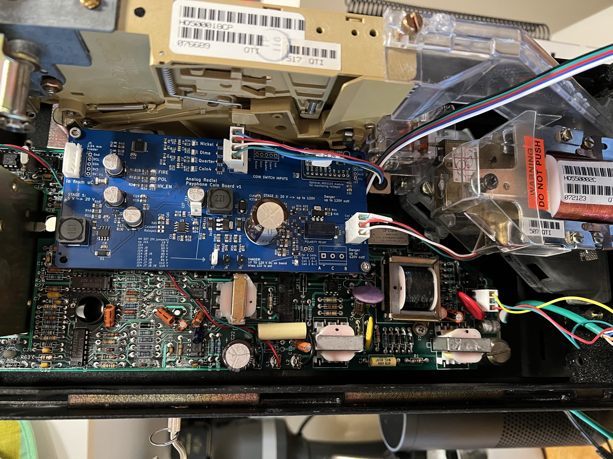

# Payphone with Analog Redial

**Working on one payphone.** One coin board v1 is built, on a v6 main board, and runs the
project's first phone, a GTE / Quadrum 120B style set: coins are counted from its coin
switches, a message plays for each, and the coins are collected or returned by its coin relay
(2026-11-14 and 15). No other phone has been tried. Coin board v2 (an on-board 3.3 V regulator
and a ground-start relay on P7) is being drawn in `Payphone_coin_board_v2/`.

> ⚠️ **The coin board makes up to 119 V DC and stores it in a capacitor: it can injure or
> kill.** Read [Safety first](../docs/hardware-coin-board.md#safety-first-high-voltage) before
> you build or power one. It is provided as is.

Analog Redial can run a real coin payphone: the handset lifts, a spoken message asks for
coins, the coin switches (or the line's coin tones) add up the credit, and the board
collects or returns the coins by firing the phone's coin relay.

| Doc | Covers |
|---|---|
| This one | the project as a whole: what the pieces are, status, payphone types, links |
| [docs/coin-board.md](docs/coin-board.md) | the coin board: how it works, output stage wiring pin by pin, parts and PCB layout |
| [docs/payphone-firmware.md](docs/payphone-firmware.md) | the firmware: the Payphone tab (coin tones, coin required, messages, log) and the coin board's driver |

Public version of the board reference: [docs/hardware-coin-board.md](../docs/hardware-coin-board.md).

## The pieces

- **Main board:** any Analog Redial board for the Payphone tab (coin required, messages,
  coin tones, the coin counter). The coin board plugs into v6's J11 I²C header.
- **Coin board** (`Payphone_coin_board_v1/`): makes up to 119 V to fire the coin relay in
  either direction, reads the 5 / 10 / 25 cent switches, and talks I²C. One built and working.
- **Instruction cards** (`instruction_cards/`): the printed cards for the phone's
  upper and lower panels, and their standard sizes (see its README).
- **Firmware** (`firmware/components/payphone/`, `coinboard/`): see
  [docs/payphone-firmware.md](docs/payphone-firmware.md).

*Coin board v1 mounted in the phone on a 3D-printed bracket (`Payphone_coin_board_v2/Coin board bracket/`).*

*Coin board v1 mounted in the phone on a 3D-printed bracket (`Payphone_coin_board_v2/Coin board bracket/`).*

## Payphone types

Payphones differ in how they report coins and how their coin relay is driven. The housing
says little: a Quadrum is only a case, and the same case held many different boards. What
matters is **what handles the coins**, and the Payphone tab's **Phone type** card asks for
both, in that order (`firmware/components/payphone/payphone_types.c`, see
[docs/payphone-firmware.md](docs/payphone-firmware.md#phone-type)).

**What handles the coins** (the categories the firmware uses):

| Inside | Coins seen by | Relay worked by | Analog Redial's part |
|---|---|---|---|
| **Coin switches and relay wired to the coin board** (own board removed or bypassed) | the coin board | the coin board, 19-119 V | everything: credit, messages, collect and return |
| **Smart (COCOT) board, working and programmed**: Elcotel, Protel, Intellicall, Ernest, AT&T Private Payphone, Nortel Millennium | the phone's board | the phone's board | only the line; untried. Most need programming with their own software and a modem; an Elcotel 5 also needs a 6 V battery and line voltage for its escrow relay |
| **Coin-line totalizer** (the telephone companies' "dumb" phones: WE 1C, 1D, 2C, Gemini 4032C) | coin tones on the line (1700 + 2200 Hz) | on a real coin line, the exchange, with about ±130 V on the line; here, the coin board if the relay's wires are moved to J2 (untried) | credit and messages from the tones. A coin-first board also waits for a ground start (coin board v2) |
| **No coin board: used as a phone** (the phone's own coin parts left alone) | coin tones on the line, if the phone sends any (untried) | nobody: coins can't be collected or returned | dial tone, ringing and calls; optionally credit and messages from the tones |
| **Coinless** | - | - | nothing: a normal phone |

**Housings** in the menu, with the insides each is found with (usual first):

| Housing | Made | Insides |
|---|---|---|
| Quadrum / GTE 120B style (smart-phone housings; they differ in where the coin return lever is) | 1980s-2000s | coin board, no coin board, smart, coinless |
| Western Electric / AT&T single-slot (1C, 1D, 2C) | 1965-1990s | coin-line, no coin board, smart (retrofits: Protel 4000/8000, Elcotel 5501), coin board, coinless |
| Western Electric 3-slot (coins ring bells and a gong, no tones) | 1920s-1960s | coinless |
| Nortel Millennium | 1990s-2000s | smart, no coin board, coinless |
| Other, or not sure | | any; "not sure" sets nothing and shows every card |

Single-slot board names (from telesfor.org): first digit 1 wall, 2 flush, 3 electronic; letter
A coin first, C coin first or dial tone first, D dial tone first, E postpay; last digit 1 rotary,
2 Touch-Tone, 3 manual. So a 1D2 is a wall-mounted, dial-tone-first, Touch-Tone phone.

Only the coin board choice, on the first phone, has been tried. The menu labels every other
choice "untested" until a phone has been shown to work with it, and the Coin tones card carries
the same label: no real phone's coin tones have been heard yet.

The tables below are what has been **measured**, one row per phone. A measured phone is also a
`KNOWN[]` entry in `payphone_types.c`, so choosing it fills in the coin board's pulse and swap (when the entry has a swap).

To add a phone, add a row to each table (and a `KNOWN[]` entry), mark anything not measured
**[verify]**, and note in the last column where the numbers came from.

### 1. Identification

| Phone | Housing | Controller board | Made | Source |
|---|---|---|---|---|
| **GTE / Quadrum 120B style** (the project's first phone) | GTE / Quadrum, coin return lower right | **HB-1301-B** (40-pin DIP, two CP Clare reed relays, 310 V gas tube); smart or dumb not known **[verify]** | week 51, 1997 | photos and bench tests, 2026-10-24 to 2026-10-31 |

### 2. Coin detection

| Phone | Sensor | Cable | Wires | Signal | Coins | Coin tones |
|---|---|---|---|---|---|---|
| GTE / Quadrum 120B style | passive coin switches (measured) | 4-wire, Molex KK 396 (coin board J3) | green common; white quarter, red dime, blue nickel | contact to common; closes for 40-95 ms per coin (measured with the coin switch capture: nickel 44-95 ms, dime 44-51 ms, quarter about 40 ms, with up to 3 ms of chatter at first contact) | 5, 10, 25 cents | not checked **[verify]** |

### 3. Coin relay

| Phone | Relay | Coils | Wires | Resistance | Operates at | Direction | Switch-off | Cable |
|---|---|---|---|---|---|---|---|---|
| GTE / Quadrum 120B style | **HD550002C** (QTI) | one, polarized | white and green to the coil path; red not connected | about 1 k at rest; 0.1 ohm across the coil once operated | 55 V no, 60 V yes on the bench (relay alone); **in the phone it needs 87 V** (about 67 mA through the 1.1 k coil) | white positive: lever left, **collect** (bench; confirm in the phone) **[verify]**; reversed: lever right, return | a contact on the white-green path opens as it operates, so it switches itself off | 3-wire, Molex KK 396 (coin board J2) |

### 4. Coin board settings

| Phone | Relay connector | J10 (two-coil) | HV (J14, J7-J9) | Pulse | Swap | Coin 4 | Tested |
|---|---|---|---|---|---|---|---|
| GTE / Quadrum 120B style | J2 | off | fit **J14 + J7 (87 V)**; 60 V and 78 V don't give the relay enough current with the phone's levers attached | 100 ms works (the armature moves at about 65-70 ms, seen as a dip in the coil current); 100-150 ms | **off** (the default): confirmed in the phone, collect and return both go the right way. On the bench alone, white positive collected, which looked like "on" | 0 (not fitted) | **yes**: collect and return in the phone, on answer and at hang-up (2026-11-14/15, 87 V, 100 ms) |

Notes on the columns:

- **HV** is set by shunts, not by firmware: [docs/coin-board.md](docs/coin-board.md#part-1-design)
  Part 1, section 6 has the table. Without J14 it stays at about 19 V, for 12-24 V coils.
- **Pulse** and **Swap** are on the Payphone tab's coin board card. Swap reverses which
  way Collect and Return drive the relay.
- **Coin 4** is the cents value of the fourth coin input (0 = only logged).

### What the first phone taught

- **The relay latches its flap down.** After a fire the white flap stays down, and the relay
  can't fire again while it is (its own contact is open): the firmware reports "no current
  (latched down?)". The next coin entering the chute pushes it back up. A stiff coin lever that
  wouldn't return caused the stuck-down states on the bench, and sent every coin straight to
  the box: it needed taking out and oiling.
- **Bench voltage isn't phone voltage.** The relay moved at 60 V on the bench, alone; in the
  phone, with its levers attached, it needs 87 V.
- **Too many coins jam the hopper** when released together, hence the coin limit (8 by
  default) on the Payphone tab.
- **The coin return lever** ("coin release") only widens the coin path to free a jam; it
  doesn't return the hopper's coins.
- **A reversed J3 plug** counts nickels but not dimes or quarters.
- **Marginal 3.3 V on the cable** (a bad crimp, or a clone module's small regulator) gives
  odd ADC readings and resets; coin board v2 has its own regulator for this.

### Still to find out for the first phone

- Whether the HB-1301-B board is smart (counts coins itself) or dumb (central-office
  controlled), and whether the phone sends coin tones on the line. It is bypassed now, so this
  only matters for someone running the phone on its own board.

## References

- [telesfor.org payphone wiki](https://telesfor.org/payphones/doku.php?id=smart): the best single
  reference found. Smart (COCOT) payphones by maker ([Elcotel](https://telesfor.org/payphones/doku.php?id=smart:elcotel),
  [Protel](https://telesfor.org/payphones/doku.php?id=smart:protel),
  [Ernest](https://telesfor.org/payphones/doku.php?id=smart:ernest),
  [Millennium](https://telesfor.org/payphones/doku.php?id=smart:millennium)) with documents and
  programming, [single-slot coin-line phones](https://telesfor.org/payphones/doku.php?id=coin:1slot)
  and their board names, [instruction cards](https://telesfor.org/payphones/doku.php?id=cards),
  [locks](https://telesfor.org/payphones/doku.php?id=locks) and a
  [rate file tool](https://payphones.telesfor.org/ratefile/).
- Douglas A. Kerr, [Operation of traditional coin telephones](https://telesfor.org/payphones/lib/exe/fetch.php?media=coin:coin_telephone-traditional-i16.pdf)
  (PDF, linked from telesfor.org): how coin lines, coin relays and totalizers work.

## Other payphone projects

People keep payphones running, or put them back on a network, in many places. These are
worth reading for ideas on hardware, phone service and keeping a phone legal and cheap to
run:

- [PhilTel](https://philtel.org/about/): Philadelphia. Free calls within North America from
  refurbished payphones with coinless boards, an Asterisk server and an ATA at each site;
  its [docs are open source](https://github.com/philtelco/philtel-docs).
- [Futel](https://futel.net): Portland, Oregon.
- [Talk To Me](http://talktomenyc.com/): New York City.
- [RandTel](https://randtel.co/): central Vermont.
- [Good Phone Project](https://www.goodphoneproject.com/): Monroe County, New York.
- [0DIAL](https://0dial.net/): Canada.
- [OIRCT](https://oirct.org/): France.

(PhilTel's About page links to the others.)
