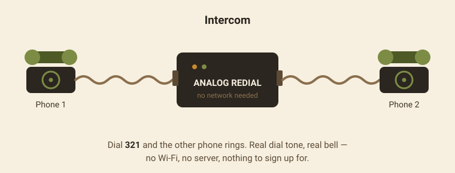
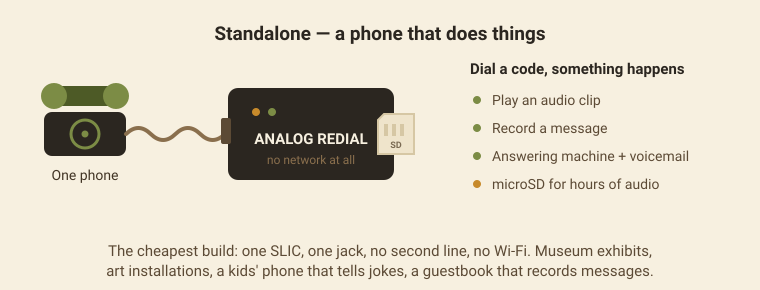
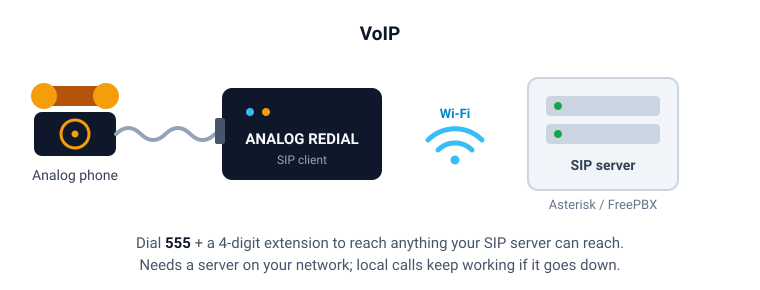
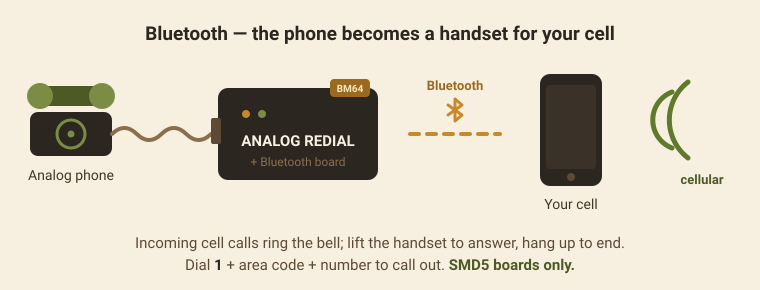

<p align="center">
  
</p>

# Analog Redial

**An ESP32-C6 analog phone exchange** — two POTS phones (rotary or
touch-tone), no server required, VoIP when you want it.

Plug in one or two analog telephones and this board gives them dial tone
and full phone-line signaling on real hardware — with
enough on-chip smarts to be a self-contained phone system on its own, or a
gateway onto a SIP/VoIP network when you want it to be.

---

## Why not just buy a VoIP adapter (ATA)?

Commercial ATAs (Grandstream HT802 and similar) bridge an analog phone to a
SIP server — they need that server to do anything, including letting two
phones on the same box call each other. This board is different:

- **Pulse (rotary) *and* touch-tone (DTMF) dialing.** Most off-the-shelf ATAs
  only decode DTMF — they can't read a rotary phone's dial pulses at all.
  That's the actual reason a vintage rotary phone can't just plug into a
  commercial adapter.
- **Standalone, offline two-phone exchange.** Two phones on one board can
  call each other directly — no SIP server, no network, no internet
  connection required. Wire this up at home with no Wi-Fi at all and
  you still have a working two-line phone system.
- **VoIP when you want it.** Register a line with Asterisk, FreePBX, or any
  standards-compliant SIP server for calls beyond the board itself.
- **Open, hackable hardware and firmware.** ESP-IDF C source, not a sealed appliance —
  add your own dial codes, tones, dial plans, or recordings.

## What people build with it

### Intercom



Two phones, one board, nothing else. Houses, classrooms, preschools,
workshops, a studio and a control room. Dial **321** and the other phone
rings with a real bell. No account, no cloud, no network — unplug the Wi-Fi
and it still works.

### Standalone — a phone that does things



The cheapest build: one SLIC, one jack, no second line, no Wi-Fi. Dial a
code and something happens — play an audio clip, record a message, leave
voicemail on the built-in answering machine. Fit a **microSD card** and you
have hours of storage instead of a few megabytes of flash.

Museum exhibits, art installations, a kids' phone that tells jokes, a
wedding guestbook that records messages.

### VoIP



Register a line with Asterisk, FreePBX, or any standards-compliant SIP
server and dial **555 +** a four-digit extension to reach anything that
server can reach. Needs a server on your network — and if it goes down,
phone-to-phone calling carries on regardless.

See [`docs/voip-setup.md`](docs/voip-setup.md).

### Bluetooth — the phone becomes a handset for your cell



Pair a cell phone and the rotary phone becomes its handset. Incoming calls
ring the bell; lift the handset to answer, hang up to end. Dial **1** + area
code + number to call out. Caller ID lands in the activity log.

Needs the **SMD5** board and its BM64 companion — designed, not yet
fabricated. See [`docs/hardware-smd5.md`](docs/hardware-smd5.md).

---

## Features

- Pulse (rotary) and touch-tone (DTMF) dialing
- Fully offline two-phone calling — no server, no network needed
- VoIP/SIP gateway mode (Asterisk/FreePBX or any standards-compliant PBX)
- **International dial tones** — pick your region in the web UI and dial tone,
  ringback and busy all switch to that country's frequencies and cadence
- Custom dial/ringback/busy tones, region-selectable
- Voicemail-style message recording, downloadable from the web UI
- Configurable dial plan — add your own dial codes and audio clips at runtime
- Web UI for status, recordings, and Wi-Fi/VoIP provisioning, with mDNS
  `<name>.local` discovery
- Optional microSD storage (single-line build only)
- Open ESP-IDF firmware

See [`docs/features.md`](docs/features.md) for the full feature list and
firmware architecture.

---

## Hardware at a glance

| Item | Detail |
|------|--------|
| MCU | ESP32-C6-DevKitC-1 |
| Codec | ES8388 stereo codec |
| SLIC | Silvertel AG1171 ×1–2 |
| Power | USB-C or DC jack |
| PCB | 2-layer, ~100×50 mm |
| Storage | Internal flash; optional microSD (single-line build) |

Full design reference: [`docs/hardware-smd4.md`](docs/hardware-smd4.md). Parts list:
[`docs/bom.md`](docs/bom.md).

---

## Quick start

```bash
git clone <this-repo-url> analog-redial
cd analog-redial/firmware
idf.py set-target esp32c6
idf.py build flash monitor
```

Full walkthrough (toolchain install, first-boot Wi-Fi setup, web UI tour):
**[`docs/getting-started.md`](docs/getting-started.md)**.

---

## Documentation

| Doc | Covers |
|-----|--------|
| [`docs/building.md`](docs/building.md) | Assembling a board: hand-solder order, checks, first power-on |
| [`docs/getting-started.md`](docs/getting-started.md) | Toolchain, flashing, first boot and Wi-Fi setup |
| [`docs/features.md`](docs/features.md) | Feature list and firmware architecture |
| [`docs/hardware-smd4.md`](docs/hardware-smd4.md) | Schematic reference, GPIO pin map, power tree |
| [`docs/hardware-smd5.md`](docs/hardware-smd5.md) | Next-spin board: Bluetooth companion, dedicated LDO, dual MCU footprint — **not yet fabricated** |
| [`docs/bom.md`](docs/bom.md) | Parts list / shopping checklist |
| [`archive/signal-levels.md`](archive/signal-levels.md) | Audio/logic level reference |
| [`docs/voip-setup.md`](docs/voip-setup.md) | Connecting a line to a SIP server |
| [`firmware/README.md`](firmware/README.md) | Toolchain setup, build layout, console commands |
| [`hardware/3d-printed-case/`](hardware/3d-printed-case/) | Enclosure (placeholder — no files yet) |

---

## ⚠️ Phone-line voltage safety

Real telephone lines carry meaningful voltage: **~48 V DC** off-hook feed,
**~60 Vrms** ringing (up to **~90 V** peaks). This is engineering guidance,
not a telecom safety certification — review
[`docs/hardware-smd4.md`](docs/hardware-smd4.md) before fabricating a board, and treat
tip/ring copper with real respect.

---

## Status

- **Hardware:** SMD4 is the current design — schematic unchanged from the
  prior spin, re-routed as a 2-layer PCB. Designed and ERC/DRC-reviewed;
  not yet fabricated/bench-tested as of this writing.
- **Firmware:** Core telephony (hook detect, pulse + DTMF dialing, tones,
  ringing, recording, VoIP) is mature and tested on earlier SMD-family
  hardware; the SMD4-specific pin-map header is written once boards are
  back from fab.

Contributions and issues welcome.

## License

[MIT](LICENSE) for firmware and documentation. Hardware design files are
provided as-is for personal/hobby use — see the [`LICENSE`](LICENSE) file's
hardware note.
