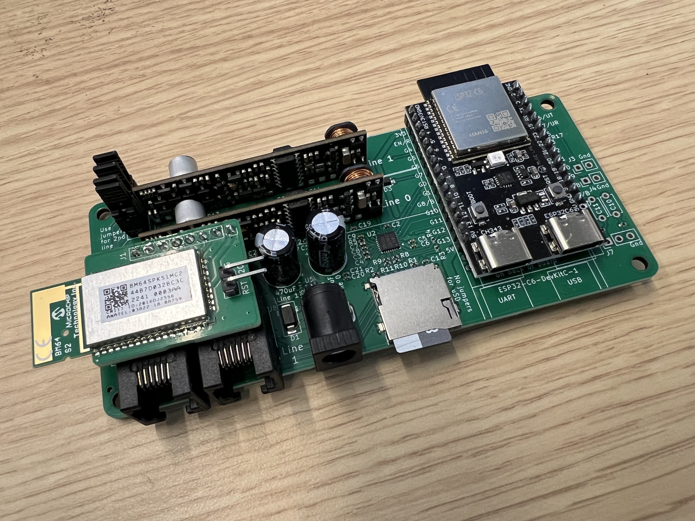
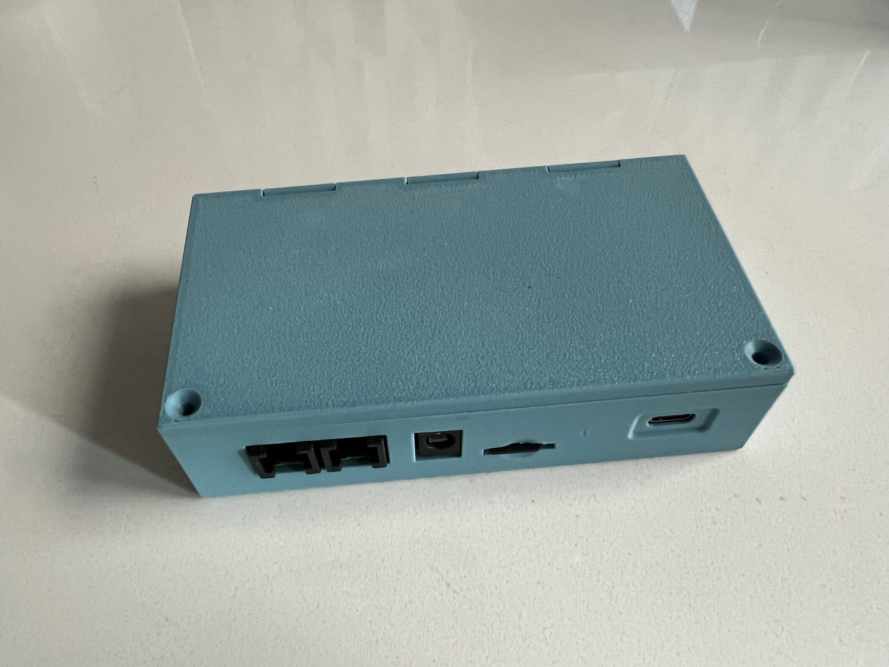
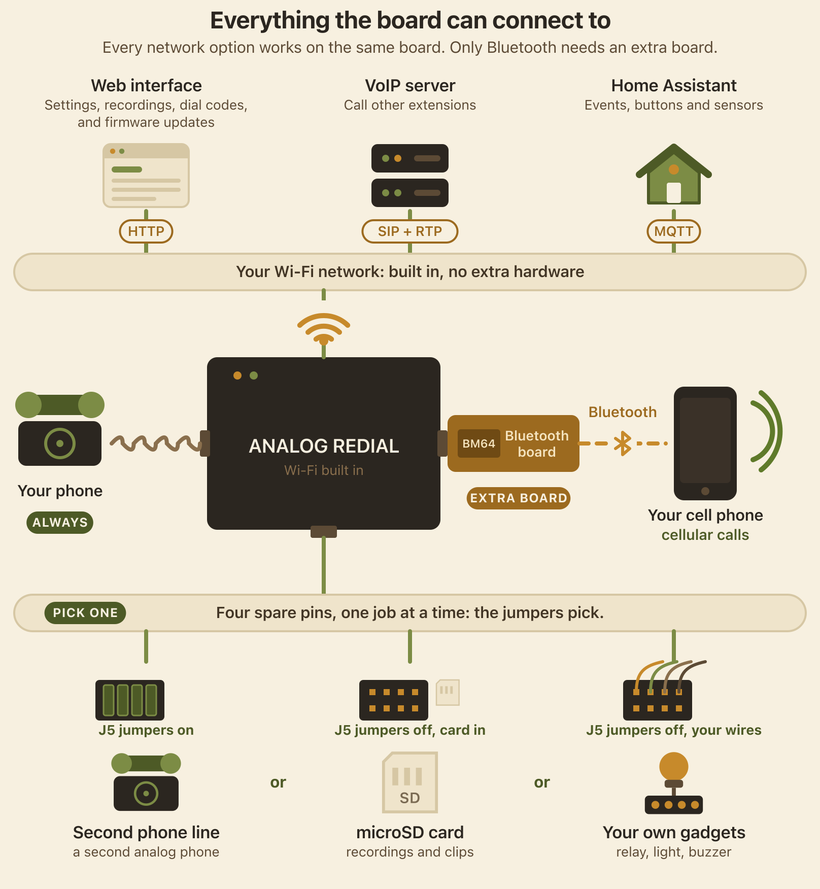

**Home** · [1 · Get a board](docs/board.md) · [2 · Parts & assembly](docs/bom.md) · [3 · Flash & test](docs/flashing.md) · [4 · Set up & use](docs/setup.md)

  

<h1 align="center">Analog Redial</h1>

  <b>Bring old telephones back to life.</b> 
  Plug in one or two analog phones, rotary or touch-tone, and they get real
  dial tone, ringing, an operator recording and an answering machine: a complete standalone phone system. 
  Hackable open source hardware and software with a working web UI for configuration.

  <a href="#everything-it-connects-to">Overview</a> ·
  <a href="#what-can-i-do-with-it">What it does</a> ·
  <a href="#set-it-up-from-your-browser">Web interface</a> ·
  <a href="#what-does-one-cost">Cost</a> ·
  <a href="#build-one">Build one</a> ·
  <a href="#community">Community</a>

<table>
  <tr>
    <td width="50%"></td>
    <td width="50%"></td>
  </tr>
  <tr>
    <td align="center">The board: an ESP32-C6, an audio codec, with dual phone lines and the bluetooth module.</td>
    <td align="center">In its 3D-printed case  (<a href="https://github.com/sdylewski/Analog-Redial/blob/main/docs/case.md">case guide and print files</a>)</td>
  </tr>
</table>

## What can I do with it?

| | What you get | What you need |
|---|---|---|
| **Offline Calling** | Two phones, one board. Dial **321** (configurable) and the other phone rings.  No Wi-Fi required. Use in 2 rooms of a house or a fun toy for kids| 2 phones |
| **A phone that does things** | Dial a code and something happens: play a clip, leave a message, hear a joke. For museum exhibits, art pieces, a wedding guestbook phone. Add your own codes and audio from the browser. | One phone |
| **Call between boards** | Put a board in each room. Each gets its own 4-digit number the first time it's on your Wi-Fi; dial another board's number and its phone rings. It's VoIP over your home network: no server, no internet, nothing to set up. | Two or more boards   Wi-Fi |
| **VoIP server** | Register a line with Asterisk, FreePBX or any SIP server and call anything that server can reach, at home or away. If the server goes down, the boards can still call each other directly. | One phone   Wi-Fi   SIP server |
| **Home Assistant** | Every pickup, hang-up and dial code becomes an event, so a dial code can turn on a light and the phone can ring when your doorbell does. Over MQTT or a plain webhook. *Experimental.* | Wi-Fi and Home Assistant (or any MQTT broker) |
| **Switch things** | Dial a code and a pin goes high for a few seconds or continuously: a relay, a buzzer, a lamp. | One line   no microSD   a relay |
| **Bluetooth calls** | Pair your mobile and the rotary phone becomes its handset: the bell rings for incoming calls, lift to answer, dial out on the rotary dial. | The BM64 Bluetooth board |

### Why not just buy a VoIP adapter?

You can do a lot with VoIP adapters and an Asterisk server, but this system can work fully offline if desired while also adding VoIP when needed.  There's also the possibility of uSD card access, bluetooth, or 4 GPIO pins to do even more.

## System overview

  

Every network option runs on the board's own Wi-Fi, with nothing to add.
Bluetooth is the only one that needs an extra board.

### The finer print

- **Dialing.** Rotary pulse and touch-tone, on either line. Dial codes can be
  up to 10 digits (spaces, dashes and parentheses are ignored). Add your own
  codes and audio clips from the browser and give any built-in
  code a different number. 
  	- Play an audio file after dialing a number: **412** plays dial-up modem sounds
  	- Respond to any number: **314** reads pi aloud.
  	- A kitchen timer: dial **846**, then the number of minutes, and the phone rings when time is up.
  	- Optional digit readback speaks each digit you dial (**822**
  on, **821** off)
- **Calls.** Line-to-line calls with ringback and busy tones. 
	- Optional intercom mode: lift one handset, wait, and the other phone rings with its
  own double ring. 
  	- Optional VoIP calls (G.711): directly between Analog Redial boards on the same network, with no server, or through a SIP server such as Asterisk.
- **Sound.** Dial tone, ringback and busy that match your country (North
  America, several European countries, Japan, China, or a generic
  international set). Echo cancellation and earpiece volume per line. An
  off-hook alert if a handset is left off. Experimental voice effects
  (Dalek, chipmunk, robot) mid-call.
- **Messages.** Record a message with **211** and download it from the
  browser. 
  	- Optional per-line answering machine, each line with its own greeting,
  that also answers VoIP or local calls. 
  	- Storage to internal flash or microSD card for hours of storage
  (1-line version only). 
- **Home automation.** Every pickup, hang-up, dial code and incoming ring
  can go to Home Assistant, or any system that takes a webhook or MQTT. Home
  Assistant can ring a phone or fire a pin output back. Experimental; see
  [Home Assistant](docs/home-assistant.md).
- **Things on the pins.** A dial code can switch one of four spare pins
  (a relay, a buzzer, a lamp) for a set number of seconds, or toggle it.
- **Day to day.** Quiet hours that silence the bell overnight. Remembers
  several Wi-Fi networks. An optional web password. Firmware updates from
  the browser. A one-button rescue mode for when it can't find its network.
  Board blink codes to indicate activity and errors.
- **Open.** ESP-IDF C firmware under the MIT license, KiCad hardware files,
  and a serial console for debugging.

Full feature list and firmware architecture: [Features](docs/features.md).

---

## Set it up from your browser

The board serves its own web page at **`http://phone.local`**, reachable
from any phone or laptop on your Wi-Fi. No app, no account, no cloud. On
first boot it makes its own Wi-Fi network with a setup page that gets it
onto yours.

<table>
  <tr>
    <td align="center" width="33%"> <b>Status</b> Lines, activity, the dial guide</td>
    <td align="center" width="33%"> <b>Phone settings</b> Answering machine, tones, effects</td>
    <td align="center" width="33%"> <b>Dial codes</b> Your own codes and audio</td>
  </tr>
  <tr>
    <td align="center"> <b>VoIP</b> SIP server, generated Asterisk script</td>
    <td align="center"> <b>Recordings</b> Play or download messages</td>
    <td align="center"> <b>Hardware</b> Line count, microSD, firmware update</td>
  </tr>
</table>

Click any picture for the full page. A guided tour is in
[Set up & use](docs/setup.md).

---

## What does one cost?

US prices from October 2026, including shipping and import tariff:

| | Per board | 5 boards |
|---|---:|---:|
| Assembled PCB from JLCPCB, delivered (5-board minimum) | $17.11 | $85.53 |
| Parts you solder, from DigiKey ([parts list](docs/bom.md)) | $19 | $95 |
| DigiKey shipping, about $5 an order | $1 | $5 |
| **Total, one phone line** | **about $37** | **about $186** |
| Second phone line (optional) | +$10 | +$50 |
| Bluetooth board (optional, v5) | +$15 | +$80 |

**Five boards cost about $186 in all, about $37 each.** Want just one?
JLCPCB's minimum is five, so it's about $110 up front, with four spare PCBs.
The five-board Bluetooth figure is $15 a board plus about $5 shipping. Buying
the hand-solder parts from AliExpress saves $7 per board.

You'll also want a 2 A USB-C charger (or a 5.5-6 V, 2 A DC supply for the DC jack) and one or two analog phones. 

Most of a small order is fixed PCB setup fees, so boards get cheaper when people
order together. If you'd like a board from a group order,
**[register your interest](https://forms.gle/kVKHiXejV6M2ZxC17)**: no
commitment, it just tells us how many people want one.

Price breakdown: [Get a board](docs/board.md#what-it-costs).

---
 

## Build one

No surface-mount soldering needed: the fab places the small parts, and
everything you solder is through-hole. If you can solder a header and type a
few commands in a terminal, you can build one.

| Step | Guide | What's in it |
|---|---|---|
| **1** | [Get a board](docs/board.md) | Board versions, ordering from JLCPCB, pooled orders, costs |
| **2** | [Parts](docs/bom.md) and [assembly](docs/building.md) | What to buy, soldering order, checks before power-on |
| **3** | [Flash & test](docs/flashing.md) | Install ESP-IDF, flash the firmware, run the hardware self-test |
| **4** | [Set up & use](docs/setup.md) | Wi-Fi, the web interface, dial codes, your own audio |

Going further: [VoIP setup](docs/voip-setup.md) ·
[Home Assistant](docs/home-assistant.md) ·
[Board reference (v4)](docs/hardware-smd4.md) ·
[Board reference (v5)](docs/hardware-smd5.md) ·
[Features & firmware architecture](docs/features.md) ·
[Firmware developer notes](https://github.com/sdylewski/Analog-Redial/blob/main/firmware/README.md)

> ⚠️ **Phone lines carry real voltage.** The board drives about 48 V DC on
> an off-hook line and about 60 V AC while ringing, with peaks near 90 V.
> Don't touch the phone jacks or the line chips while it's powered, and never
> connect it to your house or telephone-company wiring. This is a hobby
> project, not certified telecom equipment.

---

## Community

- **Discord:** [join the server](https://discord.gg/zEZkqfcxqE) for questions, build help and show-and-tell
- **Want a board from a pooled order?** [Interest form](https://forms.gle/kVKHiXejV6M2ZxC17)
- **Bugs and questions:** [GitHub Issues](https://github.com/sdylewski/Analog-Redial/issues)
- **Built one?** Post a picture in the Discord channel! We'd love to see it.

---

## Project history

| When | Version | What it was |
|------|---------|-------------|
| Aug 2020 | **Raspberry Pi**   | A Raspberry Pi 4 in a project box, two SLIC modules hand-wired on breadboard to the GPIO header, and a USB sound dongle per phone line. Hand written python software and shell scripts. No web UI, but it worked!|
| Jun 2026 | **v1** | The first ESP32 board: through-hole, with a WM8731 codec and two AG1170 SLICs. The Pi's job on a $5 microcontroller. Never built because boards got lost in the mail.|
| Jul 2026 | **v2**   | First surface-mount board: ESP32-C6 module, ES8388 codec, AG1171 SLICs, microSD. Required rework on audio lines and usb connection but it worked. |
| Sep 2026 | **v4**   | 2-layer, built around a cheaper 32-pin ESP32-C6-DevKitC-1, one or two phone lines, optional microSD. |
| Oct 2026 | **v5**  | Working: takes a genuine or clone ESP32-C6 module, and adds the Bluetooth companion.  **Boards made before 2026-10-24: with a clone module, remove the clone's bottom-right 5V pin** (the design files are fixed now) (see [Get a board](docs/board.md)). |
| Oct 2026 | **v6** | **Released, not tested yet.** v5 with the clone-module 5V pin fixed (no pin to remove) and updated silkscreen. It should work, but v5 is the tested board. |

## License

[MIT](LICENSE) for the firmware and documentation. Hardware design files are
provided as-is for personal and hobby use; see the note in [`LICENSE`](LICENSE).
