**Home** · [1 · Get a board](docs/board.md) · [2 · Parts & assembly](docs/bom.md) · [3 · Flash & test](docs/flashing.md) · [4 · Set up & use](docs/setup.md)

  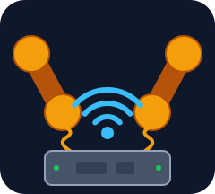

<h1 align="center">Analog Redial</h1>

  <b>Bring old telephones back to life.</b> 
  Plug in one or two analog phones, rotary or touch-tone, and they get real
  dial tone, ringing, an operator recording and an answering machine: a complete phone system! 
  Hackable open source hardware and software with a working web UI for configuration.

  <a href="#everything-it-connects-to">Overview</a> ·
  <a href="#what-can-i-do-with-it">What it does</a> ·
  <a href="#set-it-up-from-your-browser">Web interface</a> ·
  <a href="#what-does-one-cost">Cost</a> ·
  <a href="#build-one">Build one</a> ·
  <a href="#community">Community</a>

<table>
  <tr>
    <td width="50%">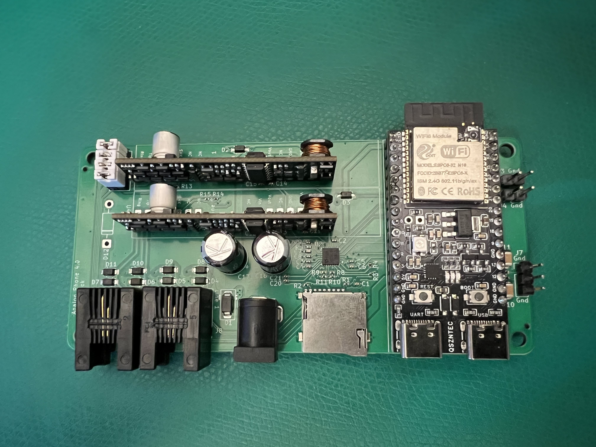</td>
    <td width="50%">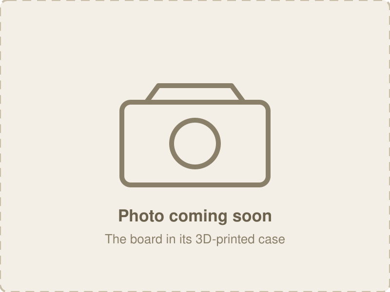</td>
  </tr>
  <tr>
    <td align="center">The board: an ESP32-C6, an audio codec, with dual phone lines.</td>
    <td align="center">In its 3D-printed case (<a href="https://github.com/sdylewski/Analog-Redial/tree/main/hardware/3d-printed-case">print files</a>)</td>
  </tr>
</table>

---

## Everything it connects to

  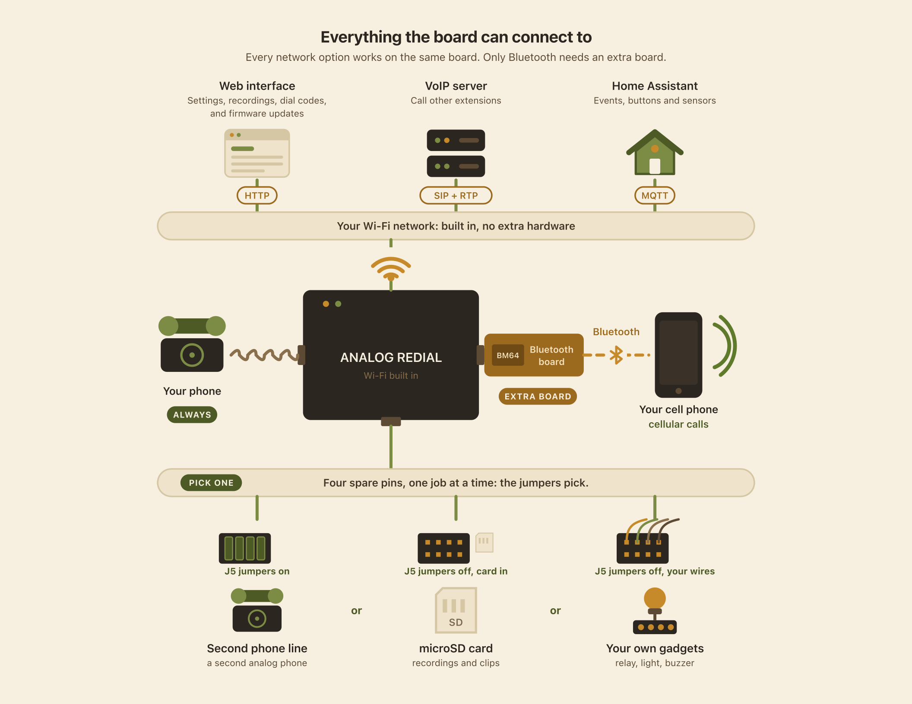

Every network option runs on the board's own Wi-Fi, with nothing to add.
Bluetooth is the only one that needs an extra board.

## What can I do with it?

| | What you get | What you need |
|---|---|---|
| **Intercom** | Two phones, one board. Dial **321** and the other phone rings, or turn on intercom mode: lift one handset, wait, and the other rings. No Wi-Fi, no internet. Rooms in a house, kids' rooms. | A second phone line |
| **A phone that does things** | Dial a code and something happens: play a clip, leave a message, hear a joke. Museum exhibits, art pieces, a wedding guestbook phone. Add your own codes and audio from the browser. | One phone |
| **Answering machine** | Each line has its own greeting. Messages save on the board, or on a microSD card for hours of storage. Play or download them from the web page. | One phone (microSD for the most room) |
| **VoIP** | Register a line with Asterisk, FreePBX or any SIP server and call anything that server can reach. If the server goes down, the two phones can still call each other. | Wi-Fi and a SIP server |
| **Home Assistant** | Every pickup, hang-up and dial code becomes an event, so a dial code can turn on a light and the phone can ring when your doorbell does. Over MQTT or a plain webhook. *Experimental.* | Wi-Fi and Home Assistant (or any MQTT broker) |
| **Switch things** | Dial a code and a pin goes high for a few seconds: a relay, a buzzer, a lamp. | One line, no microSD, and a relay |
| **Your cell phone** *(coming soon)* | Pair your mobile and the rotary phone becomes its handset: the bell rings for incoming calls, lift to answer, dial out on the rotary dial. | The Bluetooth board, with the v5 board |

### Why not just buy a VoIP adapter?

Off-the-shelf analog telephone adapters (ATAs) only understand touch-tone,
so a rotary phone can't dial through them, and they need a SIP server before
they do anything at all, even to let two phones on the same box call each
other. Analog Redial reads rotary pulses as well as touch-tone, and it is a
complete hackable phone exchange on its own.

### The finer print

- **Dialing.** Rotary pulse and touch-tone. Add your own dial codes and
  audio clips from the browser, no rebuild. Optional digit readback.
- **Calls.** Line-to-line calls with ringback and busy tones. Optional
  intercom mode: lift one handset, wait, and the other phone rings.
  VoIP in and out (G.711, on your network).
- **Sound.** Dial tone, ringback and busy that match your country (North
  America, several European countries, Japan, China, or a generic
  international set). Echo cancellation and earpiece volume per line. An
  off-hook alert if a handset is left off.
- **Messages.** Record a message with **211** and download it from the
  browser. A per-line answering machine, each line with its own greeting.
  Insert a microSD card for hours of storage (1-line version only).
- **Day to day.** Quiet hours that silence the bell overnight. Remembers
  several Wi-Fi networks. Firmware updates from the browser. A one-button
  rescue mode for when it can't find its network.
- **Open.** ESP-IDF C firmware under the MIT license, KiCad hardware files,
  and a serial console for poking at every part of the hardware.

Full feature list and firmware architecture: [Features](docs/features.md).

---

## Set it up from your browser

The board serves its own web page at **`http://phone.local`**, reachable
from any phone or laptop on your Wi-Fi. No app, no account, no cloud. On
first boot it makes its own Wi-Fi network with a setup page that gets it
onto yours.

<table>
  <tr>
    <td align="center" width="33%"><a href="docs/pics/status.png">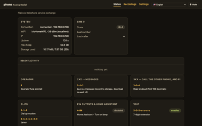</a> <b>Status</b> Lines, activity, the dial guide</td>
    <td align="center" width="33%"><a href="docs/pics/settings-phone.png">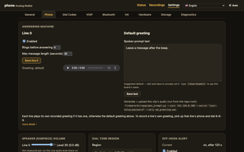</a> <b>Phone settings</b> Answering machine, tones, effects</td>
    <td align="center" width="33%"><a href="docs/pics/settings-dialcodes.png">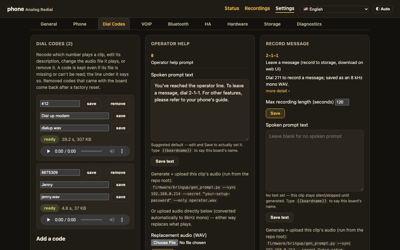</a> <b>Dial codes</b> Your own codes and audio</td>
  </tr>
  <tr>
    <td align="center"><a href="docs/pics/settings-voip.png">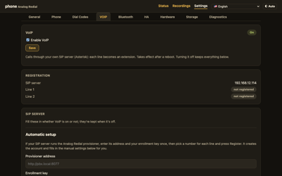</a> <b>VoIP</b> SIP server, generated Asterisk script</td>
    <td align="center"><a href="docs/pics/recordings.png">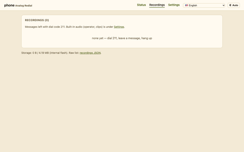</a> <b>Recordings</b> Play or download messages</td>
    <td align="center"><a href="docs/pics/settings-hardware.png">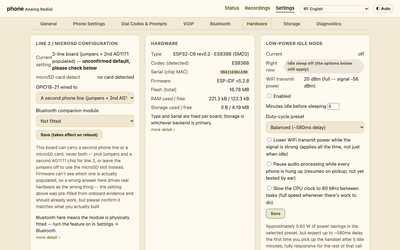</a> <b>Hardware</b> Line count, microSD, firmware update</td>
  </tr>
</table>

Click any picture for the full page. A guided tour is in
[Set up & use](docs/setup.md).

---

## What does one cost?

US prices from October 2026, including shipping and import tariff:

| | Per board | 5 boards |
|---|---:|---:|
| Assembled PCB from JLCPCB, delivered (5-board minimum) | $17.11 | $85.53 |
| Parts you solder, from DigiKey ([parts list](docs/bom.md)) | $19 | $95 |
| DigiKey shipping, about $5 an order | $1 | $5 |
| **Total, one phone line** | **about $37** | **about $186** |
| Second phone line (optional) | +$10 | +$50 |
| Bluetooth board (optional, v5) | +$20 | +$100 |

**Five boards cost about $186 in all, about $37 each.** Want just one?
JLCPCB's minimum is five, so it's about $110 up front, with four spare PCBs.

You'll also want a 2A USB-C charger and one or two analog phones. Buying
the hand-solder parts from AliExpress instead brings them to about $12 a
board, or about $30 each for the whole board.

Most of a small order is fixed setup fees, so boards get cheaper when people
order together. If you'd like a board from a group order,
**[register your interest](https://forms.gle/kVKHiXejV6M2ZxC17)**: no
commitment, it just tells us how many people want one.

Price breakdown: [Get a board](docs/board.md#what-it-costs).

---

## Build one

No surface-mount soldering needed: the fab places the small parts, and
everything you solder is through-hole. If you can solder a header and type a
few commands in a terminal, you can build one.

| Step | Guide | What's in it |
|---|---|---|
| **1** | [Get a board](docs/board.md) | Board versions, ordering from JLCPCB, pooled orders, costs |
| **2** | [Parts](docs/bom.md) and [assembly](docs/building.md) | What to buy, soldering order, checks before power-on |
| **3** | [Flash & test](docs/flashing.md) | Install ESP-IDF, flash the firmware, run the hardware self-test |
| **4** | [Set up & use](docs/setup.md) | Wi-Fi, the web interface, dial codes, your own audio |

Going further: [VoIP setup](docs/voip-setup.md) ·
[Board reference (v4)](docs/hardware-smd4.md) ·
[Board reference (v5)](docs/hardware-smd5.md) ·
[Features & firmware architecture](docs/features.md) ·
[Firmware developer notes](https://github.com/sdylewski/Analog-Redial/blob/main/firmware/README.md)

> ⚠️ **Phone lines carry real voltage.** The board drives about 48 V DC on
> an off-hook line and about 60 V AC while ringing, with peaks near 90 V.
> Don't touch the phone jacks or the line chips while it's powered, and never
> connect it to your house or telephone-company wiring. This is a hobby
> project, not certified telecom equipment.

---

## Community

- **Discord:** coming soon <!-- TODO: Discord invite link -->
- **Want a board from a pooled order?** [Interest form](https://forms.gle/kVKHiXejV6M2ZxC17)
- **Bugs and questions:** [GitHub Issues](https://github.com/sdylewski/Analog-Redial/issues)
- **Built one?** Post a picture in the Discord channel! We'd love to see it.

---

## Project history

| When | Version | What it was |
|------|---------|-------------|
| Aug 2020 | **Raspberry Pi**  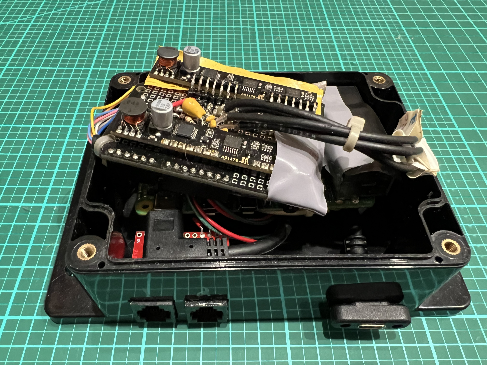 | A Raspberry Pi 4 in a project box, two SLIC modules hand-wired on breadboard to the GPIO header, and a USB sound dongle per phone line. Hand written python software and shell scripts. No web UI, but it worked!|
| Jun 2026 | **v1** | The first ESP32 board: through-hole, with a WM8731 codec and two AG1170 SLICs. The Pi's job on a $5 microcontroller. Never built because boards got lost in the mail.|
| Jul 2026 | **v2**  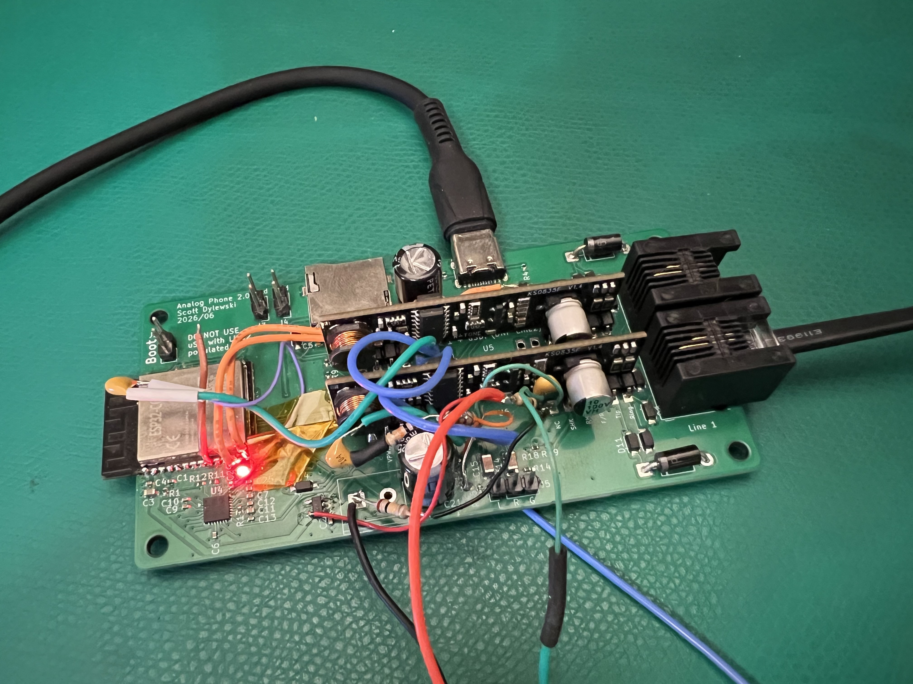 | First surface-mount board: ESP32-C6 module, ES8388 codec, AG1171 SLICs, microSD. Required rework on audio lines and usb connection but it worked. |
| Sep 2026 | **v4**   | The current board: 2-layer, built around a cheaper 32-pin ESP32-C6-DevKitC-1, one or two phone lines, optional microSD. |
| Oct 2026 | **v5** | At the fab: takes a genuine or clone ESP32-C6 module, and adds the Bluetooth companion. |

## License

[MIT](LICENSE) for the firmware and documentation. Hardware design files are
provided as-is for personal and hobby use; see the note in [`LICENSE`](LICENSE).
