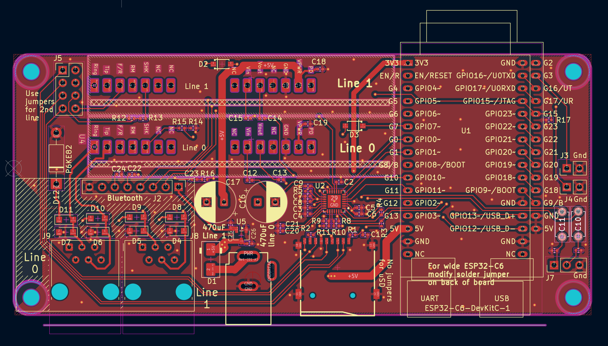

[Home](../README.md) · **1 · Get a board** · [2 · Parts & assembly](bom.md) · [3 · Flash & test](flashing.md) · [4 · Set up & use](setup.md)

# 1 · Get a board

The Analog Redial board is a small 2-layer PCB. A fab house makes it and
places the small surface-mount parts (the audio codec, resistors,
capacitors and diodes). You add the larger through-hole parts with a soldering iron in [step 2](bom.md).

<table>
  <tr>
    <td width="50%"></td>
    <td width="50%"></td>
  </tr>
  <tr>
    <td align="center">Analog Redial V6 top</td>
    <td align="center">V5 with SMT components only</td>
  </tr>
</table>

## Which board

| | **v4** (SMD4) | **v5** (SMD5) |
|---|---|---|
| Status | **Current.** Built and in daily use | Coming soon: at the fab, not yet tested |
| Microcontroller | ESP32-C6-DevKitC-1 | ESP32-C6-DevKitC-1, or a cheaper 30-pin clone |
| Phone lines | 1 or 2 | 1 or 2 |
| microSD | Single-line build | Single-line build |
| Bluetooth | No | Header for the Bluetooth companion |
| Size | 110 × 54 mm | 115 × 54 mm |
| Reference | [Board reference (v4)](hardware-smd4.md) | [Board reference (v5)](hardware-smd5.md) |
| KiCad project | [`Analog Redial v4`](https://github.com/sdylewski/Analog-Redial/tree/main/hardware/kicad/Analog%20Redial%20v4) | [`Analog Redial v5`](https://github.com/sdylewski/Analog-Redial/tree/main/hardware/kicad/Analog%20Redial%20v5) |

Build **v4** for now. Both take the same parts, so the parts list and
assembly guide cover either one.

> ⚠️ **v5 board error with the 30-pin clone module: read before soldering.** On the v5 PCB the clone's
> **bottom-right 5V pin** is wired to **GND** (the footprint is wrong for the clone's pinout). If you fit a
> clone, **take that pin out**: cut it off the module, or leave it unsoldered, so it doesn't connect to the
> board at all. The **bottom-left 5V pin** is then the module's only 5 V connection, and it is enough. Left
> in, the pin shorts the 5 V rail to ground. With the power off, check with a meter that the 5 V pin has no
> continuity to ground. The genuine 32-pin DevKitC-1 is not affected. The next board revision (v6) fixes the footprint.

## Three ways to get one

| Route | What you do |
|-------|-------------|
| **Join a pooled order** | Cheapest per board. Register interest and you'll hear when an order goes in: **[interest form](https://forms.gle/kVKHiXejV6M2ZxC17)**. No commitment. |
| **Order your own** | Upload the design to JLCPCB with SMT assembly. Minimum 5 boards. Steps [below](#ordering-from-jlcpcb). |
| **Fully from scratch** | Order bare PCBs (cheap) and place every part yourself. The ES8388 codec is a 28-pin QFN with a thermal pad, so you need a hotplate or reflow oven, not just an iron. |

## What it costs

The bare board plus SMT assembly, delivered to the US. **Assembly includes
the SMT parts themselves**, so don't count the codec and passives again.
Quoted October 2026: 1.6 mm, lead-free HASL, top-side assembly only.

| | **5 boards** (the minimum) |
|---|---:|
| PCB | $8.10 |
| Assembly, incl. SMT parts | $26.92 (Economic) |
| **Merchandise** | **$35.02** |
| Shipping | $30.86 |
| Sales tax, 8.625% | $3.02 |
| Import tariff, about 47.5% of merchandise | $16.63 |
| **Delivered total** | **$85.53** |
| **Per board** | **$17.11** |
| Per board with the hand-solder parts (about $19) | **about $36** |

JLCPCB's minimum order is 5, so you end up with four spare boards. Most of
the price is fixed set-up and shipping.

## Ordering from JLCPCB

1. **Get the production files.** Open the KiCad project and export Gerbers,
   BOM and CPL with the
   [JLCPCB Tools plugin](https://github.com/Bouni/kicad-jlcpcb-tools). To
   open the schematic for editing, also install the shared symbol and
   footprint library,
   [sdylewski/MajorHack-Kicad-Libraries](https://github.com/sdylewski/MajorHack-Kicad-Libraries).
2. **Pick your build** before generating the CPL: dual-line, or single-line
   with microSD. See [Build options](bom.md#build-options). 2nd line's support
   parts and the microSD socket are mutually exclusive.
3. **Upload the Gerbers** at jlcpcb.com: 2 layers, 1.6 mm, lead-free HASL,
   any colour. Turn on **PCB Assembly**, top side, **Economic**.
4. **Upload the BOM and CPL** and work through the checklist:

| | Check |
|---|------|
| | Every through-hole part is marked "do not place": the DevKit, SLICs, RJ12 jacks, DC jack, TVS, bulk capacitors, all pin headers and mounting holes, and **C10**/**C11** |
| | Extended parts: **C365736** (ES8388 codec) always; **C91145** (microSD socket) on the single-line build |
| | In JLC's placement preview, check the codec's pin-1 dot matches the board's pin-1 mark |

### SMT parts worth knowing

Everything else on the SMT side is commodity Basic-library parts costing
fractions of a cent. The KiCad BOM export lists them all.

| Part | JLC (LCSC) | Notes |
|------|------------|-------|
| **U2** ES8388 audio codec | [C365736](https://www.lcsc.com/product-detail/C365736.html), about $1 | Extended. The whole audio path for both phone lines runs through it |
| **Card1** microSD socket, TF-01A | [C91145](https://www.lcsc.com/product-detail/C91145.html), about $0.20 | Extended. Single-line build only |

Budget about $2 in SMT parts, plus about $3 setup per unique Extended part.

## Safety

**Never connect the phone ports to a wall jack or a telephone-company line.**
Each phone port is a telephone-company side (FXS) interface, not a line
input: it supplies about 48 V DC off-hook and about 72 V when ringing. That
can injure someone and damage the telephone network. The board is only for
connecting to phones directly; it reaches the outside world over Wi-Fi
(VoIP), and nothing on it connects to a telco line.

## The case

3D-printable cases for v4, single-line and dual-line, are in
[`hardware/3d-printed-case`](https://github.com/sdylewski/Analog-Redial/tree/main/hardware/3d-printed-case).
v5 is 5 mm longer and needs its own case.

---

**Next: [2 · Parts & assembly](bom.md)**
