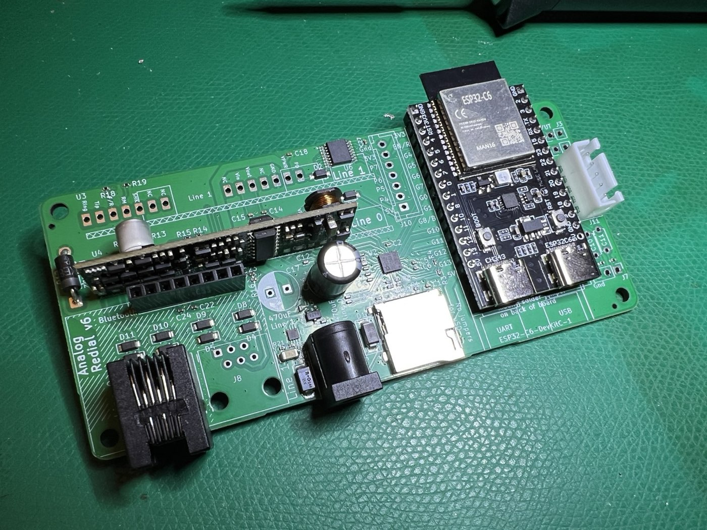
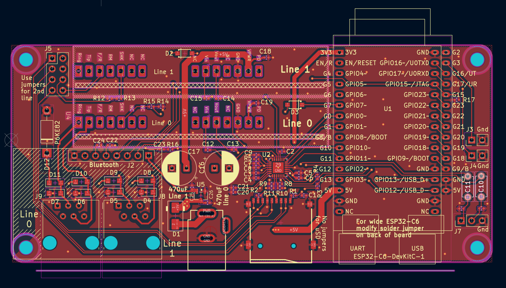

[Home](../README.md) · **1 · Get a board** · [2 · Parts & assembly](bom.md) · [3 · Flash & test](flashing.md) · [4 · Set up & use](setup.md)

# 1 · Get a board

The Analog Redial board is a small 2-layer PCB. A fab house makes it and
places the small surface-mount parts (the audio codec, resistors,
capacitors and diodes). You add the larger through-hole parts with a soldering iron in [step 2](bom.md).

<table>
  <tr>
    <td width="50%"></td>
    <td width="50%"></td>
  </tr>
  <tr>
    <td align="center">A finished v6 board, one line</td>
    <td align="center">The v6 design, top</td>
  </tr>
</table>

## Which board

**v6 is the current board: order or build that one.** It runs two phone lines, the microSD
card, the payphone coin board and four extra I/O pins all at once, takes the cheaper clone
module with nothing to cut off, and protects itself from a wrong DC adapter. v5 and v5.1
boards are already out there and stay fully supported; their guides are below.

| | **v6** (SMD6), current | **v5** (SMD5) | **v5.1** | **v4** (SMD4) |
|---|---|---|---|---|
| Status | **Built and working**: two phone lines, the codec, Wi-Fi and the payphone coin board. The microSD card and the extra I/O (J10) haven't been checked on it yet | **Working**, the longest-tested board; boards are in use | v5 with the clone-module 5V pin fixed, plus silkscreen and fab-file updates. Released, not built | **Proven**, the first board in daily use |
| Microcontroller | ESP32-C6-DevKitC-1, or a cheaper 30-pin clone (move two solder jumpers) | Same, but a clone needs one pin removed | Same as v6 | ESP32-C6-DevKitC-1 only |
| Phone lines | 1 or 2 | 1 or 2 | 1 or 2 | 1 or 2 |
| microSD | With one or two lines | Single-line build only | Single-line build only | Single-line build only |
| Spare pins | Four on **J10**, whatever else is fitted | Four on **J5**, single line without microSD only | as v5 | as v5 |
| Expansion header (Bluetooth board) | Yes | Yes | Yes | No |
| I²C accessory header (payphone coin board) | Yes (**J11**) | No | No | No |
| DC jack protection | Cuts off a wrong adapter (up to about 20 V) | None: a 9 V or 12 V adapter destroys it | None | None |
| Size | 115 × 54 mm | 115 × 54 mm | 115 × 54 mm | 110 × 54 mm |
| Reference | [Board reference (v6)](hardware-smd6.md) | [Board reference (v5)](hardware-smd5.md) | same as v5 | [Board reference (v4)](hardware-smd4.md) |
| Build guide | [Build a v6 board](build-v6.md) | [Build a v5 board](build-v5.md) | same as v5 | [Assembly](building.md) |
| Firmware (`flash_board.py --board`) | `smd6` | `smd5` | `smd5` | `smd4` |
| KiCad project | [`Analog Redial v6`](https://github.com/sdylewski/Analog-Redial/tree/main/hardware/kicad/Analog%20Redial%20v6) | [`Analog Redial v5`](https://github.com/sdylewski/Analog-Redial/tree/main/hardware/kicad/Analog%20Redial%20v5) (as fabbed) | [`Analog Redial v5.1`](https://github.com/sdylewski/Analog-Redial/tree/main/hardware/kicad/Analog%20Redial%20v5.1) | [`Analog Redial v4`](https://github.com/sdylewski/Analog-Redial/tree/main/hardware/kicad/Analog%20Redial%20v4) |
| Schematic | [PDF](https://github.com/sdylewski/Analog-Redial/blob/main/hardware/kicad/Analog%20Redial%20v6/Analog_Redial_v6_schematic.pdf) · [image](hardware-smd6.md#schematic-and-layout) | [Image](hardware-smd5.md#2-schematic-and-layout) | same as v5 | [Image](hardware-smd4.md#2-schematic-and-layout) |

Not sure which board you have? The version is printed on the silkscreen. A v6 board also
has outlines for two JST headers (J10 and J11) and a small 16-pin chip (U6) near line 1's
SLIC, where v4 and v5 have the 2×4 J5 header.

> ⚠️ **v5 boards with the 30-pin clone module: read before soldering.** On a v5 board the clone's
> **bottom-right 5V pin** is wired to **GND** (the footprint is wrong for the clone's pinout). If you fit a
> clone, **take that pin out**: cut it off the module, or leave it unsoldered, so it doesn't connect to the
> board at all. The **bottom-left 5V pin** is then the module's only 5 V connection, and it is enough. Left
> in, the pin shorts the 5 V rail to ground. With the power off, check with a meter that the 5 V pin has no
> continuity to ground. The genuine 32-pin DevKitC-1 is not affected. **v5.1** (and v6) have the footprint
> fixed, so nothing needs removing there.

## Three ways to get one

| Route | What you do |
|-------|-------------|
| **Buy one on Tindie** | Boards are on **[Tindie](https://www.tindie.com/products/majorhack/analog-redial-hackable-telephone-board-kit/)**. If they're sold out, add the board to your Tindie wishlist: it shows how many to order next. Questions? [Join the Discord](https://discord.gg/zEZkqfcxqE) and ask there. |
| **Order your own** | Upload the design to JLCPCB with SMT assembly. Minimum 5 boards. Steps [below](#ordering-from-jlcpcb). |
| **Fully from scratch** | Order bare PCBs (cheap) and place every part yourself. The ES8388 codec is a 28-pin QFN with a thermal pad, so you need a hotplate or reflow oven, not just an iron. |

## What it costs

The bare board plus SMT assembly, delivered to the US. **Assembly includes
the SMT parts themselves**, so don't count the codec and passives again.
Quoted October 2026 for v5: 1.6 mm, lead-free HASL, top-side assembly only.
v6 adds three small SMT parts (U6, U7 and D13), a few dollars more per order
in parts and Extended-part fees; get a fresh quote when you upload.

| | **5 boards** (the minimum) |
|---|---:|
| PCB | $8.10 |
| Assembly, incl. SMT parts | $26.92 (Economic) |
| **Merchandise** | **$35.02** |
| Shipping | $30.86 |
| Sales tax, 8.625% | $3.02 |
| Import tariff, about 47.5% of merchandise | $16.63 |
| **Delivered total** | **$85.53** |
| **Per board** | **$17.11** |
| Per board with the hand-solder parts (about $19, plus about $1 of DigiKey shipping) | **about $37** |

JLCPCB's minimum order is 5, so you end up with four spare boards. Most of
the price is fixed set-up and shipping.

## Ordering from JLCPCB

> **Referral link:** [jlcpcb.com](https://jlcpcb.com/?from=EGRLSA). If you order
> through this link, I get a small kickback from JLCPCB. It helps pay for new
> board revisions. Thanks!

1. **Get the production files.** Open the KiCad project and export Gerbers,
   BOM and CPL with the
   [JLCPCB Tools plugin](https://github.com/Bouni/kicad-jlcpcb-tools). To
   open the schematic for editing, also install the shared symbol and
   footprint library,
   [sdylewski/MajorHack-Kicad-Libraries](https://github.com/sdylewski/MajorHack-Kicad-Libraries).
2. **v4 and v5 only: pick your build** before generating the CPL: dual-line, or
   single-line with microSD. See [Build options](bom.md#build-options): on those
   boards the second line's support parts and the microSD socket are mutually
   exclusive. **v6** has no choice to make: the fab places everything, and the
   board does both. Its ready-made fab files (Gerbers, BOM and CPL) are in the v6
   KiCad project's `jlcpcb/production_files/` folder.
3. **Upload the Gerbers** at [jlcpcb.com](https://jlcpcb.com/?from=EGRLSA) (referral link): 2 layers, 1.6 mm, any colour, and
   surface finish **lead-free HASL** (or HASL). Turn on **PCB Assembly**, top
   side, **Economic**. JLCPCB only offers Economic assembly with a HASL
   finish: pick OSP or ENIG and it switches to Standard assembly, which costs
   about twice as much.
4. **Upload the BOM and CPL** and work through the checklist:

| | Check |
|---|------|
| | Every through-hole part is marked "do not place": the DevKit, SLICs, RJ12 jacks, DC jack, TVS, bulk capacitors, all pin headers and mounting holes, and **C10**/**C11** |
| | Extended parts: **C365736** (ES8388 codec) always; **C91145** (microSD socket) on v6 and on a single-line v4/v5 build; on v6 also **C206010** (U6, TCA9534A) and **C239703** (U7, WS3222D). JLCPCB's BOM page marks each part Basic or Extended |
| | In JLC's placement preview, check the codec's pin-1 dot matches the board's pin-1 mark |

### SMT parts worth knowing

Everything else on the SMT side is commodity Basic-library parts costing
fractions of a cent. The KiCad BOM export lists them all.

| Part | JLC (LCSC) | Notes |
|------|------------|-------|
| **U2** ES8388 audio codec | [C365736](https://www.lcsc.com/product-detail/C365736.html), about $1 | Extended. The whole audio path for both phone lines runs through it |
| **Card1** microSD socket, TF-01A | [C91145](https://www.lcsc.com/product-detail/C91145.html), about $0.20 | Extended. Every v6 board; single-line build only on v4 and v5 |
| **U6** TCA9534APWR I/O expander (v6) | [C206010](https://www.lcsc.com/product-detail/C206010.html) | Drives line 1 and the J10 pins |
| **U7** WS3222D over-voltage switch (v6) | [C239703](https://www.lcsc.com/product-detail/C239703.html) | Cuts off a DC adapter above about 6 V, with **D13** (SMAJ22A) |

Budget about $2 in SMT parts, plus about $3 setup per unique Extended part.

## Safety

**Never connect the phone ports to a wall jack or a telephone-company line.**
Each phone port is a telephone-company side (FXS) interface, not a line
input: it supplies about 48 V DC off-hook and about 60 V AC while ringing, with peaks near 90 V. That
can injure someone and damage the telephone network. The board is only for
connecting to phones directly; it reaches the outside world over Wi-Fi
(VoIP), and nothing on it connects to a telco line.

## The case

3D-printable cases are on the [case page](case.md): v4 (single and dual line) and
v5 (one line). v6 has the same outline and mounting holes as v5.

---

**Next: [2 · Parts & assembly](bom.md)**
