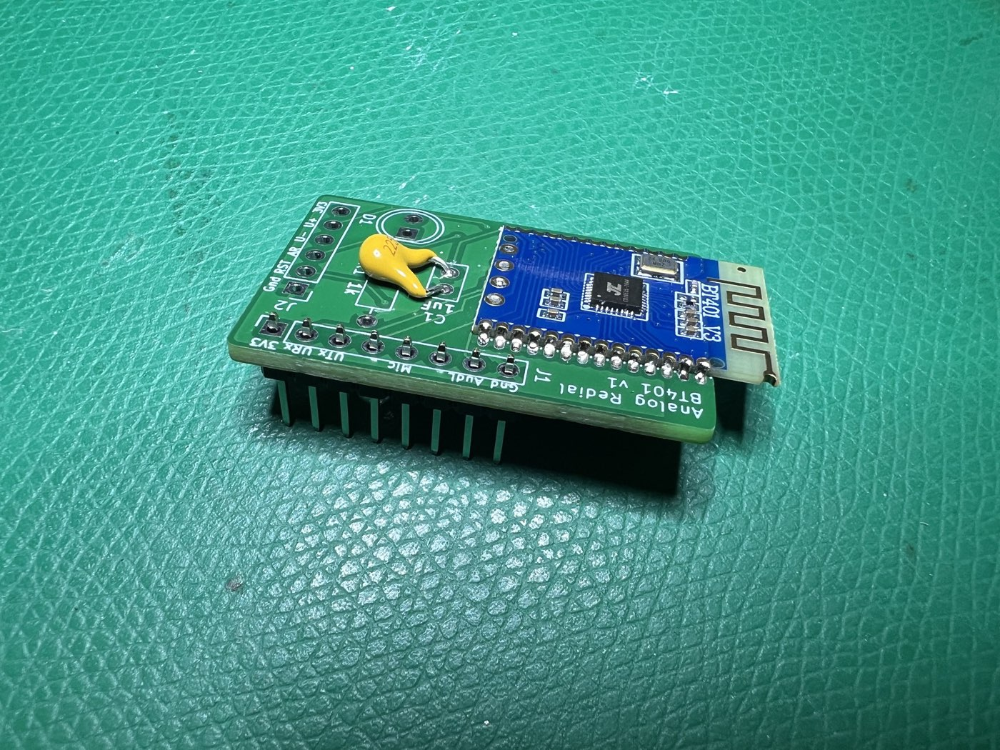

[Home](../README.md) · [1 · Get a board](board.md) · [2 · Parts & assembly](bom.md) · [3 · Flash & test](flashing.md) · [4 · Set up & use](setup.md) · **Bluetooth board**

# The Bluetooth board (BT401)

An optional extra that turns your analog phone into a handset for your cell phone. Pair
the board with your cell phone, and then:

- a call on your cell phone **rings the real bell**; lift the handset to answer, hang up to end it;
- you can **dial out on the analog phone** (dial **9** and the number) and the call goes out on your
  cell phone, with the audio through the old handset;
- the caller's number shows in the web page's activity log;
- everything else on the phone works as before.

The Bluetooth board plugs onto the 8-pin expansion header (**J2**) on a **v5 or v6** board. It is
a small DFRobot module, the **DFR0781** (a BT401), on a little adapter board of ours. Everything
on it is through-hole except the module's own castellated pads, so a regular soldering iron is
enough.

*The adapter board with the module soldered on, the 1 µF capacitor and the 8-pin header fitted. The status LED and its resistor (top, left empty) are optional.*

## Parts

| Part | Qty | Notes |
|------|-----|-------|
| **DFRobot DFR0781** (BT401 Bluetooth module) | 1 | About $3.50: [DigiKey `1738-DFR0781-ND`](https://www.digikey.com/en/products/result?keywords=DFR0781), or AliExpress. On AliExpress pick the **"DAC output"** version: this board uses the module's analog audio output, so another version won't work |
| Adapter board | 1 | Order it from the [fab files](https://github.com/sdylewski/Analog-Redial/tree/main/Bluetooth/DFR0781_BT401/DFR0781_BT401_board_v1) like the main board (no assembly needed: all hand-soldered) |
| **J1**: 8-pin 2.54 mm header | 1 | Needs unusual 9-10mm long pins to clear the RJ12 jack when it plugs into J2 on the main board |
| **C1**: 1 µF ceramic capacitor, 5 mm pitch | 1 | Not polarized. For power supply noise reduction|
| **D1**: 5 mm LED, and **R1**: 1 kΩ resistor | 1 + 1 | Not needed: a status light |
| **J2**: 6-pin 2.54 mm header | 0 | Leave it off: it only brings out USB, reset and the right audio channel, and nothing needs them |

## Build it

1. **The module.** It has gold half-holes along both long edges. Lay it on its pads with the
   antenna (the zig-zag trace at one end) **hanging off the board's edge**, as in the photo, and
   solder every pad: touch the iron to the pad and the module's edge together and add a little
   solder. Check each joint. Keep the antenna end clear of metal and of solder.
2. **C1**, the 1 µF capacitor. Either way round.
3. **J1**, the 8-pin header, on the underside as in the photo, so the board plugs into J2. Pin 1
   matches the silkscreen.
4. **D1 and R1** (optional): the LED's flat side matches the flat on the silkscreen.
5. **Look it over** with the meter on continuity: 3.3 V (pad 13, the module's VCC) and GND should
   not be connected to each other.

## Plug it in and set it up

1. **With the board powered off**, plug J1 into **J2** on the main board, pin 1 to pin 1 (J2 is the
   8-pin header beside the module).
2. Power up and open the web page. In **Settings → General → Board hardware**, set the Bluetooth
   module to **BT401** and save. The board restarts.
3. Open **Settings → Bluetooth**, press **Start pairing**, and on your cell phone pick the board
   (named "BT401-AUDIO-V31" until you rename it) in the Bluetooth list. The status shows the
   phone as connected.
4. Call the cell phone's number from another phone: the bell rings. To dial out, lift the
   handset and dial **9** and the number (9 plus ten digits).

The module only sends audio when there's a Bluetooth call or music. When it's idle the firmware
turns its output off, so it doesn't quieten your dial tone.

## Wiring it by hand

It’s ugly, but you can skip the adapter board and wire the module to J2 with five wires:

| Module pad | To J2 pin | What |
|------------|-----------|------|
| 13 (VCC) | 1 | 3.3 V |
| 26 (TX) | 2 | module to board |
| 25 (RX) | 3 | board to module |
| 8 (MIC) | 5 | handset microphone |
| 10 (DACL) | 7 | audio to the handset |
| 12 and 11 (GND) | 8 | ground |

Leave every other pad open. The pad numbers are the BT401's own; the round pads 27 to 30 on the
module's end are the same signals (GND, TX, RX and power) if they're easier to solder.

## If it doesn't connect

- **Settings → Bluetooth** shows no module, or the console command `bt401_probe` prints nothing:
  check the 3.3 V, the TX and RX wires (not swapped) and J1 sitting all the way in J2.
- **It pairs but there's no audio:** check the module is the **DAC output** version.
- **Nobody hears you:** the microphone wire (pad 8 to J2 pin 5).

The module's own documentation is on DFRobot's [GitHub page](https://github.com/DFRobot/DFRobot_BT401) (the Arduino library, with the command set) and their [wiki](https://wiki.dfrobot.com/dfr0781/).

> **This is a kit.** You build and wire the adapter board yourself, and it is for hobby and
> experimental use. It isn't a finished, certified product, and you are responsible for how you
> build and use it.

More detail, the BM64 alternative and the bench notes are in the repo:
[`Bluetooth/DFR0781_BT401/`](https://github.com/sdylewski/Analog-Redial/tree/main/Bluetooth/DFR0781_BT401).
