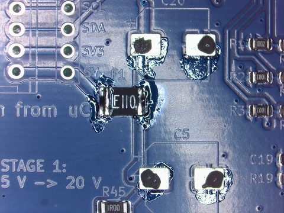
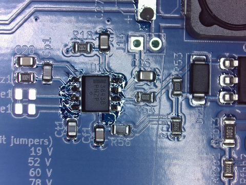
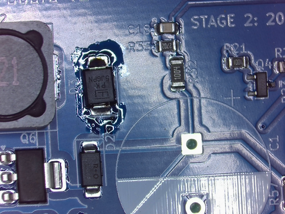

[Home](../README.md) · [1 · Get a board](board.md) · **2 · Parts & assembly** · [3 · Flash & test](flashing.md) · [4 · Set up & use](setup.md)

# Build the payphone coin board, step by step

> **Built and working with one payphone.** This page is for the coin board only. How it works,
> every connector and jumper, and the first power-up are in the
> [coin board reference](hardware-coin-board.md); read its
> [safety section](hardware-coin-board.md#safety-first-high-voltage) first.

From a board that arrives from JLCPCB with its surface-mount parts on to a board ready for its
first power-up. You order the board and have JLCPCB place the small parts
([ordering](hardware-coin-board.md#8-ordering-and-building)), then buy the larger parts below
and solder them yourself.

> ⚠️ **This board makes up to 119 V DC and stores it in a 220 µF capacitor (C1).** Build it
> with the 5 V supply disconnected, leave **J14 (the HV boost) without a shunt** until
> everything else works, and discharge C1 before you touch the board after any test. Details:
> [safety](hardware-coin-board.md#safety-first-high-voltage).

## 1. Choose your build

| Choice | Options |
|---|---|
| **Cable to the main board** | J6 (a 5-pin 2.54 mm header) or J1 (JST XH 5-pin): the same five signals, fit whichever suits your cable |
| **Relay connector** | J2 (Molex KK 396 plug, for the phone's own cable) or J11 (screw terminal, 5.08 mm), not both |
| **Coin switch connector** | J3 (Molex KK 396 plug, for the phone's own cable) or J12 (screw terminal, 2.54 mm; adds the fourth coin input), not both |
| **Relay type** | a high-voltage relay such as the HD550002C needs the J14 shunt and one of the J7-J9 settings; 12-24 V coils leave J14 empty. A two-coil relay also needs J10 and J11 |
| **ADS1115 (U4)** | optional: it only adds readings (HV, the 20 V rail, firing current). Fit it in a socket so it can be swapped |

## 2. Tools

- Soldering iron with a fine tip, and solder
- Flush cutters
- Multimeter (continuity and DC volts, and rated for the high voltage if you'll probe C1)
- Tweezers, and a magnifier or a USB microscope for the surface-mount parts
- Flux, for the surface-mount parts and the SOIC-8 chip
- A current-limited 5 V supply for the first power-up

## 3. Components needed

JLCPCB places everything else. These are the parts you buy and solder, for one board. Check
stock and price on each page before ordering.

| Ref | Qty | Part | Where | Notes |
|---|---:|---|---|---|
| **U3** | 1 | onsemi UC3843BD1R2G, SOIC-8 | [DigiKey](https://www.digikey.com/en/products/detail/onsemi/UC3843BD1R2G/921714) | stage 2 controller. ST's UC3843BD1 is the same part. TI's UCC28C43/UCC38C43, UC3843AD, UC3842 and UC3844/5 are **not** substitutes |
| **D3** | 1 | Littelfuse SMBJ130A, SMB | [DigiKey](https://www.digikey.com/en/products/detail/littelfuse-inc/SMBJ130A/688304) | HV clamp, **polarized** |
| **F1** | 1 | Littelfuse 1812L110PR, 1812 | [DigiKey](https://www.digikey.com/en/products/detail/littelfuse-inc/1812L110PR/267851) | resettable fuse, 1.1 A hold. No polarity |
| **C5, C7, C14, C20** | 4 | Nichicon UCD1H101MNL1GS, 100 µF 50 V, 8 × 10.5 mm | [DigiKey](https://www.digikey.com/en/products/detail/nichicon/UCD1H101MNL1GS/2549678) | aluminium electrolytic (not polymer or ceramic), **polarized**, surface-mount |
| **C1** | 1 | Nichicon UCS2D221MHD, 220 µF 200 V, 18 × 26.5 mm | [DigiKey](https://www.digikey.com/en/products/detail/nichicon/UCS2D221MHD/4991877) | the high-voltage capacitor, through-hole, **polarized** |
| **K1** | 1 | Panasonic TX2-5V, DPDT 5 V relay | [DigiKey](https://www.digikey.com/en/products/detail/panasonic-industry/TX2-5V/251803) | through-hole. The Omron G6S-2 DC5 fits the same footprint |
| **J2** | 1 | Molex KK 396 header, 3-pin, vertical | [DigiKey search](https://www.digikey.com/en/products/result?keywords=molex%20kk%20396%20header%203%20position) | for the phone's relay cable. Choose one whose polarizing wall is a **plain rectangle**, without the friction-lock ramp (the small bump on the wall) |
| **J3** | 1 | Molex KK 396 header, 4-pin, vertical | [DigiKey search](https://www.digikey.com/en/products/result?keywords=molex%20kk%20396%20header%204%20position) | for the phone's coin switch cable. Same wall as J2 |
| **J11** | 1 | 3-pin screw terminal block, **5.08 mm** pitch | [AliExpress](https://www.aliexpress.us/item/3256809025211496.html) | optional, instead of J2 |
| **J12** | 1 | KF128-2.54-5P screw terminal, 5 pins, 2.54 mm | [AliExpress](https://www.aliexpress.us/item/3256801737987839.html) | optional, instead of J3; adds coin input 4 |
| **J1** or **J6** | 1 | JST B5B-XH-A (5-pin, mates with XHP-5), or a 1 × 5 pin header, 2.54 mm | [DigiKey](https://www.digikey.com/en/products/detail/jst-sales-america-inc/B5B-XH-A-LF-SN/1530483) | the cable to the main board |
| **J7-J9** | 3 | 1 × 2 pin header, 2.54 mm, and 3 shunts | any | HV setting (with J14) |
| **J10** | 1 | 1 × 2 pin header and a shunt | any | two-coil relays only |
| **J14** | 1 | 1 × 2 pin header and a shunt | any | HV boost. **The shunt stays off for now** |
| **J13** | 1 | 1 × 3 pin header, 2.54 mm | any | spare analog input; optional |
| **U4 socket** | 1 | Sullins PPTC101LFBN-RC, 1 × 10 female | [DigiKey](https://www.digikey.com/en/products/detail/sullins-connector-solutions/PPTC101LFBN-RC/810149) | optional |
| **U4** | 1 | ADS1115 module | [AliExpress](https://www.aliexpress.us/item/3256806547330256.html) | optional; a ready-made breakout with a 10-pin header (VDD, GND, SCL, SDA, ADDR, ALRT, A0-A3) |

The phone's own plugs mate with J2 and J3 (a Molex KK 396 housing and crimps). If you build a
cable instead, match the housing to the header you chose.

The surface-mount parts JLCPCB places (U1, U2, the MOSFETs, diodes, inductors, resistors and
small capacitors) are listed in the
[BOM](https://github.com/sdylewski/Analog-Redial/blob/main/PayPhone/Payphone_coin_board_v1/jlcpcb/production_files/BOM-Payphone_coin_board_v1.csv).

## 4. Before you start

Look the board over. The fab has placed the small parts. Find the outlines for the seven parts
you fit yourself in the surface-mount group (**U3, D3, F1, C5, C7, C14, C20**; they're left
off so JLCPCB doesn't charge Extended-part fees) and the through-hole ones.

**Component directions.** Several parts only work one way round. The photos below show how they
sit on a finished board, but **check each part against the silkscreen and the schematic
yourself before you solder it**: a part fitted backwards is hard to take off, and on this board
a backwards capacitor or diode can fail loudly.

## Steps

Lowest parts first, tallest last, so the board sits flat on the bench while you solder. For
each part: place it, check it's flat and the right way round, solder one pad or pin, check
again, then solder the rest.

### Step 1: F1, the fuse

F1 is the 1812 part beside the 5 V input, between the pin header and C5. It has no polarity.
Tin one pad, set the fuse on it, and solder the other pad.

*F1 fitted (marked E110). C5 and C20 sit beside it, with their + marks toward the top of the photo*

### Step 2: U3, the UC3843 (SOIC-8)

Find the U3 outline (stage 2, beside L2 and Q6). **Pin 1 is marked by a dot on the chip and
by the corner on the silkscreen.** Line the dot up with pin 1, tack one corner pin, check
that all eight pins sit on their pads, then solder the rest with flux. Check for bridges
between pins with the magnifier.

*U3 fitted: the pin-1 dot is at the top left of the chip*

### Step 3: D3, the SMBJ130A TVS diode

D3 clamps the high voltage if the feedback loop fails. It's **polarized: the band (stripe)
marks the cathode, which goes to HV**, the side toward C1 and the high-voltage resistors. The
other end goes to GND. Check it against the D3 outline on the board and the schematic.

*D3 fitted: the stripe is at the top end of the diode, toward the HV side. D2 (below it) is placed by JLCPCB*

### Step 4: the 100 µF capacitors (C5, C7, C14, C20)

Surface-mount aluminium electrolytics. They're **polarized**: the **+** side is marked on the
silkscreen (the corner or the "+"), and the cap's own marking (a bar or a cut corner on the
base) is the **negative** side. The positive pads connect to +5 V (C5, C20) and the 20 V
rail (C7, C14); the negative pads connect to GND. Solder one pad, check the can sits flat
and straight, then the other.

### Step 5: the pin headers and shunt posts

J7, J8, J9, J10 and J14 are 2-pin headers; J13 is 3-pin; J6 is 5-pin (if you're using it
rather than J1). Push each in from the top, solder one pin, check it's square, then the
other. **Don't fit any shunt yet.**

### Step 6: connectors

Fit the connectors you chose in [section 1](#1-choose-your-build):

- **J2** (relay, KK 396 3-pin) or **J11** (relay, 5.08 mm screw terminal)
- **J3** (coin switches, KK 396 4-pin) or **J12** (coin inputs, 2.54 mm screw terminal)
- **J1** (JST XH 5-pin) if you're not using the J6 header

Check each one sits flat on the board before soldering. The KK headers have a polarizing
wall; fit it the way the silkscreen shows. Put the screw terminals' wire openings on the
side where you'll bring the wires in.

### Step 7: U4's socket, then U4 (optional)

Solder the 1 × 10 socket, then plug in the ADS1115 module with its pin labels matching the
silkscreen. Leave it unplugged while you do the first checks if you like: the board works
without it.

### Step 8: K1 and C1, the tallest parts

**K1**, the relay: line up its marked end (pin 1) with the outline's, and check it sits
flat before you solder it from the back.

**C1**, the 220 µF 200 V capacitor, is **polarized**: the **negative** side (the stripe
down the can, and the shorter lead) goes to the pad marked GND. A backwards C1 charged to
119 V can burst. Check twice, then solder, and trim the leads.

## 5. Check before power

1. **Bridges:** look for solder joining neighbouring pins, above all on U3 (SOIC-8), the KK
   headers and the ADS1115 socket.
2. **Polarity:** D3's band toward HV; C5, C7, C14, C20 and C1 with the negative side to GND; U3's
   dot at pin 1.
3. **Shorts:** with the meter on continuity and **no power connected**, +5 V to GND and the
   20 V rail to GND both read open (or a few kΩ, not near zero). HV to GND reads high
   (the bleed resistors).
4. **No shunts fitted yet:** J14, J7-J9 and J10 are all open.

## 6. First power-up

Follow [first power-up](hardware-coin-board.md#9-firmware-and-first-power-up) in the
reference, one step at a time. In short:

- Connect the cable to the main board's J11 and **leave J14 without a shunt**.
- Power the board from a current-limited 5 V supply. Nothing should get warm.
- On the main board's Payphone tab, tick "A coin board is connected": U1 and U4 should
  answer and the 20 V rail should read about 4.6-4.9 V.
- Only after the coin switches and a low-voltage test with a 100 Ω 5 W resistor work, fit J14
  and a J7-J9 shunt for the relay.

---

**Next: [coin board reference](hardware-coin-board.md)**: how the board works, the first power-up, and what to
do if a coin isn't counted.
