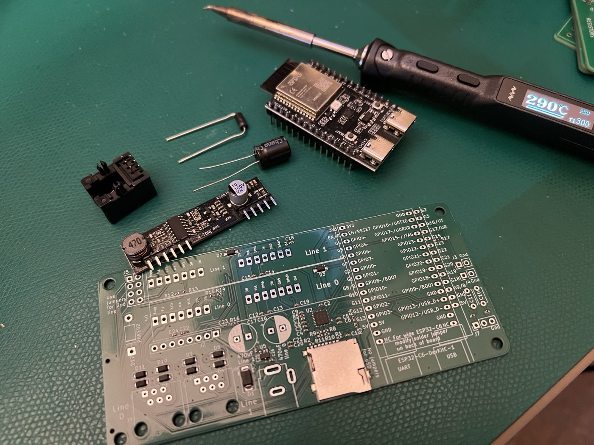
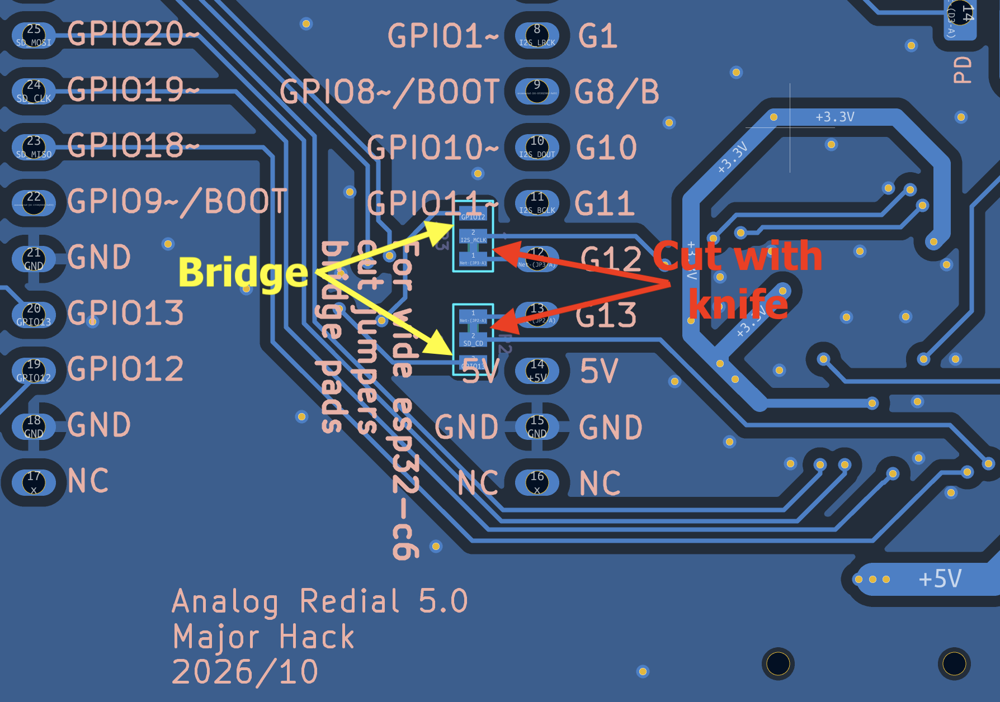
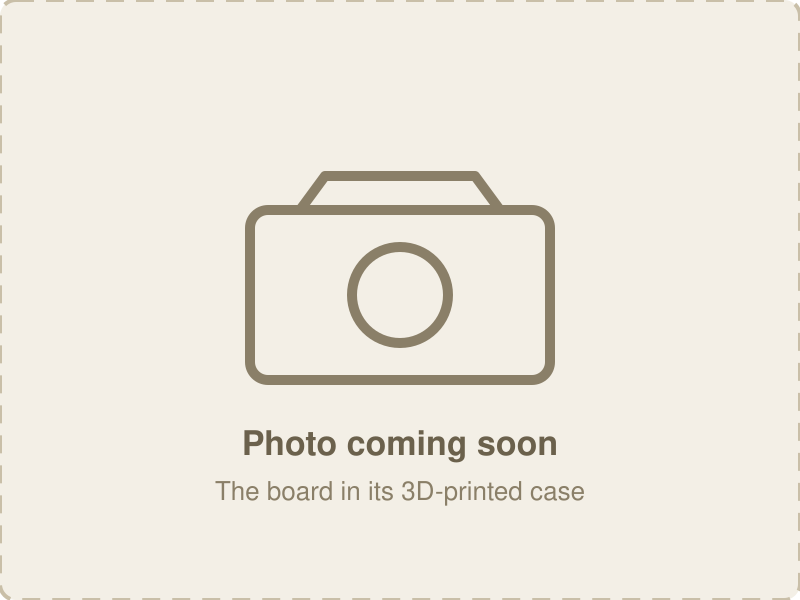
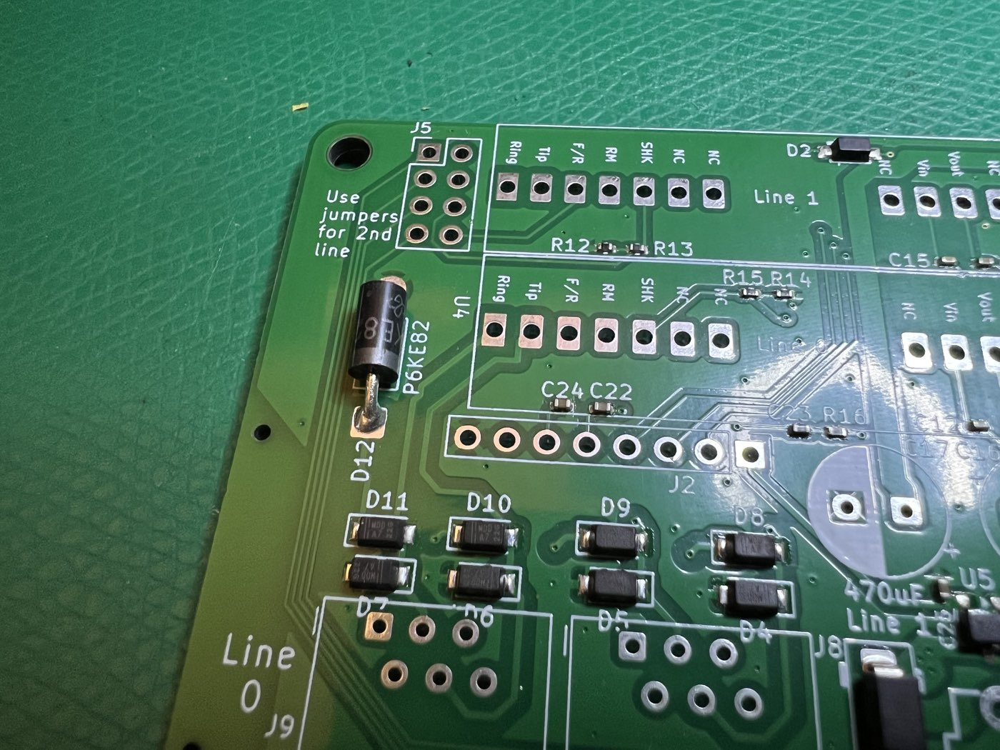
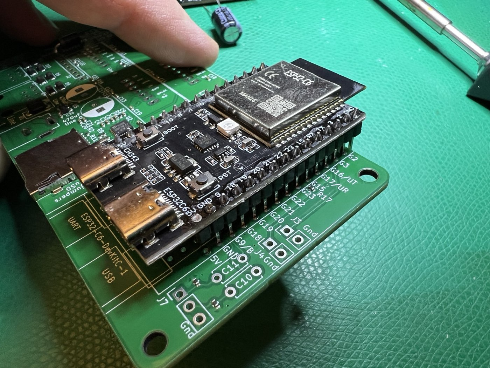
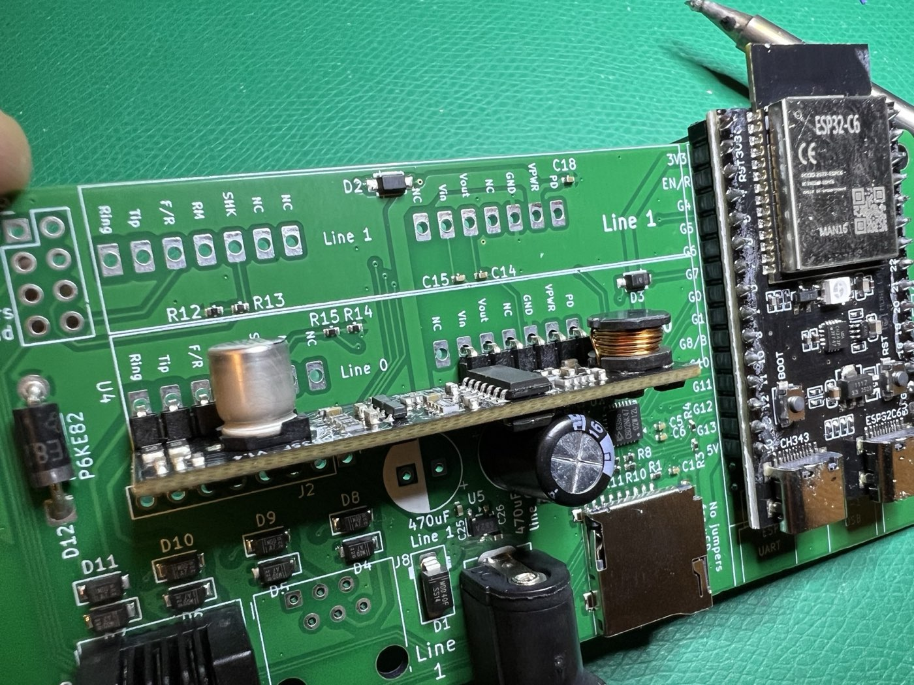

[Home](../README.md) · [1 · Get a board](board.md) · **2 · Parts & assembly** · [3 · Flash & test](flashing.md) · [4 · Set up & use](setup.md)

# Build a v5 board, step by step

From a board that arrives from the fab with its surface-mount parts on, to a board ready
to flash. Every part you add is through-hole, so a regular soldering iron is enough. The
same steps build a **v5.1**: the only difference is in [step 4](#step-4-u1-the-esp32-c6-module),
where v5.1 needs no pin removed from a clone module.

For where to buy each part, see the [parts list](bom.md). The shorter checklist version
of this page is [Assembly](building.md).

> **Building a new board?** v6 is the current board: [Build a v6 board](build-v6.md). This page is
> for the v5 and v5.1 boards already out there.

> ⚠️ **This board makes real telephone-line voltages:** about 48 V DC off-hook and about
> 60 V AC while ringing, with peaks near 90 V. Never connect its jacks to house or telco
> wiring, and don't touch the jack or SLIC pins while it's powered.

## 1. Choose your build

Two choices decide which steps you do.

**Lines and storage** (the four spare pins do one job, chosen by the J5 jumpers):

| Build | Second line | microSD | J5 shunts |
|-------|-------------|---------|-----------|
| **Dual line** | yes | no | all four fitted |
| **Single line + microSD** | no | yes | none |
| **Single line + your own gadgets** | no | no | none; your wires on J5 pins 1, 3, 5, 7 |

**Microcontroller module:**

| Module | Extra work |
|--------|------------|
| **Genuine ESP32-C6-DevKitC-1, 32 pins** (recommended) | none |
| **30-pin clone** | move two solder jumpers (step 1); on v5 (not v5.1) remove one pin (step 4) |

## 2. Tools

- Soldering iron with a fine tip, and solder
- Flush cutters
- Multimeter (continuity and DC volts): not optional, see [section 5](#5-check-before-power)
- A craft knife, for the clone's solder jumpers only
- A 2 A USB-C charger, or a regulated 5-6 V DC supply (never 9 V or 12 V)
- An analog telephone with an RJ11/RJ12 cord

## 3. Components needed

| Ref | Part | Qty | Needed for | Notes |
|-----|------|-----|------------|-------|
| **U1** | ESP32-C6-DevKitC-1 (32-pin) or a 30-pin clone | 1 | every build | 16 MB recommended, 8 MB fine |
| **U4** | Silvertel AG1171 SLIC | 1 | every build | line 0 |
| **C16** | 470 µF 16 V radial electrolytic, 8 mm, 3.5 mm pitch | 1 | every build | line 0, polarized |
| **J9** | RJ12 jack, Amphenol 87180-062LF | 1 | every build | line 0 |
| **J5** | 2×4 pin header, 2.54 mm | 1 | every build | |
| **U3** | AG1171 SLIC | 1 | dual line | line 1 |
| **C17** | 470 µF 16 V radial | 1 | dual line | line 1, polarized |
| **J8** | RJ12 jack | 1 | dual line | line 1 |
| | jumper shunts, 2.54 mm | 4 | dual line | on J5 |
| **J1** | DC barrel jack, 5.5 × 2.1 mm | 1 | optional | recommended with the clone module |
| **D12** | P6KE82**A** TVS diode | 1 | optional, recommended | line protection, polarized |
| **J2** | 1×8 pin header, 2.54 mm | 1 | optional | for the Bluetooth board |
| **J7** | 1×3 pin header | 1 | optional | audio monitor; needs C10, C11 |
| **C10**, **C11** | 1 µF film or ceramic, 5 mm pitch | 2 | optional | only with J7 |
| **J3**, **J4** | 1×2 pin header | 2 | optional | rarely useful on v5: see the [v5 reference](hardware-smd5.md#j3-and-j4-on-smd5) |
| | microSD card | 1 | single line + microSD | FAT-formatted |

## 4. Before you start

Look the board over: the fab has already placed the codec, resistors, capacitors, the
microSD socket and the regulator. Find U1's outline, the two SLIC outlines, and on the back
the two small solder jumpers **JP2** and **JP3**.

*A v5 board as it arrives, with the parts for a one-line build: the module, the diode D12, 470uF cap C16, RJ12 J9, the AG1171 SLIC*

## Steps

Lowest parts first, tallest last, so the board sits flat when it's upside-down on the bench
during soldering. For each part: push it in from the top, check it's flat and the right way
round, solder one pin, check again, then solder the rest and trim the leads.

### Step 1: JP2 and JP3 (30-pin clone only)

Skip this with the genuine 32-pin module.

On the back, each jumper has three pads, with pads 1 and 2 joined by a thin trace. For a
clone, **cut the trace between pads 1 and 2** with a craft knife, check with the meter that
they no longer connect, then **bridge pads 2 and 3** with a blob of solder. Do both, JP2 and
JP3. Never leave both sides bridged: that shorts a codec pin to a USB data line.

<table>
  <tr>
    <td width="50%"></td>
    <td width="50%"></td>
  </tr>
  <tr>
    <td align="center">Before: 1-2 joined (factory)</td>
    <td align="center">After: 1-2 cut, 2-3 bridged (<code>pics/build-v5/01-jp-after.jpg</code>)</td>
  </tr>
</table>

### Step 2: J5, 2×4 header

Only needed on a dual-line board, or if you want to use the spare GPIO pins instead of the
microSD card. Short pins down, long pins up.

### Step 3: D12, line TVS diode (optional, recommended)

**Polarized:** the band on the diode goes to the band end of the silkscreen. Bend the leads
to the 10 mm hole spacing and lay it flat. Clip the leads after soldering them on the back
of the board.

*D12 at the left edge, band at the silkscreen band*

### Step 4: U1, the ESP32-C6 module

Do the option for your ESP32 module.

<table>
  <tr>
    <td width="50%"></td>
    <td width="50%"></td>
  </tr>
  <tr>
    <td align="center">Option A: genuine DevKitC-1, 32 pins (<code>pics/build-v5/13-module-genuine.jpg</code>)</td>
    <td align="center">Option B: 30-pin clone (<code>pics/build-v5/v5-module-clone.jpg</code>)</td>
  </tr>
</table>

#### Option A: genuine ESP32-C6-DevKitC-1 (32 pins)

1. Seat it as the silkscreen outline shows. The footprint
   takes both modules: the left row of holes is shared, and on the right there are two rows,
   one for each module's width, so the pins only drop in where they fit.
2. Solder one pin at each far corner. Check the module sits flat and square against the
   board, and reheat a corner to adjust if not.
3. Solder the rest.
4. Check that every pin is soldered, on the top side and the bottom side.

*Genuine module fitted (`pics/build-v5/13a-genuine-fitted.jpg`)*

#### Option B: 30-pin clone

Step 1 (JP2, JP3) must be done first.

1. **v5 only, not v5.1: take out the clone's bottom-right 5V pin.** A mistake in the v5
   footprint puts that pin on GND (v5.1 fixes it, so there's nothing to remove). Cut it off
   the module flush, or leave it out of its hole unsoldered, so it doesn't connect at all.
   The bottom-left 5V pin is then the module's only 5 V connection, which is enough.
2. Seat it as the silkscreen outline shows: **the module's top two pins hang off the top
   edge of the board.**
3. Solder one pin at each far corner, check it's flat and square, then solder the rest.
4. Check that every pin is soldered, on the top side and the bottom side.
5. **With the power off, check with the meter** that the module's 5V pin has no continuity
   to GND.

<table>
  <tr>
    <td width="50%"></td>
    <td width="50%"></td>
  </tr>
  <tr>
    <td align="center">v5: the bottom-right 5V pin, removed (<code>pics/build-v5/13b-pin-removed.jpg</code>)</td>
    <td align="center">Clone fitted (<code>pics/build-v5/v5-module-clone.jpg</code>)</td>
  </tr>
</table>

### Step 5: J1, DC jack, and J2, Bluetooth header (optional)

Place the DC jack in its holes and solder it from the back: chunky pins, so use a hot iron
and give the solder a moment to flow into the slots. If you'll use the Bluetooth board, fit
its header (J2) at the same time: with both in, the board sits more level while you solder.
Pin 1 matches the silkscreen.

*J1 and J2 (`pics/build-v5/v5dcJack.jpg`)*

### Step 6: RJ12 jacks and 470 µF capacitors

Place your RJ12 jacks: J9 for line 0, and J8 too for two lines. They snap in; check they sit
flat before soldering. Then the 470 µF capacitors, C16 for line 0 and C17 for line 1. **They're
polarized:** the negative side (the stripe, and the shorter lead) faces the white marking on
the board. Line 0 and Line 1 are labelled, so for a one-line board just use the holes on the
right.

*J8 beside J9 (`pics/build-v5/06-j8.jpg`)*

### Step 7: U4, AG1171 SLIC for line 0 (and U3 for line 1)

A 14-pin module that stands upright. **Note which way it faces before soldering:** the
module's circuit board goes on the RJ12 side of the pin holes, as in the picture.
Desoldering a 14-pin module is miserable. Solder one end pin, check it stands straight and
square, then the other end, then the rest. For two lines, fit U3 in the "Line 1" outline the
same way.

<table>
  <tr>
    <td width="50%"></td>
  </tr>
  <tr>
    <td align="center">U4 fitted in the "Line 0" outline</td>
  </tr>
</table>

### Step 8: J5 shunts

- **Dual line:** fit all four shunts, across 1-2, 3-4, 5-6, 7-8.
- **Single line + microSD** or **your own gadgets:** none. Never a mix.

<table>
  <tr>
    <td width="50%"></td>
    <td width="50%"></td>
  </tr>
  <tr>
    <td align="center">Dual line: four shunts (<code>pics/build-v5/14-j5-dual.jpg</code>)</td>
    <td align="center">Single line: none (<code>pics/build-v5/14-j5-single.jpg</code>)</td>
  </tr>
</table>

## 5. Check before power

1. **Bridges:** look for solder joining neighbouring pins, above all on the RJ12 jacks and
   the module.
2. **Polarity:** C16/C17 stripes to the negative pads; D12's band at the silkscreen band.
3. **Shorts:** with the meter on continuity, +5 V to GND and 3.3 V to GND both read open.
   With a clone on v5, also the module's 5V pin to GND.
4. **J5:** all four shunts for two lines, none otherwise.

## 6. First power-on

Nothing plugged into the phone jacks yet.

- Power from USB-C (or the DC jack with a regulated 5-6 V, 2 A supply). The module's LED comes on, and nothing gets warm. If
  anything does, unplug and go back to [section 5](#5-check-before-power).
- Measure +5 V and 3.3 V: both within a few percent (from the DC jack, +5 V sits about
  0.4 V below the supply, after the OR diode).
- Then plug in a phone. It does nothing yet: there's no firmware.

*The finished board (`pics/build-v5/16-finished.jpg`)*

---

**Next: [3 · Flash & test](flashing.md)** (`--board smd5`, for either module once JP2/JP3
are set)
