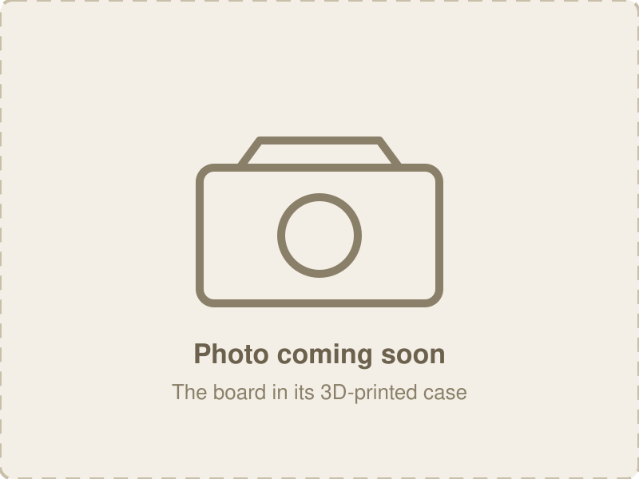
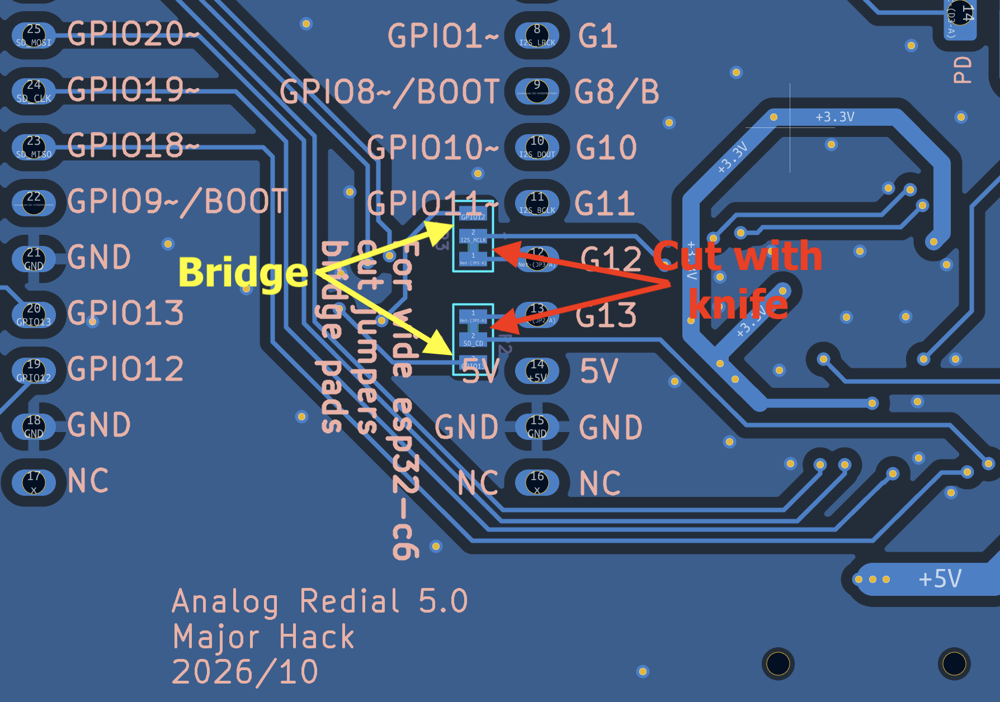

[Home](../README.md) · [1 · Get a board](board.md) · **2 · Parts & assembly** · [3 · Flash & test](flashing.md) · [4 · Set up & use](setup.md)

# Build a v5 board, step by step

From a board that arrives from the fab with its surface-mount parts on, to a board ready
to flash. Every part you add is through-hole, so a regular soldering iron is enough. The
same steps build a **v5.1**: the only difference is in [step 13](#step-13-u1-the-esp32-c6-module),
where v5.1 needs no pin removed from a clone module.

For where to buy each part, see the [parts list](bom.md). The shorter checklist version
of this page is [Assembly](building.md).

> ⚠️ **This board makes real telephone-line voltages:** about 48 V DC off-hook and about
> 60 V AC while ringing, with peaks near 90 V. Never connect its jacks to house or telco
> wiring, and don't touch the jack or SLIC pins while it's powered.

## 1. Choose your build

Two choices decide which steps you do.

**Lines and storage** (the four spare pins do one job, chosen by the J5 jumpers):

| Build | Second line | microSD | J5 shunts |
|-------|-------------|---------|-----------|
| **Dual line** | yes | no | all four fitted |
| **Single line + microSD** | no | yes | none |
| **Single line + your own gadgets** | no | no | none; your wires on J5 pins 1, 3, 5, 7 |

**Microcontroller module:**

| Module | Extra work |
|--------|------------|
| **Genuine ESP32-C6-DevKitC-1, 32 pins** (recommended) | none |
| **30-pin clone** | move two solder jumpers (step 1); on v5 (not v5.1) remove one pin (step 13) |

## 2. Tools

- Soldering iron with a fine tip, and solder
- Flush cutters
- Multimeter (continuity and DC volts): not optional, see [section 5](#5-check-before-power)
- A craft knife, for the clone's solder jumpers only
- A 2 A USB-C charger, or a regulated 5-6 V DC supply (never 9 V or 12 V)
- An analog telephone with an RJ11/RJ12 cord

## 3. Components needed

| Ref | Part | Qty | Needed for | Notes |
|-----|------|-----|------------|-------|
| **U1** | ESP32-C6-DevKitC-1 (32-pin) or a 30-pin clone | 1 | every build | 16 MB recommended, 8 MB fine |
| **U4** | Silvertel AG1171 SLIC | 1 | every build | line 0 |
| **C16** | 470 µF 16 V radial electrolytic, 8 mm, 3.5 mm pitch | 1 | every build | line 0, polarized |
| **J9** | RJ12 jack, Amphenol 87180-062LF | 1 | every build | line 0 |
| **J5** | 2×4 pin header, 2.54 mm | 1 | every build | |
| **U3** | AG1171 SLIC | 1 | dual line | line 1 |
| **C17** | 470 µF 16 V radial | 1 | dual line | line 1, polarized |
| **J8** | RJ12 jack | 1 | dual line | line 1 |
| | jumper shunts, 2.54 mm | 4 | dual line | on J5 |
| **J1** | DC barrel jack, 5.5 × 2.1 mm | 1 | optional | recommended with the clone module |
| **D12** | P6KE82**A** TVS diode | 1 | optional, recommended | line protection, polarized |
| **J2** | 1×8 pin header, 2.54 mm | 1 | optional | for the Bluetooth board |
| **J7** | 1×3 pin header | 1 | optional | audio monitor; needs C10, C11 |
| **C10**, **C11** | 1 µF film or ceramic, 5 mm pitch | 2 | optional | only with J7 |
| **J3**, **J4** | 1×2 pin header | 2 | optional | rarely useful on v5: see the [v5 reference](hardware-smd5.md#j3-and-j4-on-smd5) |
| | microSD card | 1 | single line + microSD | FAT-formatted |

## 4. Before you start

Look the board over: the fab has already placed the codec, resistors, capacitors, the
microSD socket and the regulator. Find U1's outline, the two SLIC outlines, and on the back
the two small solder jumpers **JP2** and **JP3**.

<table>
  <tr>
    <td width="50%"></td>
    <td width="50%"></td>
  </tr>
  <tr>
    <td align="center">Top, as it arrives (<code>pics/build-v5/00-top.jpg</code>)</td>
    <td align="center">Bottom, JP2 and JP3 circled (<code>pics/build-v5/00-bottom.jpg</code>)</td>
  </tr>
</table>

## Steps

Lowest parts first, tallest last, so the board sits flat on the bench while you work. For
each part: push it in from the top, check it's flat and the right way round, solder one pin,
check again, then solder the rest and trim the leads.

### Step 1: JP2 and JP3 (30-pin clone only)

Skip this with the genuine 32-pin module.

On the back, each jumper has three pads, with pads 1 and 2 joined by a thin trace. For a
clone, **cut the trace between pads 1 and 2** with a craft knife, check with the meter that
they no longer connect, then **bridge pads 2 and 3** with a blob of solder. Do both, JP2 and
JP3. Never leave both sides bridged: that shorts a codec pin to a USB data line.

<table>
  <tr>
    <td width="50%"></td>
    <td width="50%"></td>
  </tr>
  <tr>
    <td align="center">Before: 1-2 joined (factory)</td>
    <td align="center">After: 1-2 cut, 2-3 bridged (<code>pics/build-v5/01-jp-after.jpg</code>)</td>
  </tr>
</table>

### Step 2: J5, 2×4 header

Short pins down, long pins up. Fitted on every build.

*J5 fitted (`pics/build-v5/02-j5.jpg`)*

### Step 3: optional low headers: J7, J3, J4, and C10/C11

Only if you want them (see [components](#3-components-needed)). C10 and C11 are
non-polarized and only matter with J7.

*J7 with C10 and C11 (`pics/build-v5/03-j7.jpg`)*

### Step 4: D12, line TVS (optional, recommended)

**Polarized:** the band on the diode goes to the band end of the silkscreen. Bend the leads
to the 10 mm hole spacing and lay it flat.

*D12, band at the silkscreen band (`pics/build-v5/04-d12.jpg`)*

### Step 5: J9, RJ12 jack for line 0

It snaps into its holes. Check it sits flat against the board before soldering.

*J9 (`pics/build-v5/05-j9.jpg`)*

### Step 6: J8, RJ12 jack for line 1 (dual line)

As J9.

*J8 beside J9 (`pics/build-v5/06-j8.jpg`)*

### Step 7: C16, 470 µF for line 0

**Polarized:** the stripe on the can (the negative lead, also the shorter one) goes to the
negative pad, marked on the silkscreen. Backwards, it can vent.

*C16, stripe to the negative pad (`pics/build-v5/07-c16.jpg`)*

### Step 8: C17, 470 µF for line 1 (dual line)

As C16, same polarity care.

*C17 (`pics/build-v5/08-c17.jpg`)*

### Step 9: U4, AG1171 SLIC for line 0

A 14-pin module that stands upright. **Match pin 1 to the silkscreen before soldering**:
desoldering a 14-pin module is miserable. Solder one end pin, check it stands straight and
square, then the other end, then the rest.

<table>
  <tr>
    <td width="50%"></td>
    <td width="50%"></td>
  </tr>
  <tr>
    <td align="center">Pin 1 on the module and the board (<code>pics/build-v5/09-u4-pin1.jpg</code>)</td>
    <td align="center">U4 fitted, upright (<code>pics/build-v5/09-u4.jpg</code>)</td>
  </tr>
</table>

### Step 10: U3, AG1171 SLIC for line 1 (dual line)

As U4.

*Both SLICs (`pics/build-v5/10-u3.jpg`)*

### Step 11: J1, DC jack (optional)

Recommended with the clone module, whose USB-C port sits back from the board edge. Chunky
pins: use a hot iron and give the solder a moment to flow into the slots.

*J1 (`pics/build-v5/11-j1.jpg`)*

### Step 12: J2, expansion header (optional)

For the Bluetooth board, or your own. Pin 1 matches the silkscreen: a board plugged in
rotated 180° shorts the 3.3 V regulator to ground.

*J2, pin 1 marked (`pics/build-v5/12-j2.jpg`)*

### Step 13: U1, the ESP32-C6 module

The tallest part, so it goes last. Do the option for your module.

<table>
  <tr>
    <td width="50%"></td>
    <td width="50%"></td>
  </tr>
  <tr>
    <td align="center">Option A: genuine DevKitC-1, 32 pins (<code>pics/build-v5/13-module-genuine.jpg</code>)</td>
    <td align="center">Option B: 30-pin clone (<code>pics/build-v5/13-module-clone.jpg</code>)</td>
  </tr>
</table>

#### Option A: genuine ESP32-C6-DevKitC-1 (32 pins)

1. Seat it as the silkscreen outline shows. The footprint
   takes both modules: the left row of holes is shared, and on the right there are two rows,
   one for each module's width, so the pins only drop in where they fit.
2. Solder one pin at each far corner. Check the module sits flat and square against the
   board, and reheat a corner to adjust if not.
3. Solder the rest.

*Genuine module fitted (`pics/build-v5/13a-genuine-fitted.jpg`)*

#### Option B: 30-pin clone

Step 1 (JP2, JP3) must be done first.

1. **v5 only, not v5.1: take out the clone's bottom-right 5V pin.** On a v5 board that pin
   lands on GND. Cut it off the module flush, or leave it out of its hole unsoldered, so it
   doesn't connect at all. The bottom-left 5V pin is then the module's only 5 V connection,
   which is enough.
2. Seat it as the silkscreen outline shows: on the right, its pins drop into the row of holes
   that matches its width.
3. Solder one pin at each far corner, check it's flat and square, then solder the rest.
4. **With the power off, check with the meter** that the module's 5V pin has no continuity
   to GND. If it beeps, the 5V pin is still connected: power on and the 5 V rail is shorted.

<table>
  <tr>
    <td width="50%"></td>
    <td width="50%"></td>
  </tr>
  <tr>
    <td align="center">v5: the bottom-right 5V pin, removed (<code>pics/build-v5/13b-pin-removed.jpg</code>)</td>
    <td align="center">Clone fitted (<code>pics/build-v5/13b-clone-fitted.jpg</code>)</td>
  </tr>
</table>

### Step 14: J5 shunts

- **Dual line:** fit all four shunts, across 1-2, 3-4, 5-6, 7-8.
- **Single line + microSD** or **your own gadgets:** none. Never a mix.

<table>
  <tr>
    <td width="50%"></td>
    <td width="50%"></td>
  </tr>
  <tr>
    <td align="center">Dual line: four shunts (<code>pics/build-v5/14-j5-dual.jpg</code>)</td>
    <td align="center">Single line: none (<code>pics/build-v5/14-j5-single.jpg</code>)</td>
  </tr>
</table>

## 5. Check before power

1. **Bridges:** look for solder joining neighbouring pins, above all on the RJ12 jacks and
   the module.
2. **Polarity:** C16/C17 stripes to the negative pads; D12's band at the silkscreen band.
3. **Shorts:** with the meter on continuity, +5 V to GND and 3.3 V to GND both read open.
   With a clone on v5, also the module's 5V pin to GND.
4. **J5:** all four shunts for two lines, none otherwise.

*Checking +5 V to GND (`pics/build-v5/15-check.jpg`)*

## 6. First power-on

Nothing plugged into the phone jacks yet.

- Power from USB-C (or the DC jack). The module's LED comes on, and nothing gets warm. If
  anything does, unplug and go back to [section 5](#5-check-before-power).
- Measure +5 V and 3.3 V: both within a few percent (from the DC jack, +5 V sits about
  0.4 V below the supply, after the OR diode).
- Then plug in a phone. It does nothing yet: there's no firmware.

*The finished board (`pics/build-v5/16-finished.jpg`)*

---

**Next: [3 · Flash & test](flashing.md)** (`--board smd5`, for either module once JP2/JP3
are set)
