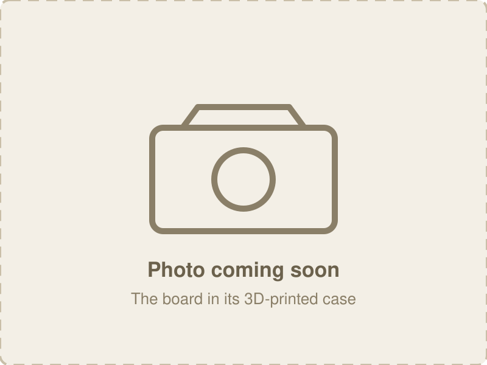
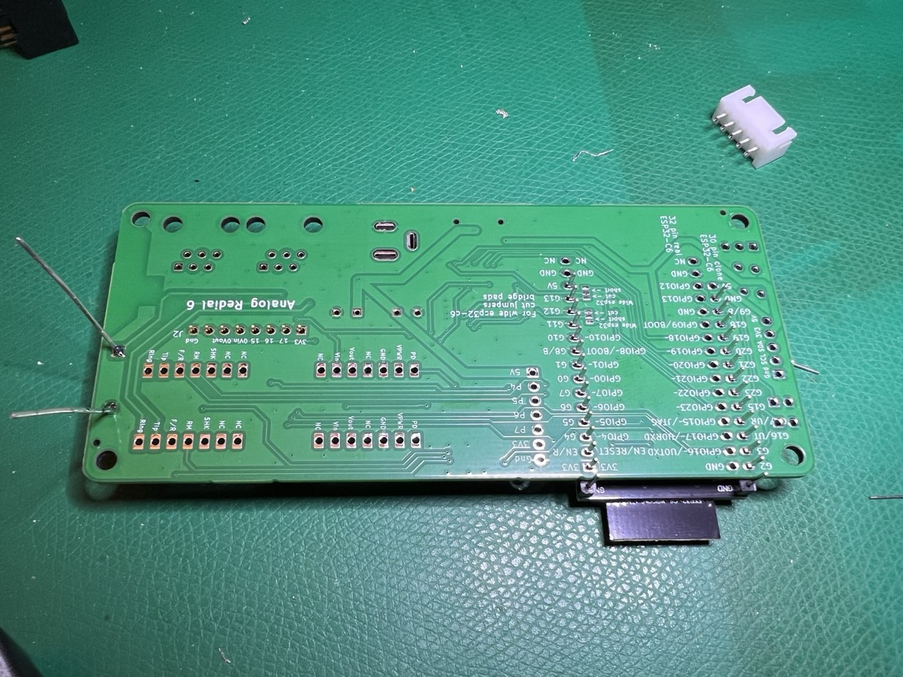
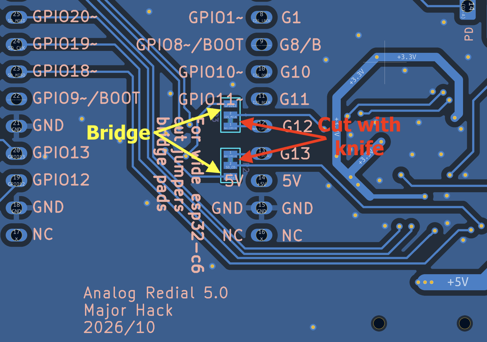
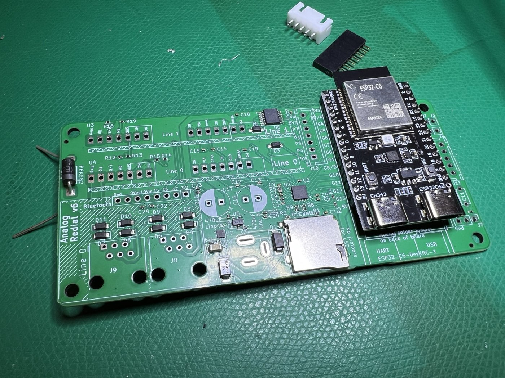
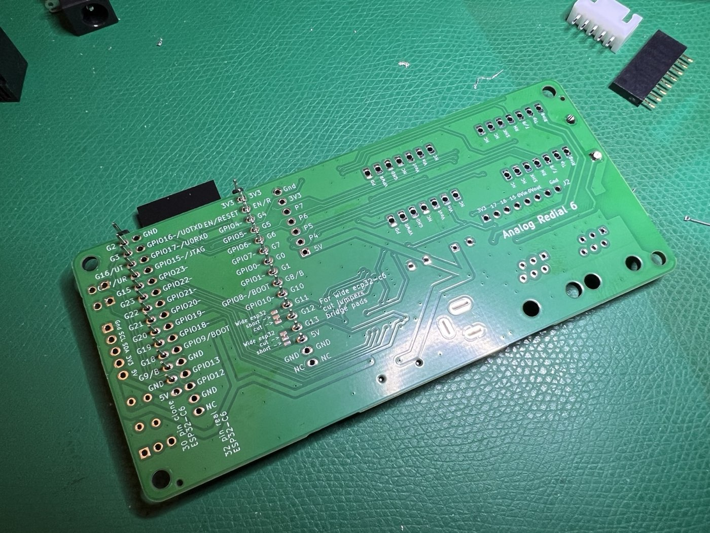
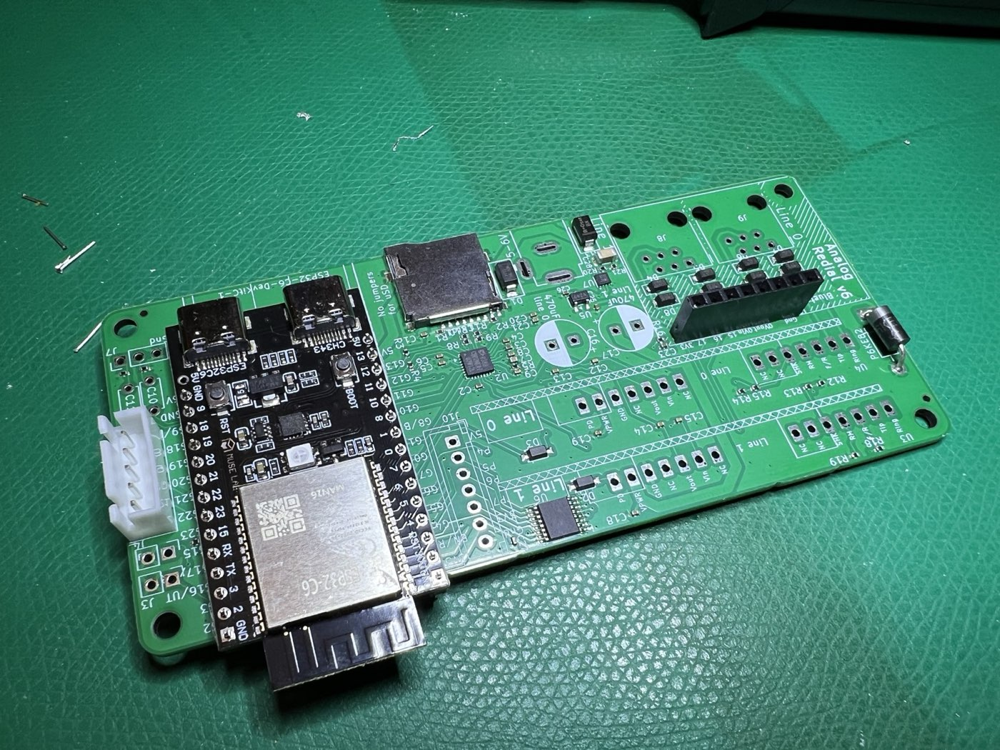
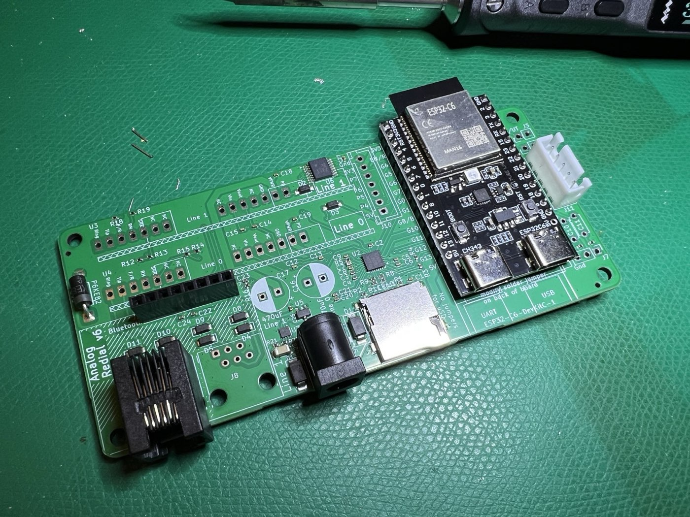
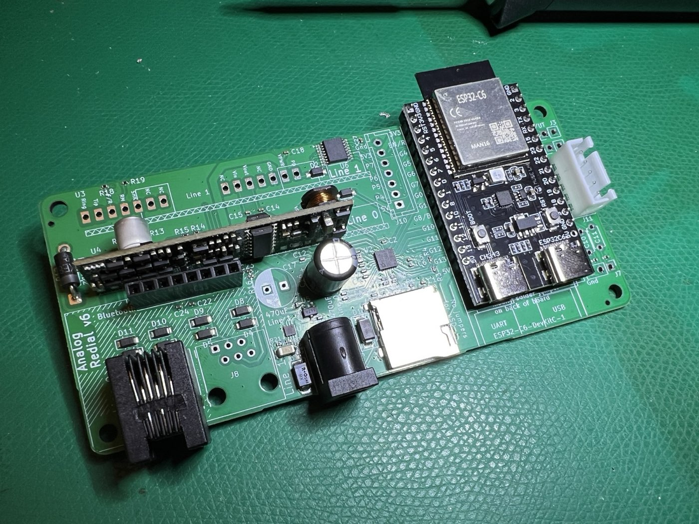
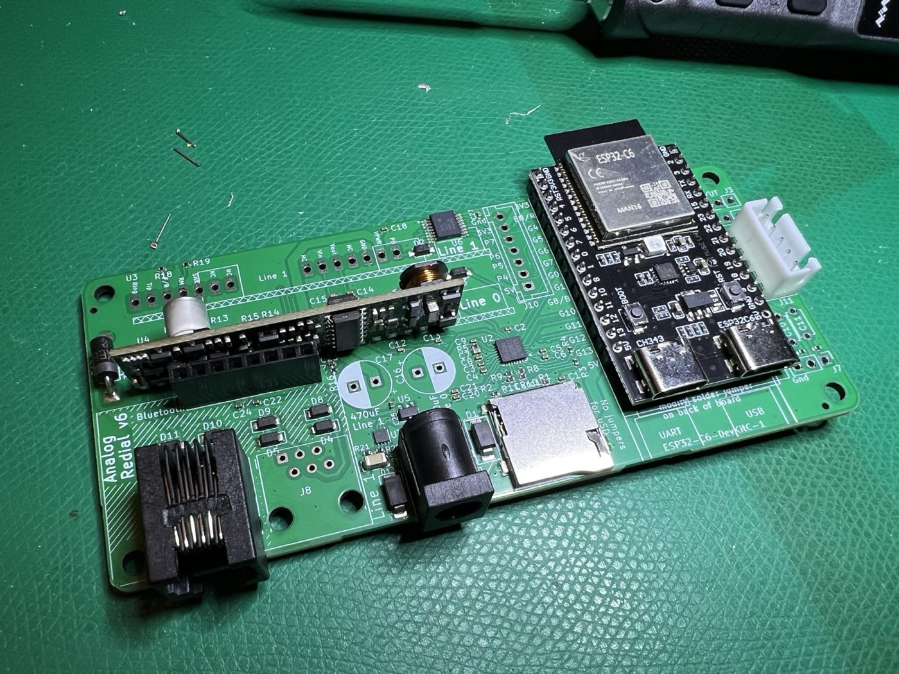
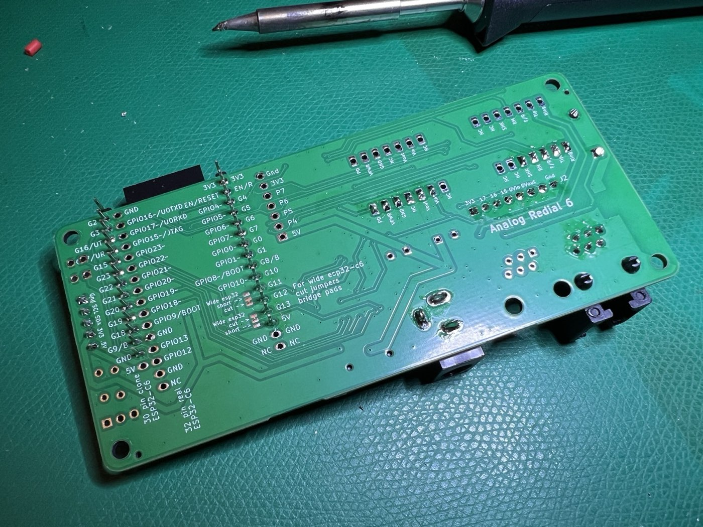

[Home](../README.md) · [1 · Get a board](board.md) · **2 · Parts & assembly** · [3 · Flash & test](flashing.md) · [4 · Set up & use](setup.md)

# Build a v6 board, step by step

> **v6 is the current board.** It's built and working: both phone lines, the codec, Wi-Fi and the
> payphone coin board. The microSD card and the J10 extra I/O haven't been checked on it yet. The
> photos on this page are from a one-line v6 build. Have a v5 or v5.1 board? Use
> [Build a v5 board](build-v5.md).

From a board that arrives from the fab with its surface-mount parts on (including U6, the
line 1 I/O expander) to a board ready to flash. Every part you add is through-hole. It's
the [v5 build](build-v5.md) with three differences: there's **no J5** (two lines and the
microSD card work together, nothing to set), there are two **JST headers** to add (J10 and
J11), and a clone module needs **no pin removed**. Board details:
[v6 board reference](hardware-smd6.md).

> ⚠️ **This board makes real telephone-line voltages:** about 48 V DC off-hook and about
> 60 V AC while ringing, with peaks near 90 V. Never connect its jacks to house or telco
> wiring, and don't touch the jack or SLIC pins while it's powered.

## 1. Choose your build

| Choice | Options |
|--------|---------|
| **Lines** | one (line 0) or two: the second line is U3, J8 and C17, with nothing else to set |
| **microSD** | with either: just put a card in |
| **Extra I/O (J10)** | fit it if you'll use the pin outputs |
| **Accessory header (J11)** | fit it for the payphone coin board or another I²C add-on |
| **Module** | genuine ESP32-C6-DevKitC-1, 32 pins (recommended), or a 30-pin clone with JP2/JP3 moved (step 1) |

## 2. Tools

- Soldering iron with a fine tip, and solder
- Flush cutters
- Multimeter (continuity and DC volts): not optional, see [section 5](#5-check-before-power)
- A craft knife, for the clone's solder jumpers only
- A 2 A USB-C charger, or a regulated 5-6 V DC supply (never 9 V or 12 V)
- An analog telephone with an RJ11/RJ12 cord

## 3. Components needed

The parts v5 and v6 share are in the [parts list](bom.md), with links.

| Ref | Part | Qty | Needed for | Notes |
|-----|------|-----|------------|-------|
| **U1** | ESP32-C6-DevKitC-1 (32-pin) or a 30-pin clone | 1 | every build | 16 MB recommended, 8 MB fine |
| **U4** | Silvertel AG1171 SLIC | 1 | every build | line 0 |
| **C16** | 470 µF 16 V radial electrolytic, 8 mm, 3.5 mm pitch | 1 | every build | line 0, polarized |
| **J9** | RJ12 jack, Amphenol 87180-062LF | 1 | every build | line 0 |
| **U3** | AG1171 SLIC | 1 | two lines | line 1 |
| **C17** | 470 µF 16 V radial | 1 | two lines | line 1, polarized |
| **J8** | RJ12 jack | 1 | two lines | line 1 |
| **J10** | JST XH 7-pin, vertical, **B7B-XH-A** | 1 | extra I/O | mates with an XHP-7 housing and SXH-001T-P0.6 crimps |
| **J11** | JST XH 5-pin, vertical, **B5B-XH-A** | 1 | payphone / I²C add-ons | mates with XHP-5; the coin board has the same header |
| **J1** | DC barrel jack, 5.5 × 2.1 mm | 1 | optional | recommended with the clone module |
| **D12** | P6KE82**A** TVS diode | 1 | optional, recommended | line protection, polarized |
| **J2** | 1×8 pin header, 2.54 mm | 1 | optional | for the Bluetooth board; pin 1 is 3.3 V |
| **J7** | 1×3 pin header | 1 | optional | audio monitor; needs C10, C11 |
| **C10**, **C11** | 1 µF film or ceramic, 5 mm pitch | 2 | optional | only with J7 |
| **J3**, **J4** | 1×2 pin header | 2 | optional | rarely useful: see the [v6 reference](hardware-smd6.md#8-mcu-module-variants) |
| | microSD card | 1 | optional | FAT-formatted |

## 4. Before you start

Look the board over: the fab has placed the codec, U6, the resistors and capacitors, the
microSD socket and the regulator. Find U1's outline, the two SLIC outlines, J10 and J11, and
on the back the two solder jumpers **JP2** and **JP3**.

<table>
  <tr>
    <td width="50%"></td>
    <td width="50%"></td>
  </tr>
  <tr>
    <td align="center">Top, as it arrives, U6 marked (<code>pics/build-v6/00-top.jpg</code>)</td>
    <td align="center">The back. JP2 and JP3 are the small pads labelled "Wide esp32 short / cut", between the module's rows (the module is already pushed through in this photo)</td>
  </tr>
</table>

## Steps

Lowest parts first, tallest last, so the board sits flat when it's upside-down on the bench
during soldering. For each part: push it in from the top, check it's flat and the right way
round, solder one pin, check again, then solder the rest and trim the leads.

### Step 1: JP2 and JP3 (30-pin clone only)

Skip this with the genuine 32-pin module.

On the back, each jumper has three pads, with pads 1 and 2 joined by a thin trace. For a
clone, **cut the trace between pads 1 and 2** with a craft knife, check with the meter that
they no longer connect, then **bridge pads 2 and 3** with a blob of solder. Do both, JP2 and
JP3. Never leave both sides bridged: that shorts a codec pin to a USB data line.

<table>
  <tr>
    <td width="50%"></td>
    <td width="50%"></td>
  </tr>
  <tr>
    <td align="center">Before: 1-2 joined (factory)</td>
    <td align="center">After: 1-2 cut, 2-3 bridged (<code>pics/build-v6/01-jp-after.jpg</code>)</td>
  </tr>
</table>

### Step 2: D12, line TVS diode (optional, recommended)

**Polarized:** the band on the diode goes to the band end of the silkscreen. Bend the leads
to the 10 mm hole spacing and lay it flat. Clip the leads after soldering them on the back
of the board.

*D12 at the left edge, leads not trimmed yet (this board had its module fitted first)*

There's no J5 on v6, so there's no 2×4 header to fit: two lines, the microSD card and the
spare pins (on J10) all work together.

### Step 3: U1, the ESP32-C6 module

Do the option for your ESP32 module.

<table>
  <tr>
    <td width="50%"></td>
    <td width="50%"></td>
  </tr>
  <tr>
    <td align="center">Option A: genuine DevKitC-1, 32 pins (<code>pics/build-v6/14-module-genuine.jpg</code>)</td>
    <td align="center">From the back, pins through and ready to solder</td>
  </tr>
</table>

#### Option A: genuine ESP32-C6-DevKitC-1 (32 pins)

1. Seat it as the silkscreen outline shows. The footprint
   takes both modules: the left row of holes is shared, and on the right there are two rows,
   one for each module's width, so the pins only drop in where they fit.
2. Solder one pin at each far corner. Check the module sits flat and square against the
   board, and reheat a corner to adjust if not.
3. Solder the rest.
4. Check that every pin is soldered, on the top side and the bottom side.

#### Option B: 30-pin clone

Step 1 (JP2, JP3) must be done first. **No pin is removed on v6**: its footprint has the
clone's 5V pins right.

1. Seat it as the silkscreen outline shows: **the module's top two pins hang off the top
   edge of the board.** On the right, its pins drop into the row of holes that matches its
   width.
2. Solder one pin at each far corner, check it's flat and square, then solder the rest.
3. Check that every pin is soldered, on the top side and the bottom side.

### Step 4: J1, DC jack, J2, Bluetooth header, and J10/J11, JST headers (optional)

Place the DC jack in its holes and solder it from the back: chunky pins, so use a hot iron
and give the solder a moment to flow into the slots. If you'll use the Bluetooth board, fit
its header (J2) at the same time: with both in, the board sits more level while you solder.
Pin 1 matches the silkscreen; it carries **3.3 V**, as on v5.

The two white JST headers go in now too, if you want them:

- **J10**, 7 pins, extra I/O. Pin 1 is +5 V and pin 7 GND.
- **J11**, 5 pins, the I²C accessory header for the payphone coin board. Pin 1 is GND and pin
  5 +5 V, the same numbering as the coin board's header, so the cable runs pin 1 to pin 1.

Both are shaped so a plug goes in only one way: match each header to its silkscreen outline
before soldering, or every cable will be reversed.

<table>
  <tr>
    <td width="50%"></td>
    <td width="50%"></td>
  </tr>
  <tr>
    <td align="center">J11 (white, beside the module) and J2 (black)</td>
    <td align="center">J1, the DC jack, beside the microSD socket (J9 is in too: step 5)</td>
  </tr>
</table>

### Step 5: RJ12 jacks and 470 µF capacitors

Place your RJ12 jacks: J9 for line 0, and J8 too for two lines. They snap in; check they sit
flat before soldering. Then the 470 µF capacitors, C16 for line 0 and C17 for line 1. **They're
polarized:** the negative side (the stripe, and the shorter lead) faces the white marking on
the board. Line 0 and Line 1 are labelled, so for a one-line board just use the holes on the
right.

*J9 at the front left, and C16 in the outline marked "line 0"; C17's outline beside it stays empty on a one-line board*

### Step 6: U4, AG1171 SLIC for line 0 (and U3 for line 1)

A 14-pin module that stands upright. **Note which way it faces before soldering:** the
module's circuit board goes on the RJ12 side of the pin holes, as in the picture.
Desoldering a 14-pin module is miserable. Solder one end pin, check it stands straight and
square, then the other end, then the rest. For two lines, fit U3 in the "Line 1" outline the
same way: on v6 it's driven by U6, so there's no jumper to set.

<table>
  <tr>
    <td width="50%"></td>
  </tr>
  <tr>
    <td align="center">U4 fitted in the "Line 0" outline</td>
  </tr>
</table>

## 5. Check before power

1. **Bridges:** look for solder joining neighbouring pins, above all on the RJ12 jacks, the
   JST headers and the module.
2. **Polarity:** C16/C17 stripes to the negative pads; D12's band at the silkscreen band.
3. **Shorts:** with the meter on continuity, +5 V to GND and 3.3 V to GND both read open. J10
   pins 1 (+5 V) and 6 (+3.3 V) to pin 7 (GND) are easy places to probe.
4. **JP2/JP3** (clone): one side of each bridged, never both.

*The back of a finished one-line board: check every joint before power*

## 6. First power-on

Nothing plugged into the phone jacks or J11 yet.

- Power from USB-C (or the DC jack with a regulated 5-6 V, 2 A supply). The module's LED comes on, and nothing gets warm. If
  anything does, unplug and go back to [section 5](#5-check-before-power).
- Measure +5 V and 3.3 V (J10 pins 1 and 6): both within a few percent.
- Then plug in a phone. It does nothing yet: there's no firmware.

*A finished one-line v6 board*

---

**Next: [3 · Flash & test](flashing.md)**, with `./flash_board.py --board smd6` (a new board
has no firmware to say what it is). Then the console's `line_exp` shows whether U6 answers,
and the self-test checks it.
