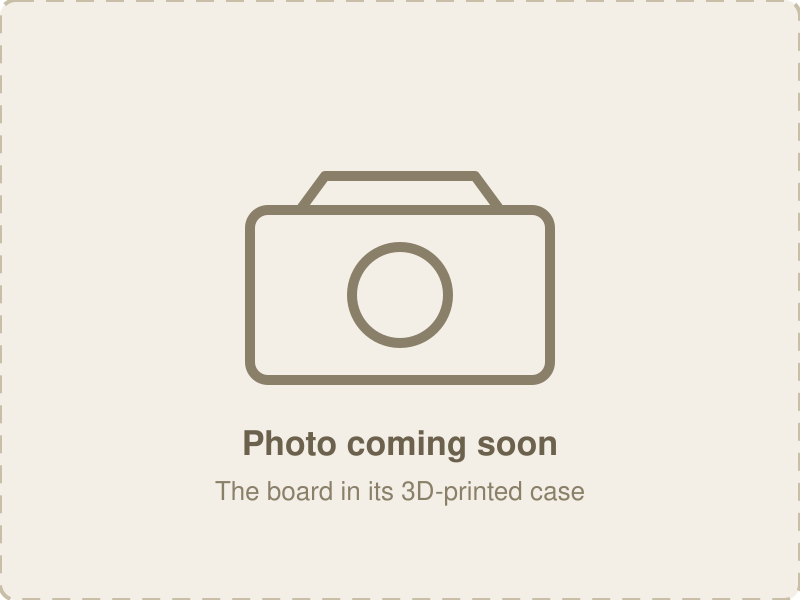

[Home](../README.md) · [1 · Get a board](board.md) · **2 · Parts & assembly** · [3 · Flash & test](flashing.md) · [4 · Set up & use](setup.md)

# Build a v6 board, step by step

> **In progress: not for use or fab.** No v6 board has been built yet. These steps are
> written from the design and will change after the first build. **v5** is the tested
> board: [Build a v5 board](build-v5.md).

From a board that arrives from the fab with its surface-mount parts on (including U6, the
line 1 I/O expander) to a board ready to flash. Every part you add is through-hole. It's
the [v5 build](build-v5.md) with three differences: there's **no J5** (two lines and the
microSD card work together, nothing to set), there are two **JST headers** to add (J10 and
J11), and a clone module needs **no pin removed**. Board details:
[v6 board reference](hardware-smd6.md).

> ⚠️ **This board makes real telephone-line voltages:** about 48 V DC off-hook and about
> 60 V AC while ringing, with peaks near 90 V. Never connect its jacks to house or telco
> wiring, and don't touch the jack or SLIC pins while it's powered.

## 1. Choose your build

| Choice | Options |
|--------|---------|
| **Lines** | one (line 0) or two: the second line is U3, J8 and C17, with nothing else to set |
| **microSD** | with either: just put a card in |
| **Extra I/O (J10)** | fit it if you'll use the pin outputs |
| **Accessory header (J11)** | fit it for the payphone coin board or another I²C add-on |
| **Module** | genuine ESP32-C6-DevKitC-1, 32 pins (recommended), or a 30-pin clone with JP2/JP3 moved (step 1) |

## 2. Tools

- Soldering iron with a fine tip, and solder
- Flush cutters
- Multimeter (continuity and DC volts): not optional, see [section 5](#5-check-before-power)
- A craft knife, for the clone's solder jumpers only
- A 2 A USB-C charger, or a regulated 5-6 V DC supply (never 9 V or 12 V)
- An analog telephone with an RJ11/RJ12 cord

## 3. Components needed

The parts v5 and v6 share are in the [parts list](bom.md), with links.

| Ref | Part | Qty | Needed for | Notes |
|-----|------|-----|------------|-------|
| **U1** | ESP32-C6-DevKitC-1 (32-pin) or a 30-pin clone | 1 | every build | 16 MB recommended, 8 MB fine |
| **U4** | Silvertel AG1171 SLIC | 1 | every build | line 0 |
| **C16** | 470 µF 16 V radial electrolytic, 8 mm, 3.5 mm pitch | 1 | every build | line 0, polarized |
| **J9** | RJ12 jack, Amphenol 87180-062LF | 1 | every build | line 0 |
| **U3** | AG1171 SLIC | 1 | two lines | line 1 |
| **C17** | 470 µF 16 V radial | 1 | two lines | line 1, polarized |
| **J8** | RJ12 jack | 1 | two lines | line 1 |
| **J10** | JST EH 7-pin, vertical, **B7B-EH-A** | 1 | extra I/O | mates with an EHR-7 housing and SEH-001T-P0.6 crimps |
| **J11** | JST EH 5-pin, vertical, **B5B-EH-A** | 1 | payphone / I²C add-ons | mates with EHR-5; the coin board has the same header |
| **J1** | DC barrel jack, 5.5 × 2.1 mm | 1 | optional | recommended with the clone module |
| **D12** | P6KE82**A** TVS diode | 1 | optional, recommended | line protection, polarized |
| **J2** | 1×8 pin header, 2.54 mm | 1 | optional | for the Bluetooth board; pin 1 is 3.6 V on v6 |
| **J7** | 1×3 pin header | 1 | optional | audio monitor; needs C10, C11 |
| **C10**, **C11** | 1 µF film or ceramic, 5 mm pitch | 2 | optional | only with J7 |
| **J3**, **J4** | 1×2 pin header | 2 | optional | rarely useful: see the [v6 reference](hardware-smd6.md#8-mcu-module-variants) |
| | microSD card | 1 | optional | FAT-formatted |

## 4. Before you start

Look the board over: the fab has placed the codec, U6, the resistors and capacitors, the
microSD socket and the regulator. Find U1's outline, the two SLIC outlines, J10 and J11, and
on the back the two solder jumpers **JP2** and **JP3**.

<table>
  <tr>
    <td width="50%"></td>
    <td width="50%"></td>
  </tr>
  <tr>
    <td align="center">Top, as it arrives, U6 marked (<code>pics/build-v6/00-top.jpg</code>)</td>
    <td align="center">Bottom, JP2 and JP3 circled (<code>pics/build-v6/00-bottom.jpg</code>)</td>
  </tr>
</table>

## Steps

Lowest parts first, tallest last. For each part: push it in from the top, check it's flat
and the right way round, solder one pin, check again, then solder the rest and trim.

### Step 1: JP2 and JP3 (30-pin clone only)

Skip this with the genuine 32-pin module.

On the back, each jumper has three pads, with pads 1 and 2 joined by a thin trace. For a
clone, **cut the trace between pads 1 and 2** with a craft knife, check with the meter that
they no longer connect, then **bridge pads 2 and 3** with solder. Both jumpers. Never leave
both sides bridged.

<table>
  <tr>
    <td width="50%"></td>
    <td width="50%"></td>
  </tr>
  <tr>
    <td align="center">Before: 1-2 joined (<code>pics/build-v6/01-jp-before.jpg</code>)</td>
    <td align="center">After: 1-2 cut, 2-3 bridged (<code>pics/build-v6/01-jp-after.jpg</code>)</td>
  </tr>
</table>

### Step 2: optional low headers: J7, J3, J4, and C10/C11

Only if you want them. C10 and C11 are non-polarized and only matter with J7.

*J7 with C10 and C11 (`pics/build-v6/02-j7.jpg`)*

### Step 3: D12, line TVS (optional, recommended)

**Polarized:** the band on the diode goes to the band end of the silkscreen.

*D12 (`pics/build-v6/03-d12.jpg`)*

### Step 4: J9, RJ12 jack for line 0

It snaps in; check it sits flat before soldering.

*J9 (`pics/build-v6/04-j9.jpg`)*

### Step 5: J8, RJ12 jack for line 1 (two lines)

As J9.

*J8 beside J9 (`pics/build-v6/05-j8.jpg`)*

### Step 6: C16, 470 µF for line 0

**Polarized:** the stripe (the negative, shorter lead) to the negative pad on the silkscreen.

*C16 (`pics/build-v6/06-c16.jpg`)*

### Step 7: C17, 470 µF for line 1 (two lines)

As C16.

*C17 (`pics/build-v6/07-c17.jpg`)*

### Step 8: U4, AG1171 SLIC for line 0

**Match pin 1 to the silkscreen before soldering.** Solder one end pin, check it stands
straight, then the other end, then the rest.

<table>
  <tr>
    <td width="50%"></td>
    <td width="50%"></td>
  </tr>
  <tr>
    <td align="center">Pin 1 on the module and the board (<code>pics/build-v6/08-u4-pin1.jpg</code>)</td>
    <td align="center">U4 fitted (<code>pics/build-v6/08-u4.jpg</code>)</td>
  </tr>
</table>

### Step 9: U3, AG1171 SLIC for line 1 (two lines)

As U4. On v6 it's driven by U6 rather than ESP32 pins, so there's no jumper to set.

*Both SLICs (`pics/build-v6/09-u3.jpg`)*

### Step 10: J10, extra I/O (optional)

JST EH, 7 pins. It's shaped so a plug goes in only one way: match the header to its
silkscreen outline before soldering, or every cable will be reversed. Pin 1 is +5 V and
pin 7 GND.

*J10 (`pics/build-v6/10-j10.jpg`)*

### Step 11: J11, I²C accessory header (optional)

JST EH, 5 pins, the same way as J10. Pin 1 is GND and pin 5 +5 V, the same numbering as the
coin board's header, so the cable runs pin 1 to pin 1.

<table>
  <tr>
    <td width="50%"></td>
    <td width="50%"></td>
  </tr>
  <tr>
    <td align="center">J11 fitted (<code>pics/build-v6/11-j11.jpg</code>)</td>
    <td align="center">With a cable plugged in (<code>pics/build-v6/11-j11-cable.jpg</code>)</td>
  </tr>
</table>

### Step 12: J1, DC jack (optional)

Recommended with the clone module. Use a hot iron; give the solder time to fill the slots.

*J1 (`pics/build-v6/12-j1.jpg`)*

### Step 13: J2, expansion header (optional)

For the Bluetooth board. Pin 1 matches the silkscreen; on v6 it carries **3.6 V**.

*J2 (`pics/build-v6/13-j2.jpg`)*

### Step 14: U1, the ESP32-C6 module

The tallest part, so it goes last. Do the option for your module.

<table>
  <tr>
    <td width="50%"></td>
    <td width="50%"></td>
  </tr>
  <tr>
    <td align="center">Option A: genuine DevKitC-1, 32 pins (<code>pics/build-v6/14-module-genuine.jpg</code>)</td>
    <td align="center">Option B: 30-pin clone (<code>pics/build-v6/14-module-clone.jpg</code>)</td>
  </tr>
</table>

#### Option A: genuine ESP32-C6-DevKitC-1 (32 pins)

1. Seat it as the silkscreen outline shows. The footprint takes both modules: the left row
   of holes is shared, and on the right there are two rows, one for each module's width, so
   the pins only drop in where they fit.
2. Solder one pin at each far corner, check it sits flat and square, then solder the rest.

*Genuine module fitted (`pics/build-v6/14a-genuine-fitted.jpg`)*

#### Option B: 30-pin clone

Step 1 (JP2, JP3) must be done first. **No pin is removed on v6**: its footprint has the
clone's 5V pins right.

1. Seat it as the silkscreen outline shows: on the right, its pins drop into the row of holes
   that matches its width.
2. Solder one pin at each far corner, check it's flat and square, then solder the rest.

*Clone fitted (`pics/build-v6/14b-clone-fitted.jpg`)*

## 5. Check before power

1. **Bridges:** look for solder joining neighbouring pins, above all on the RJ12 jacks, the
   JST headers and the module.
2. **Polarity:** C16/C17 stripes to the negative pads; D12's band at the silkscreen band.
3. **Shorts:** with the meter on continuity, +5 V to GND and 3.3 V to GND both read open. J10
   pins 1 (+5 V) and 6 (+3.3 V) to pin 7 (GND) are easy places to probe.
4. **JP2/JP3** (clone): one side of each bridged, never both.

*Checking +5 V to GND at J10 (`pics/build-v6/15-check.jpg`)*

## 6. First power-on

Nothing plugged into the phone jacks or J11 yet.

- Power from USB-C (or the DC jack). The module's LED comes on, and nothing gets warm. If
  anything does, unplug and go back to [section 5](#5-check-before-power).
- Measure +5 V and 3.3 V (J10 pins 1 and 6): both within a few percent.
- Then plug in a phone. It does nothing yet: there's no firmware.

*The finished board (`pics/build-v6/16-finished.jpg`)*

---

**Next: [3 · Flash & test](flashing.md)**, with `./flash_board.py --board smd6` (a new board
has no firmware to say what it is). Then the console's `line_exp` shows whether U6 answers,
and the self-test checks it.
