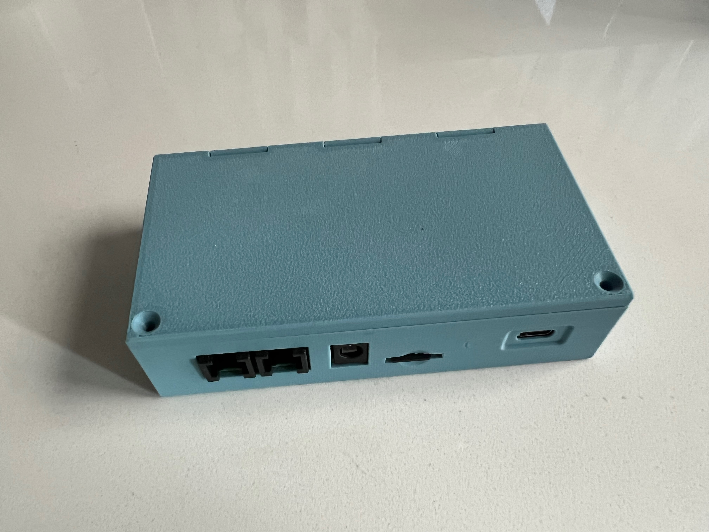

[Home](../README.md) · [1 · Get a board](board.md) · [2 · Parts & assembly](building.md) · [3 · Flash & test](flashing.md) · [4 · Set up & use](setup.md) · **Case**

# 3D-printed case

A two-part case, a box and a lid, that you print yourself. The boards are
different lengths, so **each board version has its own case**: a v4 case
will not fit a v5 or v6. **v5 and v6 boards both use the v5+ cases.**

<!-- TODO: photo of the finished board in its case (docs/pics/board_in_case.jpg) -->

*A v4 board in its case*

## Which case do I print?

| Board | Box | Lid | Status |
|-------|-----|-----|--------|
| **v4**, single line | `Box-SingleLine` | `Lid` | Ready |
| **v4**, dual line | `Box - dualLine` | `Lid` | Ready |
| **v5** and **v6**, one or two lines (5 mm longer than v4) | `Box-1Line` or `Box-2Lines`, in the `32pinESP32` or `30pinESP32` version | `Lid-withLogo` or `Lid-noLogo` | Ready. v6 has the same outline and mounting holes as v5, so it should fit; not tried on a v6 yet |

Print one box and one lid. The lid is the same for single-line and dual-line
boards.

## Files

Each part comes as a **STEP** file (for editing in CAD) and an **STL** file
(for slicing and printing).

### v4

| Part | STEP | STL |
|------|------|-----|
| Box, single line | [.step](https://github.com/sdylewski/Analog-Redial/blob/main/hardware/3d-printed-case/Analog%20Redial%20v4/AnalogRedial-4%20-%20Box-SingleLine.step) | [.stl](https://github.com/sdylewski/Analog-Redial/blob/main/hardware/3d-printed-case/Analog%20Redial%20v4/AnalogRedial-4%20-%20Box-SingleLine.stl) |
| Box, dual line | [.step](https://github.com/sdylewski/Analog-Redial/blob/main/hardware/3d-printed-case/Analog%20Redial%20v4/AnalogRedial-4%20-%20Box-%20DualLine.step) | [.stl](https://github.com/sdylewski/Analog-Redial/blob/main/hardware/3d-printed-case/Analog%20Redial%20v4/AnalogRedial-4%20-%20Box%20-%20dualLine.stl) |
| Lid | [.step](https://github.com/sdylewski/Analog-Redial/blob/main/hardware/3d-printed-case/Analog%20Redial%20v4/AnalogRedial-4%20-%20Lid.step) | [.stl](https://github.com/sdylewski/Analog-Redial/blob/main/hardware/3d-printed-case/Analog%20Redial%20v4/AnalogRedial-4%20-%20Lid.stl) |

<!-- TODO: photos of the v4 box (single-line and dual-line) and the lid -->

### v5 and v6

In [`hardware/3d-printed-case/Analog Redial v5+/`](https://github.com/sdylewski/Analog-Redial/tree/main/hardware/3d-printed-case/Analog%20Redial%20v5%2B),
in `STEP/` and `STL/` folders. The outside is 130 × 70 × 35 mm. Pick the box for the number
of phone lines you fitted and for the kind of ESP32 module on the board:

| Part | STEP | STL |
|---|---|---|
| Box, one line, real ESP32-C6-DevKitC-1 | [.step](https://github.com/sdylewski/Analog-Redial/blob/main/hardware/3d-printed-case/Analog%20Redial%20v5%2B/STEP/AnalogRedial-v5%20-%20Box-1Line-32pinESP32.step) | [.stl](https://github.com/sdylewski/Analog-Redial/blob/main/hardware/3d-printed-case/Analog%20Redial%20v5%2B/STL/AnalogRedial-v5%20-%20Box-1Line-32pinESP32.stl) |
| Box, one line, 30-pin clone module | [.step](https://github.com/sdylewski/Analog-Redial/blob/main/hardware/3d-printed-case/Analog%20Redial%20v5%2B/STEP/AnalogRedial-v5%20-%20Box-1Line-30pinESP32.step) | [.stl](https://github.com/sdylewski/Analog-Redial/blob/main/hardware/3d-printed-case/Analog%20Redial%20v5%2B/STL/AnalogRedial-v5%20-%20Box-1Line-30pinESP32.stl) |
| Box, two lines, real ESP32-C6-DevKitC-1 | [.step](https://github.com/sdylewski/Analog-Redial/blob/main/hardware/3d-printed-case/Analog%20Redial%20v5%2B/STEP/AnalogRedial-v5%20-%20Box-2Lines-32pinESP32.step) | [.stl](https://github.com/sdylewski/Analog-Redial/blob/main/hardware/3d-printed-case/Analog%20Redial%20v5%2B/STL/AnalogRedial-v5%20-%20Box-2Lines-32pinESP32.stl) |
| Box, two lines, 30-pin clone module | [.step](https://github.com/sdylewski/Analog-Redial/blob/main/hardware/3d-printed-case/Analog%20Redial%20v5%2B/STEP/AnalogRedial-v5%20-%20Box-2Lines-30pinESP32.step) | [.stl](https://github.com/sdylewski/Analog-Redial/blob/main/hardware/3d-printed-case/Analog%20Redial%20v5%2B/STL/AnalogRedial-v5%20-%20Box-2Lines-30pinESP32.stl) |
| Lid, with logo | [.step](https://github.com/sdylewski/Analog-Redial/blob/main/hardware/3d-printed-case/Analog%20Redial%20v5%2B/STEP/AnalogRedial-v5%20-%20Lid-withLogo.step) | [.stl](https://github.com/sdylewski/Analog-Redial/blob/main/hardware/3d-printed-case/Analog%20Redial%20v5%2B/STL/AnalogRedial-v5%20-%20Lid-withLogo.stl) |
| Lid, plain | [.step](https://github.com/sdylewski/Analog-Redial/blob/main/hardware/3d-printed-case/Analog%20Redial%20v5%2B/STEP/AnalogRedial-v5%20-%20Lid-noLogo.step) | [.stl](https://github.com/sdylewski/Analog-Redial/blob/main/hardware/3d-printed-case/Analog%20Redial%20v5%2B/STL/AnalogRedial-v5%20-%20Lid-noLogo.stl) |

**The USB hole.** The real ESP32-C6-DevKitC-1 has its USB-C connector at the edge of its
board, and the box has a normal-sized hole for the plug. The 30-pin clone modules have the
USB-C socket **recessed** from the edge, so the `30pinESP32` boxes have a **larger hole** that
lets a USB-C cable's plug reach in. Print the one that matches your module. With a plug that is
too wide for the hole on a real DevKitC box, the cable won't reach, so don't swap them.

The lid comes with the dial logo on it, or plain.

## What you need

- **4 × M3 screws, 5–6 mm long**, to mount the board in the box.
- A short piece of **3D-printer filament** (about 1.75 mm) for the hinge pin.

## Assembling it

1. Set the board in the box and fasten it with the four M3 screws. Use the
   short screws: a longer one can poke through the underside of the box.
2. Line up the lid's hinge with the box.
3. Push a piece of filament through the hinge as the pin, and trim it flush.

<!-- TODO: photos of the board in the open box and of the filament hinge pin -->

## Editing the design

The cases are designed in OnShape. The STEP files open in any CAD program.

<!-- TODO: link to the OnShape document, once it is made public -->

Made a better case, or one for a different phone? See
[CONTRIBUTING](https://github.com/sdylewski/Analog-Redial/blob/main/CONTRIBUTING.md).
