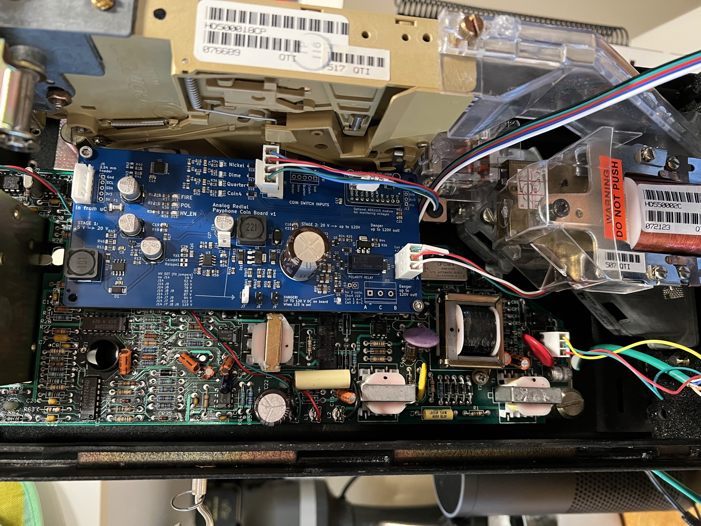

[Home](../README.md) · [1 · Get a board](board.md) · [2 · Parts & assembly](bom.md) · [3 · Flash & test](flashing.md) · [4 · Set up & use](setup.md)

# Board reference: payphone coin board

> **Built and working with one payphone.** The design and fab files are published
> ([KiCad project](https://github.com/sdylewski/Analog-Redial/tree/main/PayPhone/Payphone_coin_board_v1)).
> One board has been built and runs a GTE / Quadrum style payphone: it counts the phone's coins
> and collects and returns them. Other phones and relays haven't been tried yet. Values marked
> as measured come from that phone; the rest come from datasheets and arithmetic.

> ⚠️ **Danger: high voltage.** This board makes up to **119 V DC** and stores it in a 220 µF
> capacitor (C1). That can cause a painful shock, burns and serious injury, and in the wrong
> circumstances it can kill. Build and test it only if you are experienced with high-voltage
> circuits, and read [Safety first](#safety-first-high-voltage) before you power it. The board is
> a hobby prototype, uncertified and provided as is: you build and use it at your own risk.

The coin board connects a payphone's coin mechanism to Analog Redial. It does three jobs:

1. **Fires the coin relay** in either direction, to collect the coins in the hopper or return
   them, from a high voltage made on the board (52-119 V for the HD550002C relay, about 19 V
   for 12-24 V relays).
2. **Reads the coin switches:** 5, 10 and 25 cents, plus a fourth input for another coin or a
   coin acceptor.
3. **Talks to the main board over I²C**, on a 5-wire cable. The high voltage never goes down
   that cable: it exists only on the coin board and on the short wires to the coin relay.

It plugs into v6's **J11** I²C accessory header. It should also work on any board or
microcontroller with an I²C bus, 5 V and a 3.0-5.5 V logic supply.

## Safety first: high voltage

**What is dangerous.** With J14 fitted, the board charges C1 (220 µF, 200 V) to between 52 V and
119 V DC, set by the J7-J9 shunts. At 119 V that is about **1.6 joules** stored in a capacitor
that can deliver it in an instant. That is enough for a painful shock, a burn, or a muscle
jerk that throws your hand into something else, and it is more dangerous across the chest, with
wet skin, or for anyone with a heart condition or an implanted medical device. The same voltage
reaches the coin relay on the short wires from J2 or J11. With J14 off (the default) the
board makes only about 19 V.

**It stays charged after you switch it off.** The bleed resistors across C1 need about 33
seconds to take 119 V down to 24 V, and the red HV LED (D7) goes out at about 24 V. That is
not a safe voltage, and a failed bleed resistor or LED would hide a charged capacitor. Before
you touch the board or the relay wires:

1. Remove the 5 V power, then wait until D7 is dark and for a further minute.
2. **Measure C1 with a meter rated for the voltage** and wait for it to read under about 5 V.
3. If it doesn't fall, discharge it through a resistor of a few kΩ rated for several watts,
   held on insulated probes. Never short it with a screwdriver.

**While you work:**

- **Bring it up in stages.** Follow the first power-up steps in
  [section 9](#9-firmware-and-first-power-up). Keep **J14 off** until everything else works, and
  start from a current-limited 5 V supply.
- **Change shunts and wiring only when it is unplugged and C1 reads near zero.** That covers
  J7-J10, J14 and the relay wires.
- **Match the voltage to the relay.** A 12-24 V coil on the 52-119 V setting burns out the coil
  and can damage the board.
- **Use one hand** when you must probe a live board, with the other kept away from it. Work dry,
  with no loose jewellery or stray metal on the bench, and don't work alone.
- **Don't leave it powered and unattended** while it is a prototype, and keep children and pets
  away from it.
- **Enclose it.** Once it is working, mount it in an insulated housing, insulate and strain-relieve
  the relay wires, and make sure nobody can reach the board or those wires while it is powered.
- **Don't rely on the firmware for safety.** The board powers up with the high voltage off, the
  firmware only runs it for a collect or return, and D3 clamps a runaway supply. **Bench test
  mode** (on by default) stops the relay firing by itself while you test. But the firmware is not
  a safety system: treat every step as if the supply could come on.
- **If you get more than a tingle,** get medical attention even if you feel fine afterwards.

This design has been built and tested on one phone only, and it has no safety certification (UL, CE or
similar). It is a hobby prototype, not a consumer product, and it does not replace electrical
safety training. The same applies to anything you connect to it, including the payphone's own
wiring.

**No warranty.** The hardware design files and documentation are provided **as is**, without
warranty of any kind, express or implied, including fitness for a particular purpose. The
author is not liable for injury, death, fire or damage of any kind arising from building or
using this board or following this page. See the note in the repository's
[`LICENSE`](https://github.com/sdylewski/Analog-Redial/blob/main/LICENSE).

## 1. Overview

```
 Analog Redial (v6 J11)                COIN BOARD
 +5V  --- J6.5 ---> [stage 1: 5 V -> 20 V] ---> [stage 2: 20 V -> HV] ---> C1 (HV, 52-119 V)
 VIO  --- J6.4               ^ EN_HV                  ^ J14, J7-J9                 |
 SDA  --- J6.3 --+           |                                                     |
 SCL  --- J6.2 --+--> U1 TCA9534A (0x39): EN_HV, POL --> K1 polarity relay <--------+
 GND  --- J6.1   |                        FIRE --> Q3 firing switch --> R26 --> GND
                 |                        coin 4, quarter, dime, nickel <-- J3 / J12
                 +--> U4 ADS1115 (0x48): HV, 20 V rail, firing current, spare input (J13)

 K1 --> J2 / J11 --> the payphone's coin relay
```

| Part | Does |
|---|---|
| **U1** TCA9534A I/O expander, I²C 0x39 | reads the four coin inputs; drives EN_HV (supply on), POL (direction) and FIRE |
| **U2** MC34063, stage 1 | boosts 5 V to a 20 V rail, only while EN_HV is high |
| **U3** UC3843 + Q6, stage 2 | boosts 20 V to the high voltage on C1; J7-J9 set the voltage |
| **K1** DPDT relay | picks which coin-relay wire gets HV: collect or return |
| **Q3** with R26 | the firing switch: lets current through the coin relay for the length of the pulse, and R26 measures it |
| **U4** ADS1115 module | measures HV, the 20 V rail and the firing current, so the firmware knows the relay fired |
| **D8-D13, D15** | small green LEDs: one per coin input (blinks with a coin), and one each for FIRE, POL and EN_HV |
| **D7** | red HV LED, lit above about 24 V |

**Safe at power-up.** Pull-downs hold EN_HV, POL and FIRE low until the firmware drives them,
so nothing fires and there is no high voltage until the firmware asks for it. The supply runs
only for a collect or return, then turns off again.

## 2. Connectors

The payphone has two separate cables for this board: a 4-wire one from the coin switches and a
3-wire one from the coin relay.

| Ref | Part | Pins |
|---|---|---|
| **J6** | 5-pin header, 2.54 mm | **1 GND, 2 SCL, 3 SDA, 4 VIO, 5 +5 V**: the same pin numbers as v6's J11, so the cable is wired pin 1 to pin 1 |
| **J1** | JST XH 5-pin | the same five signals, in parallel with J6: fit whichever suits your cable |
| **J2** | Molex KK 396, 3-pin | **coin relay cable** (HD550002C): 1 green, 2 red (not connected), 3 white |
| **J11** | 3-pin screw terminal, 5.08 mm | the coin relay instead of J2: 1 coil A, 2 common (two-coil relays only, see J10), 3 coil B |
| **J3** | Molex KK 396, 4-pin | **coin switch cable**: 1 blue nickel, 2 red dime, 3 white quarter, 4 green common |
| **J12** | 5-pin screw terminal, 2.54 mm | coin inputs instead of J3: 1 GND, 2 coin 4, 3 quarter, 4 dime, 5 nickel |
| **J13** | 3-pin header | spare analog input: 1 VIO, 2 input (U4 AIN3), 3 GND |

**Jumpers:**

| Ref | What it does |
|---|---|
| **J14** | **HV boost.** No shunt (the default): stage 2 can't run and HV stays at about **19 V** whatever the firmware does, which suits 12-24 V coils. Fit it for the HD550002C and other high-voltage relays; J7-J9 then set the voltage |
| **J7-J9** | with J14 fitted, set the high voltage (table below) |
| **J10** | two-coil relays only: ties J11 pin 2 to HV, so the common wire is positive and K1 picks the coil |
| **JP1** | solder jumper, open. Bridge it only for a host that has no logic supply to give, to run U1 and U4 from 5 V |

| Shunts fitted | HV (about) |
|---|---|
| none (no J14) | **19 V**, stage 2 off |
| J14 | **52 V** |
| J14 + J9 | 60 V |
| J14 + J8 | 78 V |
| J14 + J8 + J9 | 85 V |
| J14 + J7 | 87 V |
| J14 + J7 + J9 | 94 V |
| J14 + J7 + J8 | 112 V |
| J14 + J7 + J8 + J9 | **119 V**, the maximum |

Every combination is valid and the same table is printed on the board. A missing or loose
shunt gives a lower voltage, never a higher one. The HD550002C moves at about 60 V on the bench,
but in the GTE / Quadrum phone, with its levers attached, it needs **87 V (J14 + J7)**: start a
new relay at 60 V and go up until the flap moves all the way.

## 3. The I²C bus and VIO

| Device | Address |
|---|---|
| ES8388 codec (main board) | 0x10 |
| TCA9534A, line 2 (main board v6) | 0x38 |
| **U1** TCA9534A (coin board) | **0x39** |
| **U4** ADS1115 (coin board) | **0x48** |

The main board has the I²C pull-ups, so the coin board's own (R42, R43) aren't fitted.

**VIO** is the main board's logic voltage, 3.3 V on Analog Redial. U1 and U4 run from it, so
they read and drive I²C at the host's own level, 3.3 V or 5 V, with nothing to set. The 5 V pin
powers only the converters and K1. VIO must be 3.0-5.5 V: below that the supply's switches and
the LEDs won't turn on.

## 4. The high-voltage supply

**Stage 1 (U2, MC34063)** boosts 5 V to 20 V. It has no enable pin, so EN_HV switches the
bottom of its feedback divider (Q1): with EN_HV low the converter stops, and the rail idles at
about 4.6 V (a boost converter always passes its input through).

**Stage 2 (U3, UC3843, with Q6 and L2)** boosts 20 V to HV on C1 (220 µF, 200 V). It runs from
the 20 V rail through J14, so it stops by itself when stage 1 is off. It charges C1 at about
2 W: a fraction of a second to 60 V, about a second to 119 V.

**Protection:**

- **D3** (SMBJ130A) clamps HV if the feedback loop fails, below the 200 V parts' limit.
- **Bleed resistors** across C1 drain it after EN_HV drops: 119 V falls below 24 V (D7 goes out)
  in about 33 s, and 60 V falls below 20 V in about 32 s.
- **F1**, a 1.1 A resettable fuse, on the 5 V input.

**Supply current:** charging C1 draws about 1 A peaks from the 5 V input for up to a second.
Idle, the board draws a few mA.

## 5. Firing the relay

A collect or return runs this sequence:

1. Set **POL** (K1's direction: which coin-relay wire gets HV).
2. Raise **EN_HV** and wait for HV, which U4 reads.
3. Pulse **FIRE**: Q3 lets current through the coin relay for the pulse length (100 ms by
   default, enough for the HD550002C: its coil is about 1.1 kΩ and very inductive, so the current
   builds over about 65 ms and the armature moves at about 65-70 ms, measured).
4. Drop FIRE, then EN_HV.

K1 only switches while no current flows, so its contacts never break the coil current. U4
measures the firing current across R26, and the HV drop on C1, so the firmware can tell
whether the relay fired. It drops FIRE early if the current looks like a short. **D14**
catches the coil's kick when Q3 turns off.

| POL | Coil A (J2/J11 pin 1, green) | Coil B (J2/J11 pin 3, white) |
|---|---|---|
| low (at power-up) | HV | return (through Q3) |
| high | return (through Q3) | HV |

On the GTE / Quadrum phone's HD550002C, with the cable plugged in as described above, the
default direction is correct: leave **"Collect and return are the wrong way round"** unticked.
If a relay moves the wrong way, tick it rather than rewiring.

**The HD550002C switches itself off.** A contact in series with its coil opens as it operates, and
stays open while the coin flap is down. The flap stays down after a fire until the next coin pushes
it back up, so a second Collect or Return in a row draws no current and does nothing; the firmware
reports "no current (latched down?)". A flap that won't come back up by itself needs its lever
cleaned and oiled: a stiff one sends every coin straight to the coin box.

**Two-coil relays** (separate collect and return coils on a common wire): wire them to J11
with the common on pin 2, and fit J10. The common is then always HV, and K1 picks which coil
fires.

## 6. Coin inputs

- The phone's coin switches are passive: green is the common, and it closes briefly to white,
  red or blue for a quarter, dime or nickel. The board ties the common to GND and pulls each
  line up to VIO. A closure reads low.
- Each line has a 1 ms RC filter and its own LED; the firmware polls every 3 ms and
  debounces. On the GTE / Quadrum phone each switch closes for 40-95 ms a coin (measured), with up
  to 3 ms of chatter on the quarter.
- **Coin 4** (J12 pin 2) is wired the same, for a 50¢ or $1 switch, a coin-present switch or a
  coin acceptor's pulse output. Set what it's worth on the Coin board card (0 means log it
  only).
- A Schottky diode (D16-D19) in each input lets the inputs take a switch to GND, an
  open-collector output or a logic output of **any voltage up to 40 V**, all active low. An
  active-high output needs its own inverter, and the inputs aren't protected against a
  negative voltage.

## 7. The cable to the main board

The cable carries only 5 V, VIO, GND, SDA and SCL. The only wires with high voltage are the
short ones from J2 or J11 to the relay.

- **Up to about 1 m** works at the firmware's 100 kHz I²C speed.
- **Twist SDA and SCL each with a ground wire,** or use shielded pairs, so the cable doesn't
  pick up the converters' switching noise.
- **Use 24 AWG or thicker** for 5 V and GND: charging C1 draws about 1 A peaks.
- If the main board's audio codec loses its settings when the cable is touched, the cable is
  loading the bus: an I²C buffer (TCA4307 or PCA9517 class) at the main-board end fixes that.
- **Crimps are the first thing to suspect.** U1 and U4 run from VIO (pin 4) and share the cable's
  ground, and a marginal VIO or GND wire still lets them answer on I²C. Check each of the five
  wires end to end (under 1 Ω with the board unpowered), and tug each pin in its housing.

## 8. Ordering and building

JLCPCB fabricates the board and places the surface-mount parts from the files in
[`jlcpcb/production_files/`](https://github.com/sdylewski/Analog-Redial/tree/main/PayPhone/Payphone_coin_board_v1/jlcpcb/production_files)
(gerbers, BOM and placement). You solder the rest:

- **Through-hole:** C1, K1, the connectors (J1/J6, J2/J11, J3/J12, J13), the jumper headers
  and shunts (J7-J10, J14), and U4: a ready-made ADS1115 module on a 10-pin header (a socket
  makes it easy to swap).
- **Surface-mount parts left off to save JLCPCB's Extended-part fees:** C5, C7, C14, C20
  (100 µF 50 V), U3 (UC3843 in SOIC-8), F1 and D3. All are large and easy to hand-solder.

Fit **J2 or J11** for the relay and **J3 or J12** for the coin switches, not both. Leave
**J14 off** for the first power-up.

Estimated cost for 5 boards: about **$40 a board**, delivered to the US with the hand-solder
parts. An estimate, not a quote.



*The v1 board mounted in the GTE / Quadrum phone on a 3D-printed bracket, with the coin switch cable (J3) and the relay cable (J2) plugged in.*

## 9. Firmware and first power-up

The firmware is on the **Payphone** tab (Settings → Payphone, marked Experimental). It has three
panes: **Settings**, **Log** and **Bring-up**. On Settings, turn on the Payphone features, then pick
the phone on the **Phone type** card: its housing, then what handles the coins. For a phone whose
coin switches and relay are wired to this board, choose "Coin switches and coin relay wired to the
coin board" and tick "A coin board is installed"; the settings that phone needs are filled in, and
cards that don't apply are hidden ("Show all settings" brings them back). For a phone nobody has
tried, choose "Other, or not sure" and set everything by hand. The **Coin board** card then has the
line, the relay pulse and the swap. The console has the same tests as
`coinboard [collect|return|hv]`.

**Bench test mode**, at the top of the Bring-up pane, is on until you turn it off: while it is on,
the relay never fires by itself, whatever coins or calls do (a coin switch shorted on the bench
would otherwise return a coin at full HV), but the test buttons work. Turn it off when the phone is
ready to run.

The **Bring-up** pane runs the steps below as a checklist and marks each one pass or fail from the
board's own readings: whether U1 and U4 answer, the idle rail, each coin switch seen, the HV test's
peak rail and HV against the shunts you've fitted, the firing current into a load, and HV bleeding
down afterwards. A live line at the top shows the 20 V rail, HV and the coil current, and the
**Collect**, **Return** and **HV on for 10 s** buttons (the last charges without firing, to read the
voltage) are in the steps. Step 5 has a pulse-length box for that test only, and after each Collect or Return the card plots the coil
current through the pulse (about every 1.7 ms) with HV beside it, so you can see when the relay's own
contact cuts the current and how far C1 sagged. The **Log** pane has the coin count, the simulate buttons and the log.

Suggested first power-up, one step at a time:

1. No relay, J14 off. Connect the cable and tick "A coin board is connected": the card should
   show U1 and U4 answering and the 20 V rail at about 4.6-4.9 V, with HV a little
   lower (both stages pass the 5 V through while idle). I²C works without the 5 V, so this
   reading is what shows the 5 V wire is good.
2. Close each coin switch by hand: the card shows it, and the log counts a coin.
3. **HV on for 10 s**, still with J14 off: about 20 V on the rail and 19 V on HV. Check both with a
   meter.
4. A 100 Ω 5 W resistor (or a 12-24 V coil) on J11: Collect and Return should read a current.
5. Fit J14 + J9 (60 V) and the coin relay: HV on, then Collect and Return, watching the coin flap
   and the current plot. If the flap doesn't move all the way, go up a voltage before lengthening
   the pulse (the GTE / Quadrum phone needs 87 V at 100 ms). Drop a coin between tests to reset a
   relay that switches itself off.
6. Turn Bench test mode off, lift the handset, drop coins and make a call: the Log pane shows each
   coin, and each collect or return with its reason.

### If a coin isn't counted

Step 3 of the Bring-up pane shows, for each coin input, the coins counted, the closures too short to
count, and the longest closure seen. The **Coin switch capture** card below it finds the cause: choose 2-5 coins of each kind, press Start, and
drop the nickels, dimes and quarters it asks for. It reads the four inputs every 0.2 ms and shows, for each
kind, how long the switch stays closed (minimum, average and maximum), how the contacts bounce, and how many
of the coins the board would count. A closure under about 3 ms is "too short" (the normal polling is every
3 ms); a coin that closes the wrong input means two wires are swapped (check the plug is the right way
round: J3's green wire is pin 4); nothing on any input means it never reached the board (a wire or crimp, or
a sensor that isn't a plain contact). A plug forced in backwards gives a telltale pattern: the nickel still counts but the dime and
quarter don't. On the GTE / Quadrum phone the three switches stay closed for 40-95 ms a coin, far longer than
the board needs.

### If it is flaky: check VIO and ground first

U1 and U4 need **VIO to stay above 3.0 V** (U4's own minimum is 2.0 V) with a clean ground. Measure
VIO to GND at the coin board's J6 (or J1) pins 4 and 1 while the HV test runs, and compare it with the
main board's J11 pins 4 and 1: they should agree within 0.1 V. The bring-up card's step 0 counts I²C
errors while the page is open.

| What you see | Likely cause |
|---|---|
| The log keeps showing "coin board stopped answering" then "answering"; the I²C error count climbs | VIO or GND open or intermittent at a crimp or the connector |
| "The coin board lost power" or "lost its settings" when K1 clicks (Return) or stage 1 starts | the supply sags under load: a thin or poorly crimped VIO, GND or 5 V wire, or a weak 3.3 V source on the main board |
| The EN_HV LED blinks and goes out; the HV test ends early | U1 reset, for the same reason |
| The rail reads about 14 V when a meter says 19-20 V, and HV reads high (about 1.7 times) | U4 is below its 2.0 V minimum, so its readings are wrong |
| VIO is 0 V at the coin board but 3.3 V at the main board | a bad crimp, or a pin not seated in the housing |
| VIO is under about 3.0 V even at the main board | the module's own 3.3 V regulator is the limit; a clone module's is smaller than the DevKitC-1's |

## See also

- [Coin board: design, wiring and parts](https://github.com/sdylewski/Analog-Redial/blob/main/PayPhone/docs/coin-board.md): every part value, how each stage works,
  the output stage pin by pin, the parts list and the layout
- [Payphone project overview](https://github.com/sdylewski/Analog-Redial/blob/main/PayPhone/README.md): the pieces, status, what each known payphone needs,
  and other payphone projects (PhilTel, Futel and more)
- [telesfor.org payphone wiki](https://telesfor.org/payphones/doku.php?id=smart): smart (COCOT) and
  coin-line payphones, their makers and boards, and how to program them; a good place to identify a phone
- [Payphone firmware](https://github.com/sdylewski/Analog-Redial/blob/main/PayPhone/docs/payphone-firmware.md): the Payphone tab and the coin board's driver
- [Schematic (PDF)](https://github.com/sdylewski/Analog-Redial/blob/main/PayPhone/Payphone_coin_board_v1/Payphone_coin_board_v1_schematic.pdf)
- [Board reference: v6](hardware-smd6.md), whose J11 header the coin board plugs into
