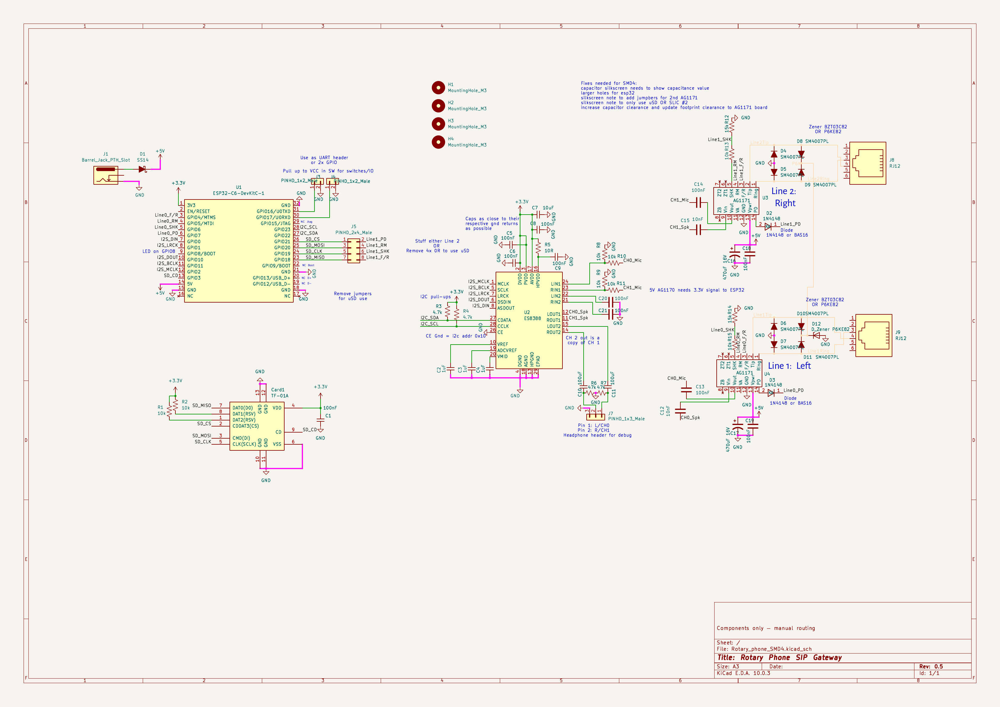
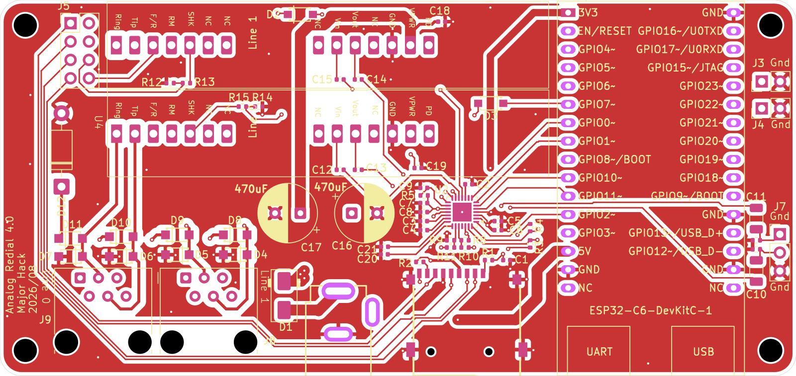

# Hardware Reference — SMD4 Board

Design reference for the current production board: a 2-layer, ESP32-C6-based
analog-phone-line gateway carrying one or two POTS lines through Silvertel
AG1171 SLICs and an Everest ES8388 stereo codec. This document describes the
board as it is today — it is not a changelog against earlier spins.

KiCad project: `hardware/kicad/Rotary_phone_SMD4/`. The custom symbols and
footprints it uses (SLICs, RJ12 jacks, ESP32-C6 modules) are
maintained separately and shared across boards:
[sdylewski/MajorHack-Kicad-Libraries](https://github.com/sdylewski/MajorHack-Kicad-Libraries) —
grab that too if you want to open the schematic for editing, not just view
or order it.

**No Bluetooth on this board.** The BM64 companion needs a dedicated 3.3 V
rail, a GPIO for its MFB pin and an 8-pin board-to-board header, none of
which SMD4 has — fitting one means hand-wiring and board modifications. It's
designed in on the next spin: see [`hardware-smd5.md`](hardware-smd5.md).

## 1. Board overview

| Item | Detail |
|------|--------|
| MCU carrier | **ESP32-C6-DevKitC-1** — a complete dev board (own USB-C port, reset button, onboard 3.3 V regulator), header/socket-mounted rather than a soldered module |
| Codec | **ES8388** stereo codec, QFN-28, I²C address **0x10** (CE tied to GND) |
| SLIC | 1–2× **Silvertel AG1171**, SIL package, hand-soldered |
| Storage | Internal SPI flash (SPIFFS) always; optional **microSD** (SPI) on single-line builds |
| Power input | **USB-C** (via the DevKit's own port) **or** a **DC jack**, diode-ORed onto one +5 V rail |
| Copper | **2 layers** (`F.Cu`, `B.Cu`) |
| Board size | ~100 × 50 mm |
| Connectors | RJ12 ×1–2 (phone lines), USB-C, DC jack, microSD (optional) |

The schematic is the same circuit across the SMD3/SMD4 spins — SMD4 changes
only the PCB layout, re-routing the same nets onto 2 copper layers instead of
4 (see [§7, 2-layer PCB notes](#7-2-layer-pcb-notes)) and adding a microSD
card-detect connection SMD3 left unwired.

Reference designators below follow the current schematic: **U1** = the
ESP32-C6-DevKitC-1 carrier, **U3**/**U4** = the two AG1171 SLICs, **J8**/**J9**
= their RJ12 jacks, **J1** = the DC jack, **D1** = the power diode-OR diode,
**J5** = the line-1/microSD jumper header, **Card1** = the microSD socket.

## 2. Schematic and layout

This doc used to carry a full pin-by-pin table for every connector on the
board. That table was really just a hand-copy of the schematic, which goes
stale the moment the schematic changes — easier, and more trustworthy, to
look at the real thing. What follows is the schematic and the top copper
layer; open the KiCad project (above) for the bottom layer, 3D view, or to
trace any net not called out below.

**Schematic:**



**PCB layout, top copper/silkscreen:**



## 3. Power tree

Two 5 V sources feed one board-level **+5 V** rail through a diode-OR, so
either input works alone and neither can back-feed the other:

```text
USB-C (DevKit's own port) ──► DevKit onboard 5V/3.3V reg ──► DevKit 3V3 pin
                                                                    │
J1 (DC jack) ──[D1, Schottky, cathode → +5V]──┐                    │
                                               ▼                    ▼
                                        board +5V rail ──────► ES8388, I²C
                                               │                pull-ups
                                               └──────────────► U3/U4 +VPWR (SLICs)
```

- **USB-C** power comes in through the DevKit module's own USB-C connector
  and is regulated by the DevKit's own onboard supply — nothing on the
  carrier PCB does that conversion.
- **DC jack (J1)** is an alternative 5 V input, isolated from USB-C by a
  series Schottky diode (**D1**, same SS14 class used elsewhere on this
  design), cathode toward +5 V. Whichever source is present (or higher)
  supplies the rail; the diode blocks reverse current into the other source.
- The diode drops roughly 0.3–0.5 V. If the DC supply needs to clear the
  DevKit onboard regulator's minimum input headroom after that drop, spec
  the DC brick a bit above 5 V (5.5–6 V) rather than exactly 5 V — check the
  specific DevKit module's onboard regulator datasheet for its minimum input.
- **No separate 3.3 V LDO on this board.** The carrier PCB's 3.3 V rail
  (ES8388 + its I²C pull-ups, and any other 3.3 V logic on the PCB) is drawn
  directly from the DevKit module's own 3.3 V output pin.
- The raw **+5 V** rail (before the DevKit's regulator) also feeds each
  AG1171's **+VPWR**, with local bulk capacitance at each SLIC.
- The DevKit module's own **EN/RESET** is left unconnected on the carrier —
  the module already has its own pull-up and reset button onboard.

## 4. J5: line-1 SLIC vs. microSD (jumper-selected)

GPIO18–21 are wired to the microSD socket directly; line 1's SLIC control
signals (F/R, RM, PD, SHK) are brought out to a second row on header **J5**
(2×4, 0.1"). Bridging shunts across each pair on **J5** routes those four
GPIOs to line 1's SLIC instead of the microSD card:

| J5 pin | Signal | J5 pin | Signal |
|--|--|--|--|
| 1 | GPIO21 (SD CS) | 2 | Line 1 PD |
| 3 | GPIO20 (SD MOSI) | 4 | Line 1 RM |
| 5 | GPIO19 (SD CLK) | 6 | Line 1 SHK |
| 7 | GPIO18 (SD MISO) | 8 | Line 1 F/R |

Bridge 1-2, 3-4, 5-6, 7-8 to enable line 1 and disable the microSD socket;
leave all four open (no jumper block populated) to use the microSD socket
instead. Without a jumper installed, line 1 has no GPIO path at all — see
[§8, build variants](#8-build-variants) for how this pairs with which
hardware gets stuffed.

## 5. ES8388 codec

One stereo codec serves both phone lines over a single I²S bus: line 0 uses
the codec's left channel, line 1 uses the right channel — each with its own
dedicated ADC input and DAC output, so both lines' receive audio digitizes
simultaneously every I²S frame. I²S (MCLK/BCLK/LRCK/DIN/DOUT) and I²C
(SDA/SCL, address `0x10`) wiring is standard and visible in the schematic
above — nothing SMD4-specific about it.

I²S: 48 kHz, 16-bit stereo, ESP32 as master, codec as slave — one LRCK frame
carries one line-0 sample and one line-1 sample. No on-chip crystal; MCLK
comes entirely from the ESP32 I²S master.

**Single-ended inputs only.** Each line's receive audio lands on its own
dedicated ADC pin (LIN1 for line 0, RIN1 for line 1) — the codec's second
ADC input pair (LIN2/RIN2) isn't used for audio on this board.

### Grounding (DGND / AGND / HPGND)

All three of the codec's ground pins, plus its exposed pad, tie to the same
board **GND** plane — they are not isolated nets on this PCB. The split
exists inside the package so digital switching noise doesn't ride on
sensitive analog references; on the PCB, route each bypass cap's ground
terminal to the nearest matching pin for the shortest loop, then stitch the
pins together at the codec.

Any monitor header on the codec's second output pair returns to the same
GND plane, at or near HPGND — do not float a monitor jack on a separate
ground island.

## 6. AG1171 SLIC & RJ12 wiring

Each SLIC (**U4** = line 0, **U3** = line 1) interfaces one RJ12 jack (**J9**
line 0, **J8** line 1) with the following support network. This is the
current, corrected wiring — earlier hand-soldered revisions had a SLIC
Vin/Vout swap and a mono-mic-capture bug; both are fixed as of this design,
so only the corrected circuit is described below.

| Signal | Wiring |
|--------|--------|
| **+VPWR** | Board **+5 V** rail, with local **470 µF** electrolytic bulk capacitance per SLIC plus a 100 nF bypass close to the SLIC's power pins |
| **PD** (power-down) | Driven from an ESP32 GPIO through a series diode only (1N4148W-class, cathode toward the PD pin) — **no pull-up or pull-down resistor**. Per the AG1171 datasheet, PD should never be pulled to a logic high; GPIO low = power-down, GPIO high (diode blocks, PD floats) = run |
| **SHK** (hook status) | AG1171 SHK is a ~3.3 V logic output with an internal 3.3 kΩ pull-up (datasheet: VOH 2.8 V min) — **not** 5 V, whichever rail the SLIC runs from. See [§7 below](#7-shk-divider-rework-smd4-as-built) for the as-built value and the fix |
| **F/R** (ring cadence), **RM** (ringing mode) | Driven directly as 3.3 V ESP32 GPIO outputs — no level shifting needed, since these are ESP32-driven control inputs on the SLIC, not SLIC-driven signals |
| **VIN** (needs external drive) | Fed from the codec's DAC output for that line through a coupling capacitor |
| **VOUT** (SLIC-driven) | Feeds the codec's ADC input for that line through a coupling capacitor and series resistor |
| **Tip/Ring** | Straight from the RJ12 jack to the SLIC, with a surge clamp hanging off it — the AG1171 datasheet's own Figure 4 protection circuit. One unidirectional TVS (**D12**, P6KE82A) clamps that bus for both lines. |


## 7. SHK divider rework (SMD4 as built)

**Remove R14 and R12**, the two 15 kΩ resistors in the hook-switch dividers.

The 15 kΩ pull-down makes the off-hook level ~1.9 V, below the ESP32-C6's
guaranteed input-high threshold of 2.475 V. It shows up as a line whose
`hookmon` never sees the handset lift while its audio path works fine; on
the first board where this was diagnosed, line 0 (GPIO6) happened to read
1.9 V as high and line 1 (GPIO19) didn't. Fix: **change the 15 kΩ to
100 kΩ** (≈2.9 V off-hook; the 100 kΩ still gives a defined low when the
SLIC is powered down), or on an existing board simply **remove the 15 kΩ**
(≈3.1–3.2 V; the 10 kΩ stays in series as current protection). Both are
safe: SHK can't exceed its own ~3.3 V internal pull-up, under the ESP32's
3.6 V absolute maximum.

**Which parts to lift:** the 15 kΩ pull-downs are **R14** (line 0) and
**R12** (line 1). The 10 kΩ series resistors — **R15** (line 0) and **R13**
(line 1) — stay put. Removing both 15 kΩ resistors is **confirmed working on
real hardware** (2026-09-27): a board where line 1 had never registered a
handset lift read both lines correctly afterwards, with no other change.

**SMD5 fixes this in the design** (10 kΩ / 100 kΩ), so no rework there.

**Mounting:** the AG1171 is a through-hole SIL module — hand-soldered even
on this SMD board.

## 8. Build variants

One PCB, two stuffing options, selected by which SLIC/jack/socket parts are
populated and whether **J5**'s jumpers are bridged:

| Build | Populate | Leave unpopulated | J5 jumpers | Firmware |
|-------|----------|--------------------|------------|----------|
| **A — Dual line** | **U4**/**J9** (line 0, always), **U3**/**J8** (line 1) | **Card1** (microSD) | **Bridged** (1-2, 3-4, 5-6, 7-8) — routes GPIO18–21 to line 1's SLIC | `CONFIG_BOARD_NUM_LINES=2`, `CONFIG_BOARD_MICROSD=0` |
| **B — Single line + microSD** | **U4**/**J9** (line 0 only), **Card1** | **U3**, **J8** (line 1) | **Open** (no jumper block) — routes GPIO18–21 to the microSD socket | `CONFIG_BOARD_NUM_LINES=1`, `CONFIG_BOARD_MICROSD=1` |

Line 0 (**U4**/**J9**) is wired to its own fixed GPIOs and is present on
every build. Line 1 and microSD are mutually exclusive: whichever one you
want, populate its parts and set **J5** to match. Card-detect (microSD pin
9 → GPIO3) means firmware checks for a card before touching the SPI bus, so
a missing card is reported cleanly instead of a failed mount attempt.

## 9. 2-layer PCB notes

This board routes on 2 copper layers (`F.Cu`/`B.Cu`) rather than 4. Standard
2-layer tradeoffs apply and are worth keeping in mind when reviewing or
modifying the layout:

- **No dedicated ground/power plane** — GND is a deliberately-poured zone on
  one side with stitching vias tying the two layers together, rather than a
  continuous internal plane. Worth confirming a continuous GND pour exists
  under the audio path (SLIC VIN/VOUT, ES8388 analog pins) specifically,
  since a broken return path there shows up as noise/crosstalk rather than a
  dead short.
- **Current-carrying nets** — the +5 V feed to the AG1171s' VPWR doesn't have
  a plane to spread heat or voltage drop across; size that trace with normal
  2-layer current-carrying practice rather than assuming a plane will help.
- **EMI/crosstalk** is generally higher on 2 layers than 4 for the same
  routing density, since there's no plane between signal layers to shield
  one from another. Not disqualifying for this design — control signals and
  audio-band I²S are not high-speed enough to be fussy about it — just worth
  a visual check on the copper pour rather than assuming it's a wash.

## 10. Board size & connectors

| Item | Detail |
|------|--------|
| Board size | **110 × 54 mm**, 2-layer |
| Phone lines | RJ12 ×1 (single-line build) or ×2 (dual-line build), **J9**/**J8** |
| Power | USB-C (via the DevKit module's own port) and DC jack (**J1**), diode-ORed |
| Storage | microSD, optional, single-line build only |
| Debug | UART header (**J3** TX / **J4** RX), optional |

---

## See also

| Doc | What's in it |
|-----|--------------|
| [`building.md`](building.md) | Hand-solder order, pre-power checks, first power-on |
| [`bom.md`](bom.md) | Parts list / shopping checklist |
| [`hardware-smd5.md`](hardware-smd5.md) | The next spin: Bluetooth, LDO, dual MCU footprint |
| [`getting-started.md`](getting-started.md) | Toolchain, flashing, first boot |
| [`../archive/signal-levels.md`](../archive/signal-levels.md) | Audio/logic levels reference |
| `hardware/kicad/Rotary_phone_SMD4/` | The KiCad project itself — the real source of truth for anything not covered above |
