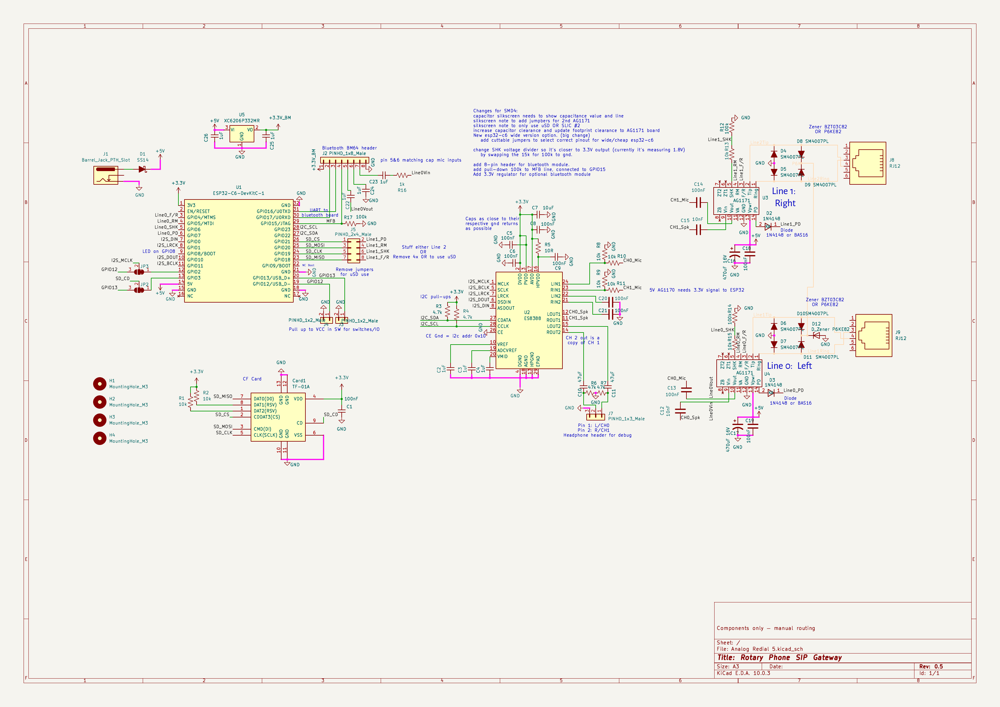
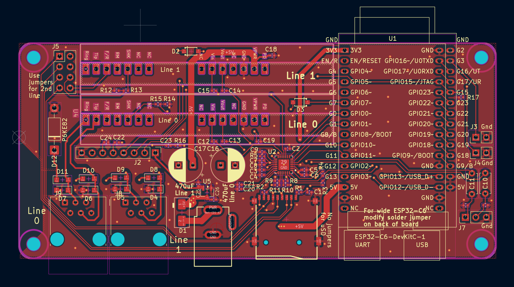
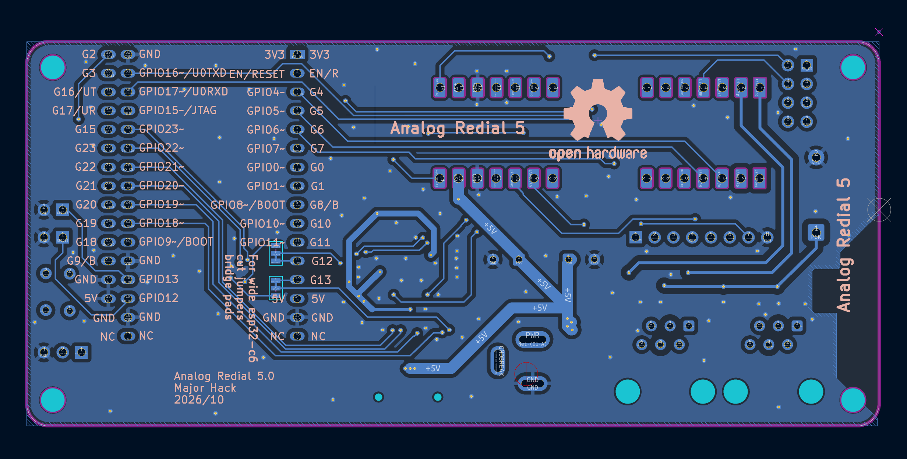
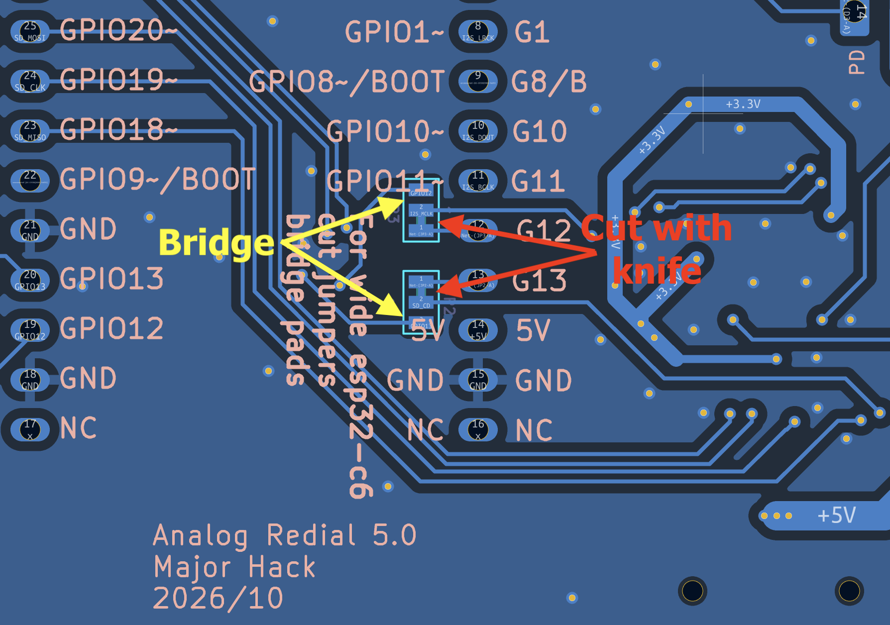

[Home](../README.md) · [1 · Get a board](board.md) · [2 · Parts & assembly](bom.md) · [3 · Flash & test](flashing.md) · [4 · Set up & use](setup.md)

# Board reference: v5 (SMD5) · coming soon

> **v5 is at the fab and not yet tested.** For a proven board, build
> [v4](hardware-smd4.md). Everything here that isn't listed as new against
> v4 carries over from v4 unchanged.

> ⚠️ **v5 board error with the 30-pin clone module: read before soldering.** On the v5 PCB the clone's
> **bottom-right 5V pin** is wired to **GND** (the footprint is wrong for the clone's pinout). If you fit a
> clone, **take that pin out**: cut it off the module, or leave it unsoldered, so it doesn't connect to the
> board at all. The **bottom-left 5V pin** is then the module's only 5 V connection, and it is enough. Left
> in, the pin shorts the 5 V rail to ground. With the power off, check with a meter that the 5 V pin has no
> continuity to ground. The genuine 32-pin DevKitC-1 is not affected. The next board revision (v6) fixes the footprint.

Design reference for the next-generation board: a 2-layer, ESP32-C6-based
analog-phone-line gateway carrying one or two POTS lines through Silvertel
AG1171 SLICs and an Everest ES8388 stereo codec, plus an optional Bluetooth
companion.

KiCad project: [`hardware/kicad/Analog Redial v5`](https://github.com/sdylewski/Analog-Redial/tree/main/hardware/kicad/Analog%20Redial%20v5). Its custom symbols and
footprints (SLICs, RJ12 jacks, ESP32-C6 modules, BM64) are maintained
separately and shared across boards:
[sdylewski/MajorHack-Kicad-Libraries](https://github.com/sdylewski/MajorHack-Kicad-Libraries) —
grab that too if you want to open the schematic for editing, not just view
or order it.

## What's new against SMD4

| Change | Why |
|--------|-----|
| **Bluetooth companion header (J2)** | 8-pin board-to-board link to a BM64 carrier — see §9 |
| **Dedicated 3.3 V LDO (U5)** for the BM64 | Keeps the module's radio bursts off the DevKit's own regulator |
| **MFB on GPIO15** with a 100 kΩ pull-down | The BM64's power button needs firmware control and must idle low |
| **SHK divider 15 kΩ → 100 kΩ** | Fixes SMD4's as-built off-hook level, which sat below the ESP32's input-high threshold |
| **Dual MCU footprint** | Takes the genuine 32-pin DevKitC-1 *or* a 30-pin AliExpress clone — see §10 |
| **C10/C11 → 5 mm disc footprint, DNP** | Drops an Extended part; fit 1 µF only if you want the J7 monitor header |
| **Board grew to 115 × 54 mm** | 5 mm longer than SMD4 — **needs its own enclosure**, an SMD4 case won't fit |

## 1. Board overview

| Item | Detail |
|------|--------|
| MCU carrier | **ESP32-C6-DevKitC-1** — a complete dev board (own USB-C port, reset button, onboard 3.3 V regulator), header/socket-mounted rather than a soldered module |
| Codec | **ES8388** stereo codec, QFN-28, I²C address **0x10** (CE tied to GND) |
| SLIC | 1–2× **Silvertel AG1171**, SIL package, hand-soldered |
| Storage | Internal SPI flash (SPIFFS) always; optional **microSD** (SPI) on single-line builds |
| Power input | **USB-C** (via the DevKit's own port) **or** a **DC jack**, diode-ORed onto one +5 V rail |
| Bluetooth | Optional **BM64** companion carrier, via **J2** — see §9 |
| Copper | **2 layers** (`F.Cu`, `B.Cu`) |
| Board size | **115 × 54 mm** |
| Connectors | RJ12 ×1–2 (phone lines), USB-C, DC jack, microSD (optional), BM64 header (optional) |

Reference designators below follow the current schematic: **U1** = the
ESP32-C6-DevKitC-1 carrier, **U3**/**U4** = the two AG1171 SLICs, **J8**/**J9**
= their RJ12 jacks, **J1** = the DC jack, **D1** = the power diode-OR diode,
**J5** = the line-1/microSD jumper header, **Card1** = the microSD socket,
**J2** = the Bluetooth companion header, **U5** = the BM64's 3.3 V LDO.

## 2. Schematic and layout

The schematic and top copper layer are below; open the KiCad project
(above) for the bottom layer, the 3D view, or to trace any net not called
out here.

**Schematic:**



**PCB layout, top copper/silkscreen:**



## 3. Power tree

Two 5 V sources feed one board-level **+5 V** rail through a diode-OR, so
either input works alone and neither can back-feed the other:

```text
USB-C (DevKit's own port) ──► DevKit onboard 5V/3.3V reg ──► DevKit 3V3 pin
                                                                    │
J1 (DC jack) ──[D1, Schottky, cathode → +5V]──┐                    │
                                               ▼                    ▼
                                        board +5V rail ──────► ES8388, I²C
                                               │                pull-ups
                                               ├──────────────► U3/U4 +VPWR (SLICs)
                                               └──────────────► U5 (BM64 LDO) ──► +3V3_BM
```

- **USB-C** power comes in through the DevKit module's own USB-C connector
  and is regulated by the DevKit's own onboard supply — nothing on the
  carrier PCB does that conversion.
- **DC jack (J1)** is an alternative 5 V input, isolated from USB-C by a
  series Schottky diode (**D1**, same SS14 class used elsewhere on this
  design), cathode toward +5 V. Whichever source is present (or higher)
  supplies the rail; the diode blocks reverse current into the other source.
- The diode drops roughly 0.3–0.5 V. If the DC supply needs to clear the
  DevKit onboard regulator's minimum input headroom after that drop, spec
  the DC brick a bit above 5 V (5.5–6 V) rather than exactly 5 V — check the
  specific DevKit module's onboard regulator datasheet for its minimum input.
- **No separate 3.3 V LDO for the main board logic.** The carrier PCB's
  3.3 V rail (ES8388 + its I²C pull-ups, and any other 3.3 V logic on the
  PCB) is drawn directly from the DevKit module's own 3.3 V output pin.
  **SMD5 adds a second, dedicated 3.3 V LDO (U5)** off the raw +5 V rail,
  purely for the BM64 — see §9.
- The raw **+5 V** rail (before the DevKit's regulator) also feeds each
  AG1171's **+VPWR**, with local bulk capacitance at each SLIC.
- The DevKit module's own **EN/RESET** is left unconnected on the carrier —
  the module already has its own pull-up and reset button onboard.

## 4. J5: line-1 SLIC vs. microSD (jumper-selected)

GPIO18–21 are wired to the microSD socket directly; line 1's SLIC control
signals (F/R, RM, PD, SHK) are brought out to a second row on header **J5**
(2×4, 0.1"). Bridging shunts across each pair on **J5** routes those four
GPIOs to line 1's SLIC instead of the microSD card:

| J5 pin | Signal | J5 pin | Signal |
|--|--|--|--|
| 1 | GPIO21 (SD CS) | 2 | Line 1 PD |
| 3 | GPIO20 (SD MOSI) | 4 | Line 1 RM |
| 5 | GPIO19 (SD CLK) | 6 | Line 1 SHK |
| 7 | GPIO18 (SD MISO) | 8 | Line 1 F/R |

Bridge 1-2, 3-4, 5-6, 7-8 to enable line 1 and disable the microSD socket;
leave all four open (no jumper block populated) to use the microSD socket
instead. Without a jumper installed, line 1 has no GPIO path at all — see
[§7, build variants](#7-build-variants) for how this pairs with which
hardware gets stuffed.

## 5. ES8388 codec

One stereo codec serves both phone lines over a single I²S bus: line 0 uses
the codec's left channel, line 1 uses the right channel — each with its own
dedicated ADC input and DAC output, so both lines' receive audio digitizes
simultaneously every I²S frame. I²S (MCLK/BCLK/LRCK/DIN/DOUT) and I²C
(SDA/SCL, address `0x10`) wiring is standard and visible in the schematic
above — unchanged from SMD4.

I²S: 48 kHz, 16-bit stereo, ESP32 as master, codec as slave — one LRCK frame
carries one line-0 sample and one line-1 sample. No on-chip crystal; MCLK
comes entirely from the ESP32 I²S master.

**Single-ended inputs only.** Each line's receive audio lands on its own
dedicated ADC pin (LIN1 for line 0, RIN1 for line 1) — the codec's second
ADC input pair (LIN2/RIN2) isn't used for audio on this board.

### Grounding (DGND / AGND / HPGND)

All three of the codec's ground pins, plus its exposed pad, tie to the same
board **GND** plane — they are not isolated nets on this PCB. The split
exists inside the package so digital switching noise doesn't ride on
sensitive analog references; on the PCB, route each bypass cap's ground
terminal to the nearest matching pin for the shortest loop, then stitch the
pins together at the codec.

Any monitor header on the codec's second output pair returns to the same
GND plane, at or near HPGND — do not float a monitor jack on a separate
ground island.

## 6. AG1171 SLIC & RJ12 wiring

> **Never connect the RJ12 jacks to a wall jack or a telephone-company line.**
> Each one is a telephone-company side (FXS) interface, not a line input: it
> supplies about 48 V DC off-hook and about 72 V when ringing, which can injure
> someone and damage the telephone network. The board is only for connecting to
> phones directly.

Each SLIC (**U4** = line 0, **U3** = line 1) interfaces one RJ12 jack (**J9**
line 0, **J8** line 1) with the following support network.

| Signal | Wiring |
|--------|--------|
| **+VPWR** | Board **+5 V** rail, with local **470 µF** electrolytic bulk capacitance per SLIC plus a 100 nF bypass close to the SLIC's power pins |
| **PD** (power-down) | Driven from an ESP32 GPIO through a series diode only (1N4148W-class, cathode toward the PD pin) — **no pull-up or pull-down resistor**. Per the AG1171 datasheet, PD should never be pulled to a logic high; GPIO low = power-down, GPIO high (diode blocks, PD floats) = run |
| **SHK** (hook status) | AG1171 SHK is a ~3.3 V logic output with an internal 3.3 kΩ pull-up (datasheet: VOH 2.8 V min) — **not** 5 V, whichever rail the SLIC runs from. **SMD5 uses a 10 kΩ / 100 kΩ divider**, giving ~2.9 V off-hook — comfortably above the ESP32-C6's 2.475 V input-high threshold (0.75 × VDD). This fixes SMD4's as-built 10 kΩ / 15 kΩ divider, which landed at ~1.9 V and only worked on some pads by luck |
| **F/R** (ring cadence), **RM** (ringing mode) | Driven directly as 3.3 V ESP32 GPIO outputs — no level shifting needed, since these are ESP32-driven control inputs on the SLIC, not SLIC-driven signals |
| **VIN** (needs external drive) | Fed from the codec's DAC output for that line through a coupling capacitor |
| **VOUT** (SLIC-driven) | Feeds the codec's ADC input for that line through a coupling capacitor and series resistor |
| **Tip/Ring** | Straight from the RJ12 jack to the SLIC, with a surge clamp hanging off it — the AG1171 datasheet's own Figure 4 protection circuit. Each line has a 4-diode bridge (M7/1N4007-class, D4–D11) that steers every tip and ring conductor two ways: down to GND (D4–D7) if it goes below ground, and up to a shared `/P6K` bus (D8–D11) if it goes too far positive. **One** unidirectional TVS (**D12**, P6KE82A, cathode on `/P6K`, anode on GND) clamps that bus for both lines — the datasheet's "only one needed per line card". The bridge isn't in series with the line, and it isn't there for wiring polarity |

```text
+5V ──► +VPWR (SLIC)      470µF + 100nF locally at each SLIC

ESP32 GPIO ── PD net ──►|──► PD pin      (diode only — cathode toward PD, no pull-up)

ESP32 GPIO ◄── SHK ── 10k ──┬── (from SLIC SHK pin, ~3.3 V logic)
                           100k   ← SMD5's fixed value
                             │
                            GND

ESP32 GPIO ─────────────► F/R    (output — ring cadence)
ESP32 GPIO ─────────────► RM     (output — ringing mode)

Codec DAC out ──[coupling cap]──► SLIC VIN
SLIC VOUT ──[coupling cap + series R]──► Codec ADC in

Tip/Ring ◄──► RJ12 jack
              │
              ├── [M7 ×2 per conductor] ──► GND      (clamps below ground)
              └── [M7 ×2 per conductor] ──► /P6K ──[D12 P6KE82A]──► GND   (one TVS, both lines)
```

**SHK divider: fixed on SMD5**, unlike SMD4. SMD4's as-built 15 kΩ
pull-down makes the off-hook level ~1.9 V, below the ESP32-C6's guaranteed
input-high threshold of 2.475 V — SMD5 uses 100 kΩ instead (≈2.9 V
off-hook), designed in rather than needing a rework. See
[`hardware-smd4.md`](hardware-smd4.md) §7 for the full story if you're
comparing against an SMD4 board.

**Mounting:** the AG1171 is a through-hole SIL module — hand-soldered even
on this SMD board.

## 7. Build variants

One PCB, two stuffing options, selected by which SLIC/jack/socket parts are
populated and whether **J5**'s jumpers are bridged:

| Build | Populate | Leave unpopulated | J5 jumpers | Firmware |
|-------|----------|--------------------|------------|----------|
| **A — Dual line** | **U4**/**J9** (line 0, always), **U3**/**J8** (line 1) | **Card1** (microSD) | **Bridged** (1-2, 3-4, 5-6, 7-8) — routes GPIO18–21 to line 1's SLIC | `CONFIG_BOARD_NUM_LINES=2`, `CONFIG_BOARD_MICROSD=0` |
| **B — Single line + microSD** | **U4**/**J9** (line 0 only), **Card1** | **U3**, **J8** (line 1) | **Open** (no jumper block) — routes GPIO18–21 to the microSD socket | `CONFIG_BOARD_NUM_LINES=1`, `CONFIG_BOARD_MICROSD=1` |

Line 0 (**U4**/**J9**) is wired to its own fixed GPIOs and is present on
every build. Line 1 and microSD are mutually exclusive: whichever one you
want, populate its parts and set **J5** to match. Card-detect (microSD pin
9 → GPIO3) means firmware checks for a card before touching the SPI bus, so
a missing card is reported cleanly instead of a failed mount attempt.

## 8. 2-layer PCB notes

This board routes on 2 copper layers (`F.Cu`/`B.Cu`) rather than 4. Standard
2-layer tradeoffs apply and are worth keeping in mind when reviewing or
modifying the layout:




- **No dedicated ground/power plane** — GND is a deliberately-poured zone on
  one side with stitching vias tying the two layers together, rather than a
  continuous internal plane. Worth confirming a continuous GND pour exists
  under the audio path (SLIC VIN/VOUT, ES8388 analog pins) specifically,
  since a broken return path there shows up as noise/crosstalk rather than a
  dead short.
- **Current-carrying nets** — the +5 V feed to the AG1171s' VPWR doesn't have
  a plane to spread heat or voltage drop across; size that trace with normal
  2-layer current-carrying practice rather than assuming a plane will help.
- **EMI/crosstalk** is generally higher on 2 layers than 4 for the same
  routing density, since there's no plane between signal layers to shield
  one from another. Not disqualifying for this design — control signals and
  audio-band I²S are not high-speed enough to be fussy about it — just worth
  a visual check on the copper pour rather than assuming it's a wash.

## 9. Bluetooth companion header (J2)

**SMD5 addition.** An 8-pin board-to-board header links a BM64 Bluetooth
Classic audio carrier to the main board. The carrier is a separate PCB
(`Bluetooth/Bluetooth_board/`), sent to fabrication alongside SMD5 and not
yet tested — the web UI's Bluetooth tab marks the feature "experimental, not
mainstream yet" for that reason. Fitting this on SMD4 instead means serious hand-wiring,
not a drop-in option.

**Which module.** The **BM64** carrier is the tested, supported choice (about $14). The next option
to try is the **DFRobot DFR0781 (BT401)** module, about $3.50, hand-wired to the same header; it has a
text command set with call control, and is not yet tested here. A cheaper BK3266-type module was tried
and did not work as intended (see `Bluetooth/BK3266/` in the repository).

The status LED shows pairing/connection state once this is fitted and
working — see [the status light reference](setup.md#7-the-status-light).

| J2 pin | Net | Carrier side | Notes |
|--------|-----|--------------|-------|
| 1 | `+3V3_BM` | BM64 `BAT_IN` | From **U5**, a dedicated XC6206 LDO off +5 V — not the DevKit's 3.3 V rail |
| 2 | GPIO17 / U0RXD | BM64 `HCI_TXD` | ESP receives |
| 3 | GPIO16 / U0TXD | BM64 `HCI_RXD` | ESP transmits |
| 4 | `MFB` (GPIO15) | BM64 `MFB` | Power button / UART wake, 100 kΩ pull-down on the main board |
| 5 | via **C22** 1 µF ← `Line0Vin`'s SLIC `VOUT` | BM64 `MIC_P1` | Handset mic → Bluetooth |
| 6 | via **C24** 1 µF ← GND | BM64 `MIC_N1` | AC ground for the differential mic input |
| 7 | via **C23** 1 µF → **R16** 1 kΩ → `Line0Vin` | BM64 `AOHPL` | Bluetooth audio → earpiece. The 1 kΩ limits fault current into the SLIC |
| 8 | GND | GND | |

Audio never passes through firmware — both directions are analog, between
the BM64 and line 0's SLIC. The ESP32 only carries control over the UART.

**Orientation matters.** Pin 1 is +3.3 V and pin 8 is GND, so mating the two
boards rotated 180° shorts the LDO output straight to ground. Mark pin 1 on
both silkscreens and dry-fit before applying power.

**Bluetooth is SMD5-only.** On SMD4 it takes hand-wiring and board
modifications, which is why [`hardware-smd4.md`](hardware-smd4.md) doesn't
describe it.

## 10. MCU module variants

> ⚠️ **v5 board error with the 30-pin clone module: read before soldering.** On the v5 PCB the clone's
> **bottom-right 5V pin** is wired to **GND** (the footprint is wrong for the clone's pinout). If you fit a
> clone, **take that pin out**: cut it off the module, or leave it unsoldered, so it doesn't connect to the
> board at all. The **bottom-left 5V pin** is then the module's only 5 V connection, and it is enough. Left
> in, the pin shorts the 5 V rail to ground. With the power off, check with a meter that the 5 V pin has no
> continuity to ground. The genuine 32-pin DevKitC-1 is not affected. The next board revision (v6) fixes the footprint.


The footprint accepts two modules, and they are **not** pin-compatible:
pad positions 12/13 and 19/20 swap between vendors.

| Pad | Genuine ESP32-C6-DevKitC-1 | 30-pin AliExpress clone |
|-----|---------------------------|--------------------------|
| 12 | `GPIO2` (I²S MCLK) | `GPIO12` / USB D− |
| 13 | `GPIO3` (microSD card-detect) | `GPIO13` / USB D+ |
| 19 | `GPIO12` / USB D− | `GPIO2` |
| 20 | `GPIO13` / USB D+ | `GPIO3` |

Two 3-pad solder jumpers take care of the only two nets affected:
**JP3** routes `I2S_MCLK` and **JP2** routes the microSD card-detect to
either pad 12/13 (genuine module, bridged by default) or pad 19/20 (clone).
Set correctly, both land on the module's GPIO2/GPIO3, so both variants use
the normal `CONFIG_BOARD_TYPE_SMD5` build with native USB working.

| Jumper | Net | Default (pads 1–2 bridged) | Clone (cut 1–2, bridge 2–3) |
|--------|-----|---------------------------|------------------------------|
| **JP3** | `I2S_MCLK` | pad 12 | pad 19 |
| **JP2** | `SD_CD` | pad 13 | pad 20 |

<table>
  <tr>
    <td width="50%"></td>
    <td width="50%"></td>
  </tr>
  <tr>
    <td align="center">Modification needed for cheap 30-pin esp32-c6-devkit</td>
    <td align="center">add photo of finished rework</td>
  </tr>
</table>

Bridge one side only: both sides together short GPIO2 to a USB data line.
(`CONFIG_BOARD_TYPE_SMD5_CHEAP` remains for a clone board with the jumpers
left at the default, which costs native USB.) Full detail, including the
symptoms of getting it wrong, is in
[`archive/hardware/smd5.md`](https://github.com/sdylewski/Analog-Redial/blob/main/archive/hardware/smd5.md).

## 11. Board size & connectors

| Item | Detail |
|------|--------|
| Board size | **115 × 54 mm**, 2-layer — **5 mm longer than SMD4** (110 × 54 mm), so an SMD4 enclosure will not fit |
| Phone lines | RJ12 ×1 (single-line build) or ×2 (dual-line build), **J9**/**J8** |
| Power | USB-C (via the DevKit module's own port) and DC jack (**J1**), diode-ORed |
| Storage | microSD, optional, single-line build only |
| Bluetooth | BM64 companion via **J2**, optional — §9 |
| Debug | UART header (**J3** TX / **J4** RX), optional |

---

## See also

| Doc | What's in it |
|-----|--------------|
| [`hardware-smd4.md`](hardware-smd4.md) | The current, fabricated-and-tested board |
| [`building.md`](building.md) | Hand-solder order, pre-power checks, first power-on |
| [`bom.md`](bom.md) | Parts list / shopping checklist |
| [`archive/hardware/smd5.md`](https://github.com/sdylewski/Analog-Redial/blob/main/archive/hardware/smd5.md) | Dev notes: jumper plan, MCU footprint details, open questions |
| [KiCad project](https://github.com/sdylewski/Analog-Redial/tree/main/hardware/kicad/Analog%20Redial%20v5) | The real source of truth for anything not covered above |
