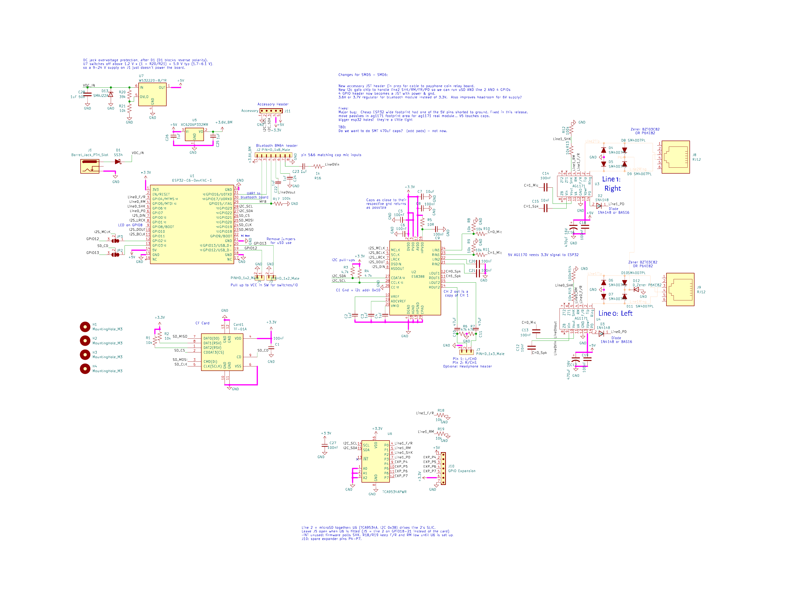
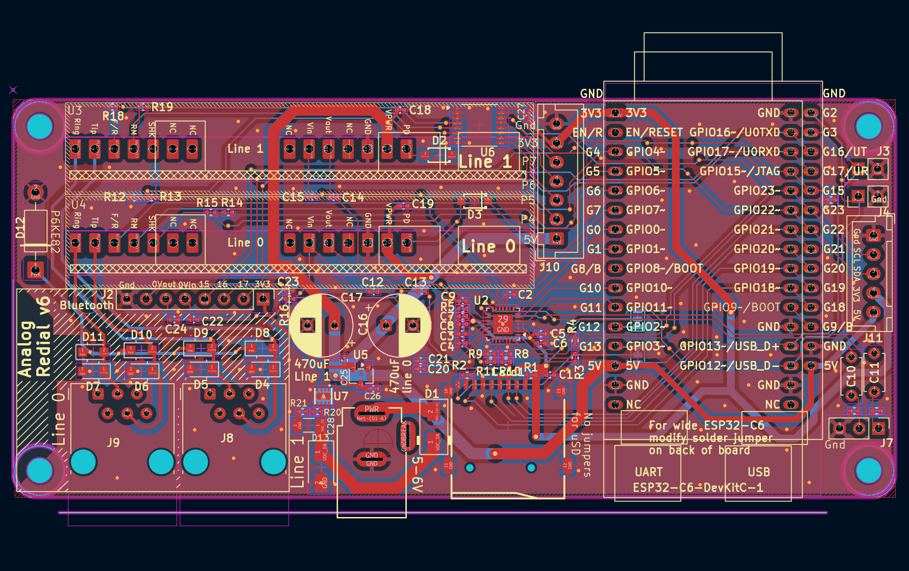

[Home](../README.md) · [1 · Get a board](board.md) · [2 · Parts & assembly](bom.md) · [3 · Flash & test](flashing.md) · [4 · Set up & use](setup.md)

# Board reference: v6 (SMD6)

> **Released, not built or tested yet.** The design and fab files are published
> ([KiCad project](https://github.com/sdylewski/Analog-Redial/tree/main/hardware/kicad/Analog%20Redial%20v6)), but no v6 board has been built, and its firmware support has
> only run against simulated chips. **v5** is the tested board: see the
> [v5 board reference](hardware-smd5.md). This page may change after the first build.

v6 is v5 with everything at once: **two phone lines and the microSD card together**,
payphone support and four extra I/O pins. An I²C I/O expander (U6) drives the second
line's SLIC, so GPIO18-21 belong to the microSD card alone and there is no J5 jumper
block to set. Everything not listed as new here carries over from v5 unchanged: the
[v5 reference](hardware-smd5.md) covers the codec, the SLIC wiring, the power tree and
the expansion header in full.

Build instructions: [Build a v6 board](build-v6.md).

## What's new against v5

| Change | Why |
|--------|-----|
| **U6, a TCA9534A I/O expander** (I²C 0x38) drives line 1's SLIC | Frees GPIO18-21 for the microSD card: two lines and microSD on one board, no J5 |
| **J10, a 7-pin JST XH header** with the expander's four spare pins (P4-P7) | Extra I/O that works whatever the lines and card are set to (§6) |
| **J11, a 5-pin JST XH I²C accessory header** | Add-on boards on the shared I²C bus, such as the payphone coin board (§7) |
| **Clone-module footprint fixed** | A 30-pin clone needs no pin removed; only JP2/JP3 to set (§8) |
| **D1 is an SS34 (3 A)** instead of v5's SS14 (1 A) | Headroom on the DC-jack input |
| **U7, a WS3222D over-voltage switch**, plus D13 (SMAJ22A) on the DC-jack input | A wrong adapter (9 V, 12 V, up to about 22 V) cuts +5 V off instead of damaging the board |
| Larger vias on +5 V / +3.3 V, teardrops, silkscreen updates | |

Same outline as v5 (115 × 52 mm) and the same mounting holes.

## Schematic and layout

The full schematic is a one-page PDF: **[v6 schematic (PDF)](https://github.com/sdylewski/Analog-Redial/blob/main/hardware/kicad/Analog%20Redial%20v6/Analog_Redial_v6_schematic.pdf)**. It's also below
as an image; open the KiCad project (above) for the bottom layer, the 3D view, or to edit.

**Schematic:**

**PCB layout, top copper/silkscreen** (from KiCad: no v6 board has been built yet):

## 1. Board overview

| Item | Detail |
|------|--------|
| MCU carrier | **ESP32-C6-DevKitC-1** (32-pin), or a 30-pin clone with JP2/JP3 set (§8) |
| Codec | **ES8388**, I²C 0x10, as on v5 |
| SLIC | 1–2× **Silvertel AG1171**: line 0 (U4, J9) on ESP32 GPIOs as on v5; line 1 (U3, J8) on U6 |
| I/O expander | **U6 TCA9534APWR**, TSSOP-16, I²C **0x38** (A0-A2 to GND), placed by the fab |
| Storage | Internal flash always; **microSD** (Card1) on GPIO18-21 with any number of lines |
| Power input | USB-C (the DevKit's port) or the DC jack, diode-ORed onto +5 V (D1, SS34) |
| Headers | J2 expansion (Bluetooth board), **J10** extra I/O, **J11** I²C accessory, J7 audio monitor, J3/J4 |
| Copper | 2 layers |

## 2. The I²C bus

One bus (SDA GPIO22, SCL GPIO23 as on v5), pulled up to 3.3 V by **R3** and **R4**
(4.7 kΩ), at 100 kHz:

| Address | Device | Where |
|---------|--------|-------|
| 0x10 | ES8388 codec | on the board |
| 0x38 | U6, line 1's expander | on the board |
| 0x39, 0x48 | payphone coin board (TCA9534A, ADS1115) | on J11's cable |

An accessory on J11 must avoid 0x10 and 0x38. Keep the bus at 100 kHz: J11 can carry a
cable of up to about 1 m.

## 3. U6: line 1 on the expander

| U6 pin | Port | Net | Direction | Notes |
|--------|------|-----|-----------|-------|
| 4 | P0 | Line1 F/R | out | **R18** 10 kΩ to GND |
| 5 | P1 | Line1 RM | out | **R19** 10 kΩ to GND |
| 6 | P2 | Line1 SHK | in | from U3's SHK through **R13** 10 kΩ, **R12** 100 kΩ to GND: about 3 V off-hook |
| 7 | P3 | Line1 PD | in / out | to U3's PD through **D2** (1N4148), as line 0's PD: input = run, driven low = power-down |
| 9-12 | P4-P7 | EXP_P4-P7 | out | J10 pins 2-5 (§6) |
| 1-3 | A0-A2 | GND | | address 0x38 |
| 13 | ~INT | | | not connected |
| 16 | VDD | +3.3 V | | |

**Power-up is safe on its own.** The TCA9534A starts with every pin an input. R18 and R19
hold F/R and RM low, so line 1 can't ring, and PD floats, so the SLIC runs. The firmware
writes the output register before making any pin an output, so nothing is driven high on
the way up.

**How the firmware drives it** (`firmware/components/ag1170/line_expander.c`): a task reads
SHK every 4 ms (a dial pulse's shortest break is 15 ms), sends F/R and RM changes as soon as
they're asked for, and checks the configuration register once a second, putting it back if
the chip has lost power. After about 200 ms of failed reads, line 1 reads on-hook until the
chip answers again. Line 0's timing doesn't depend on any of this.

## 4. microSD and line 1 together

GPIO18-21 go to the microSD socket only, so there's nothing to choose: fit U3, J8 and C17
for a second line, put a card in for microSD, or both. Settings → General → Board hardware
still says how many lines are fitted.

## 5. SLICs, codec, power, J2

As on v5 ([§3](hardware-smd5.md#3-power-tree), [§5](hardware-smd5.md#5-es8388-codec),
[§6](hardware-smd5.md#6-ag1171-slic--rj12-wiring), [§9](hardware-smd5.md#9-expansion-header-j2-currently-used-for-the-bluetooth-board)),
except:

- **D1** is an SS34 (3 A).
- The **DC jack takes a regulated 5-6 V**, as on v5. Unlike v5, a higher voltage doesn't
  reach the board: U7 (WS3222D) disconnects +5 V once the input rises above about 6 V (R20/R21
  set the threshold). D13 (SMAJ22A) clamps fast spikes, and it sets the real limit: above
  about 22 V it starts to conduct and would overheat, so never use an adapter over 20 V. It protects;
  it doesn't regulate, so a 9 V or 12 V adapter still won't run the board.

> **Never connect the RJ12 jacks to a wall jack or a telephone-company line.** They supply
> about 48 V DC off-hook and about 60 V AC while ringing, for phones only.

## 6. J10: extra I/O

JST XH, 7 pins, 2.5 mm pitch (B7B-XH-A; mates with an XHP-7 housing and SXH-001T-P0.6
crimps).

| J10 pin | Signal |
|---------|--------|
| 1 | +5 V |
| 2 | P4 |
| 3 | P5 |
| 4 | P6 |
| 5 | P7 |
| 6 | +3.3 V |
| 7 | GND |

P4-P7 are U6's spare pins: **3.3 V outputs, a few mA each**, low from power-up. In the
firmware they are the board's pin outputs (Settings → Dial Codes → Pin outputs, shown as
"J10 P4" to "J10 P7"): a dial code drives one high for a few seconds or toggles it, and
Home Assistant can do the same. Switch a relay or a MOSFET with them, not a load directly.
Unlike J5 on v4 and v5, they work with two lines and a card fitted.

## 7. J11: I²C accessory header

JST XH, 5 pins, 2.5 mm pitch (B5B-XH-A; mates with XHP-5).

| J11 pin | Signal |
|---------|--------|
| 1 | GND |
| 2 | SCL |
| 3 | SDA |
| 4 | +3.3 V |
| 5 | +5 V |

The payphone coin board's J1 and J6 use the same pin numbers, so its cable is wired pin 1
to pin 1. Its 3.3 V is the coin board's logic supply; its 5 V powers the coin board's
converter, which draws about 1 A peaks while charging, so use 24 AWG or thicker for 5 V and
GND. The coin board is sent to fab but not built or tested yet: see
[the coin board reference](hardware-coin-board.md).

## 8. MCU module variants

The same dual footprint as v5 ([v5 §10](hardware-smd5.md#10-mcu-module-variants)), with the
clone's 5 V pin fixed: **nothing is removed from a clone module on v6.** A clone still needs
the two solder jumpers on the back moved to the clone side:

| Jumper | Net | Genuine DevKitC-1 (default, pads 1–2) | 30-pin clone (cut 1–2, bridge 2–3) |
|--------|-----|---------------------------------------|------------------------------------|
| **JP3** | I²S MCLK | pad 12 | pad 19 |
| **JP2** | microSD card-detect | pad 13 | pad 20 |

Bridge one side only. Both modules then run the same firmware build. **J3** and **J4** are on
pads 20 and 19, as on v5: the genuine module's USB data lines, or the clone's card-detect and
MCLK, so connect nothing to them.

## 9. Firmware

`CONFIG_BOARD_TYPE_SMD6`, built in `firmware/build.smd6/` and flashed with
`./flash_board.py --board smd6` ([step 3](flashing.md)): a blank board has no firmware to
say what it is. There is one v6 build for both modules, and no v6 image in the
firmware-update releases yet.

---

## See also

| Doc | What's in it |
|-----|--------------|
| [`build-v6.md`](build-v6.md) | Building a v6 board, step by step |
| [`hardware-smd5.md`](hardware-smd5.md) | The v5 board: everything v6 carries over |
| [`bom.md`](bom.md) | Where to buy the parts v5 and v6 share |
| [v6 schematic (PDF)](https://github.com/sdylewski/Analog-Redial/blob/main/hardware/kicad/Analog%20Redial%20v6/Analog_Redial_v6_schematic.pdf) | The full schematic, one page |
| [v6 README](https://github.com/sdylewski/Analog-Redial/tree/main/hardware/kicad/Analog%20Redial%20v6) | The design's status |
