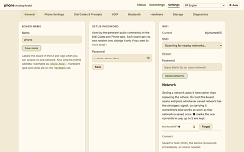
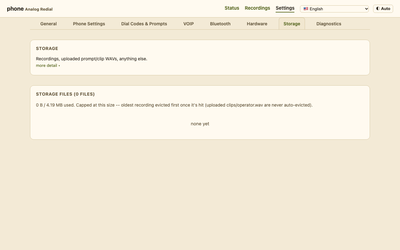
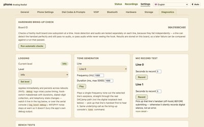

[Home](../README.md) · [1 · Get a board](board.md) · [2 · Parts & assembly](bom.md) · [3 · Flash & test](flashing.md) · **4 · Set up & use**

# 4 · Set up & use

Get a flashed board onto your Wi-Fi. This describes everything you can do from its
web interface. If someone handed you a ready-made board, start here.

## 1. Get it on your Wi-Fi

Power the board up. With no Wi-Fi saved yet, it makes **its own Wi-Fi
network** for setup:

1. On your phone or laptop, join the open network **`AnalogRedial-XXXX`**.
2. A setup page should pop up. If it doesn't, browse to
   **`http://192.168.4.1`**.
3. Enter your home Wi-Fi name and password, and optionally give the board
   a name. Submit, and it reboots onto your network.

The board needs **2.4 GHz** Wi-Fi; the ESP32-C6 can't use 5 GHz.

The phones work before any of this: dial tone, calls between the two lines,
clips and recordings all run without a network. Wi-Fi is for modifying settings through the web interface, and VoIP.

## 2. Open the web interface

Browse to **`http://phone.local`** from any device on the same Wi-Fi. If you
named the board, it's `http://<name>.local` instead.

- **More than one board?** If `phone` is already taken on the network, the
  board uses `phone1`, `phone2` and so on. Give each board its own name in
  Settings → General to keep it fixed.
- **`.local` not loading?** Some networks don't pass these names. Find the
  board in your router's list of connected devices and open its IP address
  directly.
- **Web password (optional).** Out of the box, anyone on your Wi-Fi can
  change the settings. Settings → General → **Web password** turns on a
  password: settings pages can still be viewed, but changing anything asks
  you to sign in, and so does everything to do with recordings and stored
  audio: the Recordings page, playing, downloading and deleting them (by default for 30 days, or until the board restarts). Scripts
  pass it with `curl -u admin:PASSWORD`, or by setting `REDIAL_PASSWORD`
  for the tools in `firmware/bringup/`. The board talks plain HTTP, so the
  password crosses your network unencrypted: it keeps out casual changes
  and other websites, not someone watching your Wi-Fi traffic.
  - **How long you stay signed in** is a setting: until you close the
    browser, 1, 7, 30 (the default), 90 days or 1 year. That's the
    *sign-in*; the password itself never expires. Restarting the board
    always signs everyone out.
  - **A hint** (optional, up to 80 characters) is shown on the sign-in page.
    Anyone who can reach the board can read it, so describe the password
    ("the dog + the year"); don't write it. The board refuses a hint that
    is the password.
  - Forgot it? See [§8](#8-the-boot-button-rescue-and-reset).

## 3. Dialing

The **Status** page always shows the board's current dial codes. The
defaults:

| Dial | What happens |
|------|--------------|
| **0** | Operator: a spoken help message |
| **211** | Record a message after the beep. Play or download it under Recordings |
| **321** | Ring the other phone (two-line boards) |
| **412** | A dial-up modem sound, for old times' sake |
| **555** + 4 digits | A VoIP call to that extension ([VoIP setup](voip-setup.md)) |
| **821** / **822** | Digit readback off / on |
| **899** | Record this line's answering-machine greeting |

Add your own codes with your own audio in Settings → Dial Codes & Prompts.

**Make a code switch something.** On a one-line board with no microSD card,
four spare pins (GPIO18–21) are wired to header J5. Under Settings → Dial
Codes → **Pin outputs**, pick a code, a pin and a time: dial it and that pin
goes high for that many seconds (or toggles, if you set 0). Wire a relay or
a MOSFET to it to unlock a door, sound a buzzer, switch a lamp. The output
is 3.3 V at only a few mA, so don't connect a solenoid directly. It will
often switch a 5 V relay module, but check that yours does (the parts page
says what to look for). Set the board to
"Neither" under Settings → Hardware, take the four shunts off J5, and leave
the microSD socket empty. The card shows what's in the way if it isn't
active.

**Home Assistant (experimental).** The board can POST every pickup,
hang-up, dial code and incoming ring to a Home Assistant webhook (Settings →
General → Webhook), and Home Assistant can ring a phone or fire a pin output
over HTTP. Or tick Settings → General → MQTT and the board appears in Home
Assistant as a device. Settings → Dial Codes → Home Assistant codes adds codes
whose only job is to tell Home Assistant they were dialed. Experimental: see [Home Assistant](home-assistant.md).

## 4. The web interface

Click any picture for the full page.

<table>
  <tr>
    <td width="40%"></td>
    <td valign="top"><b>Status.</b> Each line's state and last caller, Wi-Fi
    and storage, recent activity (calls, recordings, misdials) and the dial
    guide. On a new board it also shows a one-time setup card for the board
    name and hardware type.</td>
  </tr>
  <tr>
    <td></td>
    <td valign="top"><b>Recordings.</b> Messages left with 211 and on the
    answering machine: length, time, play, download, delete.</td>
  </tr>
  <tr>
    <td></td>
    <td valign="top"><b>Settings → General.</b> Board name, saved Wi-Fi
    networks, the optional web password, interface language, and quiet
    hours that keep the bell silent overnight.</td>
  </tr>
  <tr>
    <td></td>
    <td valign="top"><b>Settings → Phone Settings.</b> The answering machine
    per line, your country's dial tone, the off-hook alert, echo
    cancellation, digit readback, voice effects, intercom mode and earpiece
    volume.</td>
  </tr>
  <tr>
    <td></td>
    <td valign="top"><b>Settings → Dial Codes & Prompts.</b> Every clip code
    and its audio, editable: change a code, upload new audio, or add a new
    one. Also the operator message and the record-message prompt.</td>
  </tr>
  <tr>
    <td></td>
    <td valign="top"><b>Settings → VOIP.</b> SIP server and per-line
    extension, registration status, and a generated setup script for your
    Asterisk server. Walkthrough in §6 below.</td>
  </tr>
  <tr>
    <td></td>
    <td valign="top"><b>Settings → Hardware.</b> One or two lines,
    microSD, board and chip details, firmware updates, and resets.</td>
  </tr>
  <tr>
    <td></td>
    <td valign="top"><b>Settings → Storage.</b> A file manager for the
    board's flash and the microSD card.</td>
  </tr>
  <tr>
    <td></td>
    <td valign="top"><b>Settings → Diagnostics.</b> The full log, log
    level, and the hardware self-test.</td>
  </tr>
</table>

**Settings → Bluetooth** arrives with the v5 board.

## 5. Your own audio

**From the browser:** Settings → Dial Codes & Prompts takes a WAV upload in
almost any format (any sample rate, 8 to 32 bit, mono or stereo) and
converts it on the board. Changes take effect immediately, no rebuild.

**From the command line:** `firmware/bringup/gen_prompt.py` makes a clip
from an MP3 or from text (text-to-speech on your computer) and uploads it.
To build your own clips into every firmware image instead, see
[`firmware/assets/README.md`](https://github.com/sdylewski/Analog-Redial/blob/main/firmware/assets/README.md).

Use audio you have the rights to. The board ships with the operator message,
the answering machine's default greeting and a public-domain modem sound.

## 6. VoIP

Optional. Register one or both lines with Asterisk, FreePBX or another SIP
server to call beyond the board, then dial **555** + an extension. With the
VoIP provisioner running next to Asterisk, it's one button: Settings →
VOIP → Automatic setup, pick a number, **Register**. Otherwise fill in the
form, download the generated setup script and run it on your server. Calls stay on your local network (no encryption).
Walkthrough: [VoIP setup](voip-setup.md).

## 7. The status light

The DevKit's RGB LED shows what the board is doing. It's deliberately dim.

| Light | Meaning |
|---|---|
| **Red, fast blink** | Starting up |
| **Red, slow blink** | Something failed to start, but the board is running. Check Settings → Diagnostics |
| **Green, slow blink** | Joining Wi-Fi, or waiting in setup mode. If it keeps blinking after boot, it's in setup mode: see [§1](#1-get-it-on-your-wi-fi) |
| **Green, solid** (30 s) | Just joined Wi-Fi |
| **Off** | Running normally |
| **Yellow, fast blink** | Installing a firmware update. Don't unplug it |
| **Blue** | Bluetooth pairing (v5) |

## 8. The BOOT button: rescue and reset

With the board **running**, hold the **BOOT** button on the DevKit:

| Hold | What happens |
|------|--------------|
| **3 seconds, then let go** | **Rescue mode.** The board brings up its own Wi-Fi network (named after the board) for one session, keeping your saved networks. Join it and browse to **192.168.4.1** for the full web interface, which doesn't ask for the web password there, so you can remove a forgotten one (Settings → General). Use this when it can't reach the network in front of it |
| **10 seconds** | **Forget Wi-Fi.** Erases saved networks and the web password, and restarts in setup mode ([§1](#1-get-it-on-your-wi-fi)) |

The light changes at the 3-second mark so you know when to let go. Holding
BOOT **while plugging in** does something different: it puts the chip in
USB flashing mode.

With the board plugged into a computer, the serial console command
`webpass clear` also removes a forgotten web password.

## 9. Updating the firmware

Build a new image ([step 3](flashing.md)) and either flash it over USB, or
upload the `rotary_phone_gateway.bin` from your build directory in Settings → Hardware → Firmware. The
board installs it and restarts; if the new version fails to start, it goes
back to the old one.

---

**Back to: [Home](../README.md)**
