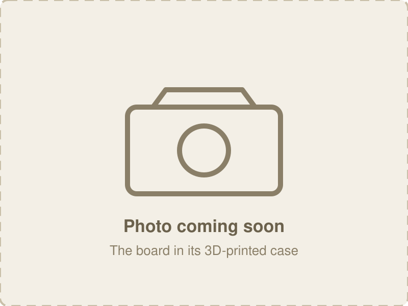

# 3D-printed case

A two-part case, box and lid, for the Analog Redial board. The build guide
(which one to print, screws, assembly) is the
[case page](../../docs/case.md).

<!-- TODO: replace with a photo of the board in its case, e.g. ../../docs/pics/board_in_case.jpg -->

## v4 board

In [`Analog Redial v4/`](Analog%20Redial%20v4/). Print one box and the lid.

| File | Print it for |
|------|--------------|
| `AnalogRedial-4 - Box-SingleLine.stl` | Single-line board |
| `AnalogRedial-4 - Box - dualLine.stl` | Dual-line board |
| `AnalogRedial-4 - Lid.stl` | Either |

The `.step` files are the same parts, for editing in CAD.

## v5 and v6 boards

In [`Analog Redial v5/`](Analog%20Redial%20v5/), for a one-line board: the box
(`AnalogRedial-5 - Box-OneLine-130x70x35`, also as `.3mf`) and the lid
(`AnalogRedial-5 - Lid-FlatHead-130x70`). v5 is 5 mm longer than v4, so the v4
case won't fit it. v6 has the same outline and mounting holes as v5, so this
case should fit it too (not tried yet).
